<h1 align="center">
  <a href="https://onOrca.dev">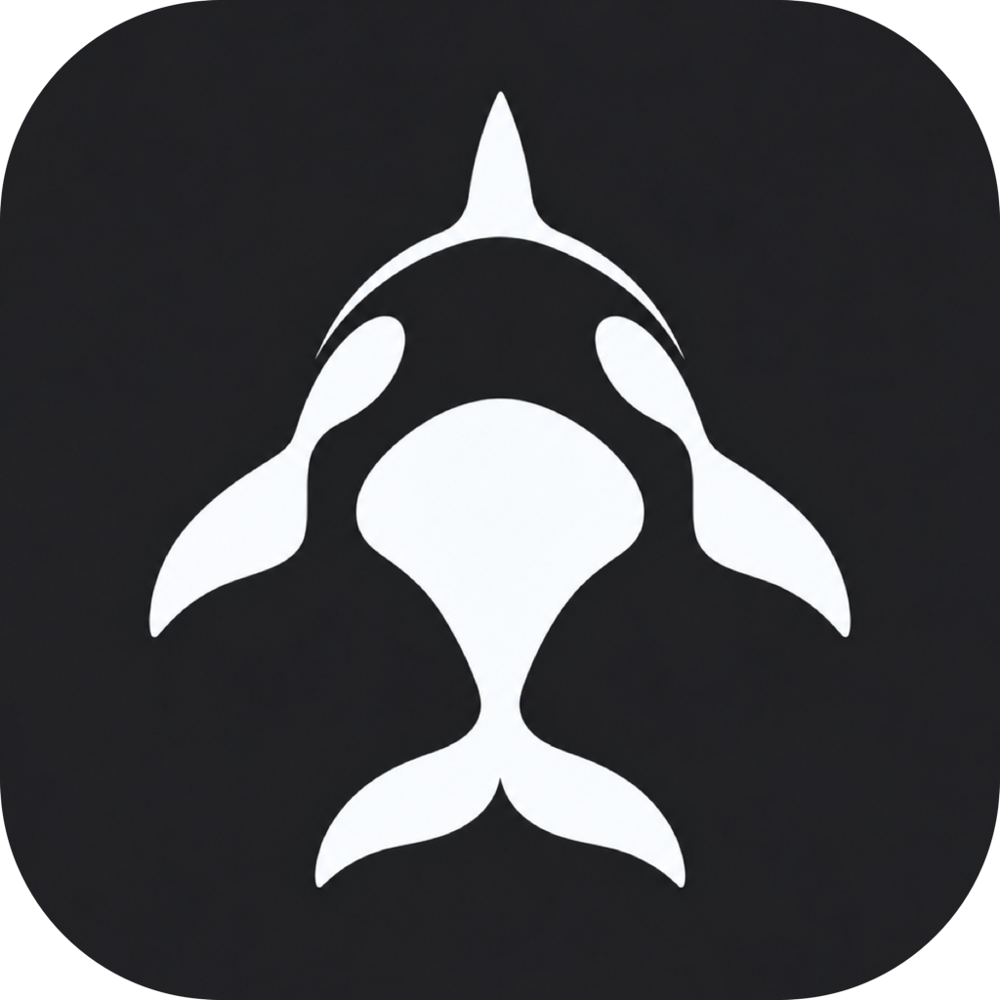</a> Orca
</h1>

<p align="center">
  <a href="https://github.com/stablyai/orca"></a>
  <a href="https://github.com/stablyai/orca/releases"></a>
  
  <a href="https://discord.gg/fzjDKHxv8Q"></a>
  <a href="https://x.com/orca_build"></a>
  
</p>

<p align="center">
  <sub><a href="docs/readme/README.zh-CN.md">中文</a> · <a href="docs/readme/README.ja.md">日本語</a> · <a href="docs/readme/README.ko.md">한국어</a> · <a href="docs/readme/README.es.md">Español</a> · <a href="docs/readme/README.fr.md">Français</a> · <a href="docs/readme/README.pt.md">Português</a> · <a href="docs/readme/README.tr.md">Türkçe</a> · <a href="docs/readme/README.ru.md">Русский</a></sub>
</p>

<p align="center">
  <strong>The AI Orchestrator for 100x builders.</strong><br/>
  Run Codex, ClaudeCode, OpenCode or Pi side-by-side — each in its own worktree, tracked in one place.
</p>

<h3 align="center"><a href="https://onorca.dev/download"><ins>Download Orca</ins></a></h3>

<p align="center">
  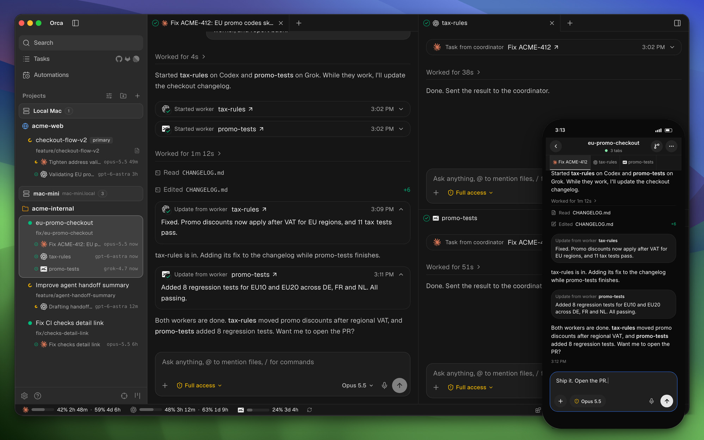
</p>

> [!NOTE]
> **This is a fork of [stablyai/orca](https://github.com/stablyai/orca)** that adds a **visual Workflow Builder** for multi-agent orchestration. Everything upstream Orca does still works the same way. The download links, badges and app store builds below are upstream's and **do not include the Workflow Builder**; to use it, [build from source](#build-this-fork-from-source).

## What this fork adds: the Workflow Builder

Upstream Orca can already coordinate agents. Its orchestration layer has Runs, Tasks, Dispatches, supervised workers, mailboxes and decision gates. You drive all of it from the `orca orchestration` CLI, usually by asking a coordinator agent to run the commands. That agent decides when each worker starts, what each worker is told, and who talks to whom.

This fork puts a **canvas and a deterministic controller** on top of that same layer. You draw the team once, save it as a preset, and run it again whenever you like. Orca then runs the graph itself instead of trusting a coordinator agent to follow a plan.

Open it from **Workflows** in the left sidebar.

### How it differs from upstream orchestration

|                       | Upstream Orca orchestration                            | This fork's Workflow Builder                                                                                                                                                                                            |
| --------------------- | ------------------------------------------------------ | ----------------------------------------------------------------------------------------------------------------------------------------------------------------------------------------------------------------------- |
| **How you define it** | CLI commands typed by you or by a coordinator agent    | A drag-and-drop graph (React Flow), saved as a reusable preset                                                                                                                                                          |
| **Who schedules**     | The coordinator agent decides, turn by turn            | A deterministic scheduler in Orca's main process: sequential steps, parallel branches, joins (`all`/`any`), decisions, human approvals, retries and bounded loops                                                       |
| **Agent setup**       | Flags on each `worker-start`                           | Per node: CLI agent, model, effort, role instructions, task template, skills, tool notes, workspace isolation and an optional JSON result contract                                                                      |
| **Who may talk**      | Any worker can message anyone in its Run               | Communication edges are **enforced**: `orchestration.send` refuses messages along routes you didn't draw (`workflow_route_refused`), and each route has its own payload policy, size, count and rate limits             |
| **What gets passed**  | Whatever the agent writes                              | Only what the route's policy selects from the sender's final report (summary, structured JSON, chosen fields, git refs, test results…). The sender's conversation is never forwarded.                                   |
| **Order vs. data**    | Combined in the coordinator's head                     | Two separate graphs: **execution dependencies** (order) and **communication routes** (data). A route never implies an order.                                                                                            |
| **Watching a run**    | `check`, `worker-show` and terminals                   | Execution mode on the same canvas: live node status, attempts, models and timers; a timeline; a searchable message log; metrics; run output; CSV/JSON export; run history                                               |
| **Recovery**          | Manual (`dispatch-show`, `worker-stop`, retry by hand) | Retry, Stop and retry, Pause, Resume and Cancel buttons. Runs are saved to disk and resume after an Orca restart; Orca's own Task and Dispatch rows decide the outcome, and anything unprovable is marked _Unconfirmed_ |
| **Reuse**             | Re-type the commands                                   | Presets with save, duplicate, import and export, plus six built-in templates (sequential, parallel, research → implement, hierarchical team, minimal communication, auth feature)                                       |

Under the hood, nothing about Orca's runtime changed: every workflow step becomes a real Orca Run, Task and Dispatch, started through the same RPC handlers the `orca` CLI uses. The upstream commands keep working, and you can inspect a workflow's workers with them. The one change to existing code is a route-guard hook in `orchestration.send`, which applies only to Runs that a workflow owns.

**Limits worth knowing.** The Workflow Builder enforces routing, placement, timeouts, attempt limits and message budgets. It does **not** sandbox agents: an agent with shell access can still read files, run commands or use the network. Token counts are estimates. Full details are in the [Workflow Builder guide](docs/workflow-builder.md).

### Build this fork from source

You need Node 24 (via nvm or similar) and pnpm, which comes with Node through Corepack:

```bash
corepack enable pnpm
```

Install dependencies:

```bash
pnpm install
```

Run the app in development mode, then click **Workflows** in the sidebar:

```bash
pnpm dev
```

Run the Workflow Builder's tests:

```bash
pnpm test src/shared/workflow src/main/workflows src/renderer/src/components/workflows --maxWorkers=2
```

Package a macOS app you can launch directly (the output goes to `dist/`):

```bash
pnpm build:unpack
```

Or build the full macOS installer:

```bash
pnpm build:mac
```

The [Workflow Builder guide](docs/workflow-builder.md) covers the optional live test with real Claude workers, the architecture and the security boundary.

---

## Features (from upstream Orca)

<table>
<tr>
<td width="50%" valign="middle">

### Mobile Companion

Monitor and steer your agents from your phone — get notified when an agent finishes and send follow-ups from anywhere.

[iOS App Store](https://apps.apple.com/us/app/orca-ide/id6766130217) · [Android APK](https://www.onorca.dev/download/android) · [Docs →](https://www.onorca.dev/docs/mobile)

</td>
<td width="50%">
  <a href="https://www.onorca.dev/docs/mobile"><picture><source srcset="docs/assets/feature-wall/mobile-companion-app-showcase.gif" type="image/gif">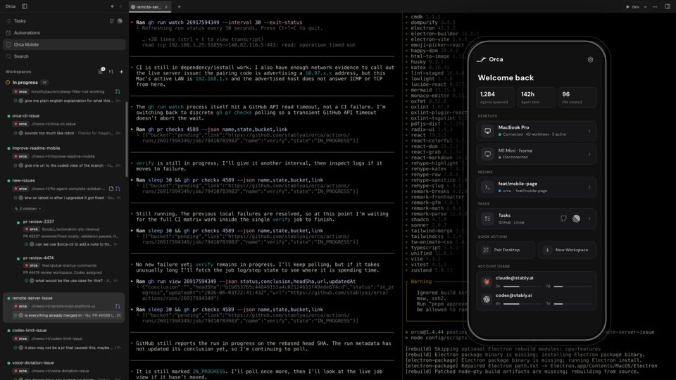</picture></a>
</td>
</tr>
<tr>
<td width="50%" valign="middle">

### Parallel Worktrees

Fan one prompt across five agents, each in its own isolated git worktree — compare the results and merge the winner.

[Docs →](https://www.onorca.dev/docs/model/worktrees)

</td>
<td width="50%">
  <a href="https://www.onorca.dev/docs/model/worktrees"><picture><source srcset="docs/site/public/docs/tab-split.gif" type="image/gif">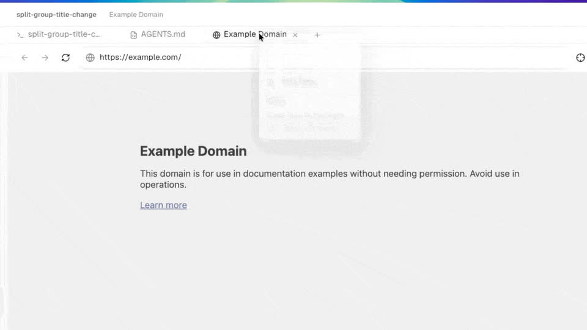</picture></a>
</td>
</tr>
<tr>
<td width="50%" valign="middle">

### Terminal Splits

Ghostty-class terminals with WebGL rendering, infinite splits, and scrollback that survives restarts.

[Docs →](https://www.onorca.dev/docs/terminal)

</td>
<td width="50%">
  <a href="https://www.onorca.dev/docs/terminal"><picture><source srcset="resources/onboarding/feature-wall/tile-02.webp" type="image/webp">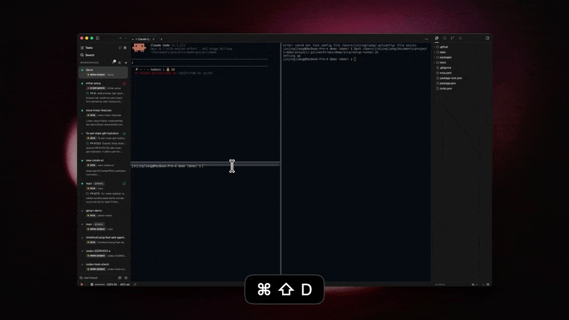</picture></a>
</td>
</tr>
<tr>
<td width="50%" valign="middle">

### Design Mode

Click any UI element in a real Chromium window to send its HTML, CSS, and a cropped screenshot straight into your agent's prompt.

[Docs →](https://www.onorca.dev/docs/browser/design-mode)

</td>
<td width="50%">
  <a href="https://www.onorca.dev/docs/browser/design-mode"><picture><source srcset="docs/site/public/docs/orca-design-mode.gif" type="image/gif">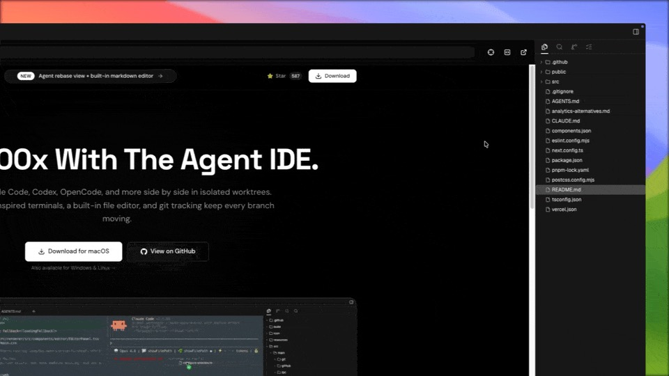</picture></a>
</td>
</tr>
<tr>
<td width="50%" valign="middle">

### GitHub &amp; Linear, Native

Browse PRs, issues, and project boards in-app — open a worktree from any task and review without a context switch.

[Docs →](https://www.onorca.dev/docs/review/linear)

</td>
<td width="50%">
  <a href="https://www.onorca.dev/docs/review/linear"><picture><source srcset="resources/onboarding/feature-wall/tile-03.webp" type="image/webp">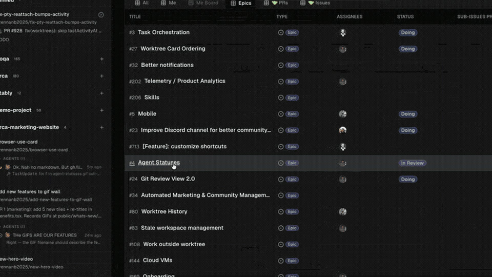</picture></a>
</td>
</tr>
<tr>
<td width="50%" valign="middle">

### SSH Worktrees

Run agents on a beefy remote box with full file editing, git, and terminals — auto-reconnect and port forwarding included.

[Docs →](https://www.onorca.dev/docs/ssh)

</td>
<td width="50%">
  <a href="https://www.onorca.dev/docs/ssh"><picture><source srcset="resources/onboarding/feature-wall/tile-06.webp" type="image/webp">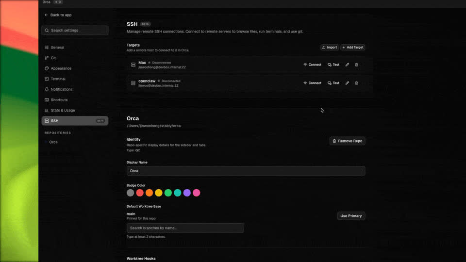</picture></a>
</td>
</tr>
<tr>
<td width="50%" valign="middle">

### Annotate AI Diffs

Drop comments on any diff line and ship them back to the agent — review, edit, and commit without leaving Orca.

[Docs →](https://www.onorca.dev/docs/review/annotate-ai-diff)

</td>
<td width="50%">
  <a href="https://www.onorca.dev/docs/review/annotate-ai-diff"><picture><source srcset="docs/site/public/docs/annotate-ai-diff.gif" type="image/gif">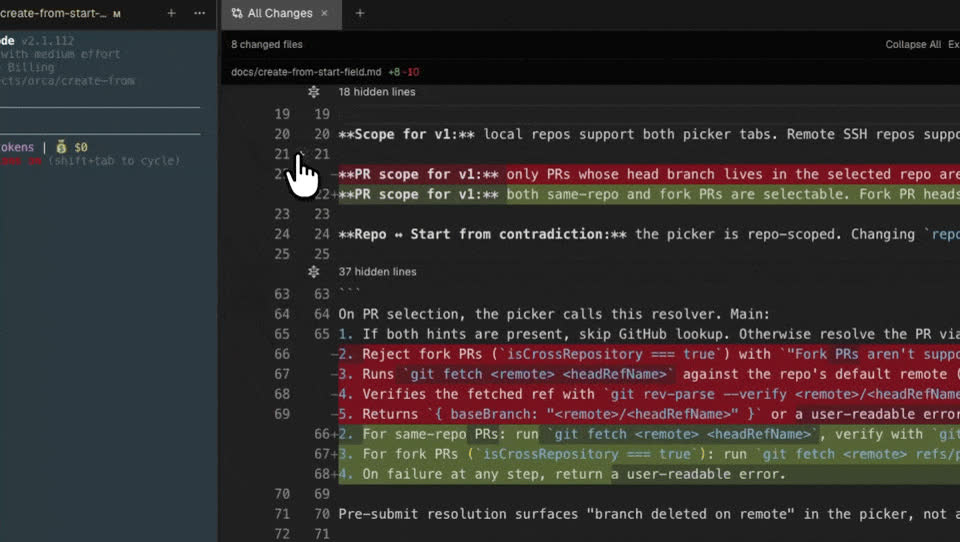</picture></a>
</td>
</tr>
<tr>
<td width="50%" valign="middle">

### Drag Files to Agents

VS Code's editor with autosave everywhere — drag files or images straight into an agent prompt.

[Docs →](https://www.onorca.dev/docs/editing/file-explorer)

</td>
<td width="50%">
  <a href="https://www.onorca.dev/docs/editing/file-explorer"><picture><source srcset="resources/onboarding/feature-wall/tile-07.gif" type="image/gif">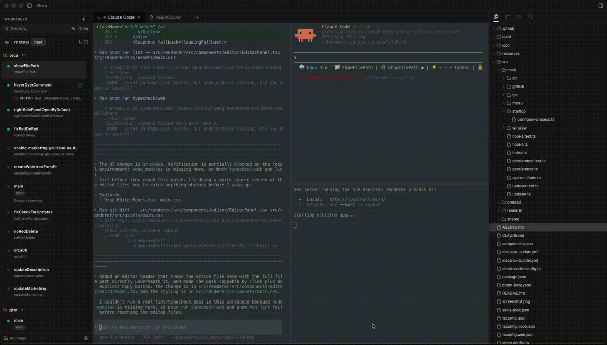</picture></a>
</td>
</tr>
<tr>
<td width="50%" valign="middle">

### Orca CLI

Agents drive Orca too — script every workflow with `orca worktree create`, `snapshot`, `click`, and `fill`.

[Docs →](https://www.onorca.dev/docs/cli/overview)

</td>
<td width="50%">
  <a href="https://www.onorca.dev/docs/cli/overview"><picture><source srcset="resources/onboarding/feature-wall/tile-09.webp" type="image/webp">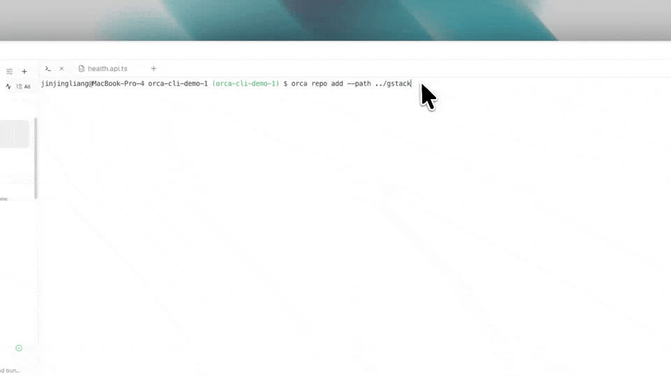</picture></a>
</td>
</tr>
</table>

**Also in the box:**

- **[Quick open](https://www.onorca.dev/docs/model/quick-open)** — Search across worktrees, files, agents, commands, and repo context without leaving your flow.
- **[Account switcher &amp; usage tracking](https://www.onorca.dev/docs/agents/usage-tracking)** — See Claude and Codex usage and rate-limit resets, and hot-swap accounts without re-logging in.
- **[Rich repo previews](https://www.onorca.dev/docs/editing/markdown)** — Preview Markdown, images, PDFs, and repo docs in the workspace.
- **[Computer Use](https://www.onorca.dev/docs/cli/computer-use)** — Let agents operate desktop apps and visible UI when a workflow needs real interaction.
- **[Notifications and unread state](https://www.onorca.dev/docs/notifications)** — Know when an agent finishes or needs attention, then mark threads unread to come back later.
- **And many, many more** — we ship daily, so this list is perpetually behind. The [changelog](https://github.com/stablyai/orca/releases) is the real feature list.

---

## Supported Agents

Works with **any CLI agent** — if it runs in a terminal, it runs in Orca.

<p>
  <a href="https://docs.anthropic.com/claude/docs/claude-code"><kbd> Claude Code</kbd></a> &nbsp;
  <a href="https://github.com/openai/codex"><kbd> Codex</kbd></a> &nbsp;
  <a href="https://x.ai/cli"><kbd> Grok</kbd></a> &nbsp;
  <a href="https://cursor.com/cli"><kbd> Cursor</kbd></a> &nbsp;
  <a href="https://docs.github.com/en/copilot/how-tos/set-up/install-copilot-cli"><kbd> GitHub Copilot</kbd></a> &nbsp;
  <a href="https://dev.meta.ai/docs/muse-code"><kbd> Muse</kbd></a> &nbsp;
  <a href="https://deepseek-harness.github.io/deepseek-harness/"><kbd> DeepSeek Harness</kbd></a> &nbsp;
  <a href="https://zcode.z.ai/en/docs"><kbd> ZCode</kbd></a> &nbsp;
  <a href="https://opencode.ai/docs/cli/"><kbd> OpenCode</kbd></a> &nbsp;
  <a href="https://mimo.xiaomi.com/coder"><kbd> MiMo Code</kbd></a> &nbsp;
  <a href="https://ampcode.com/manual#install"><kbd> Amp</kbd></a> &nbsp;
  <a href="https://openclaude.gitlawb.com/"><kbd> OpenClaude</kbd></a> &nbsp;
  <a href="https://antigravity.google/docs/cli-overview"><kbd> Antigravity</kbd></a> &nbsp;
  <a href="https://pi.dev"><kbd> Pi</kbd></a> &nbsp;
  <a href="https://omp.sh"><kbd> oh-my-pi</kbd></a> &nbsp;
  <a href="https://hermes-agent.nousresearch.com/docs/"><kbd> Hermes Agent</kbd></a> &nbsp;
  <a href="https://devin.ai/cli"><kbd> Devin</kbd></a> &nbsp;
  <a href="https://goose-docs.ai/docs/quickstart/"><kbd> Goose</kbd></a> &nbsp;
  <a href="https://docs.augmentcode.com/cli/overview"><kbd> Auggie</kbd></a> &nbsp;
  <a href="https://github.com/autohandai/code-cli"><kbd> Autohand Code</kbd></a> &nbsp;
  <a href="https://github.com/charmbracelet/crush"><kbd> Charm</kbd></a> &nbsp;
  <a href="https://docs.cline.bot/cline-cli/overview"><kbd> Cline</kbd></a> &nbsp;
  <a href="https://www.codebuddy.ai/cli"><kbd> CodeBuddy</kbd></a> &nbsp;
  <a href="https://www.codebuff.com/docs/help/quick-start"><kbd> Codebuff</kbd></a> &nbsp;
  <a href="https://freebuff.com"><kbd>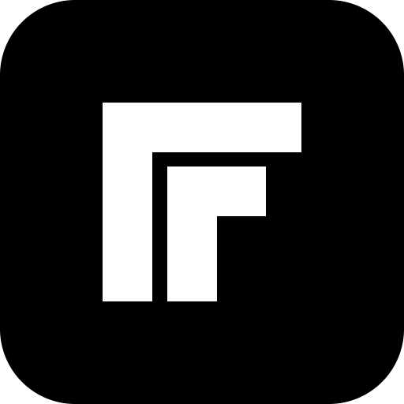 Freebuff</kbd></a> &nbsp;
  <a href="https://commandcode.ai/docs/quickstart"><kbd> Command Code</kbd></a> &nbsp;
  <a href="https://docs.continue.dev/cli/quickstart"><kbd> Continue</kbd></a> &nbsp;
  <a href="https://docs.factory.ai/cli/getting-started/quickstart"><kbd> Droid</kbd></a> &nbsp;
  <a href="https://kilo.ai/docs/cli"><kbd> Kilocode</kbd></a> &nbsp;
  <a href="https://www.kimi.com/code/docs/en/kimi-code-cli/getting-started.html"><kbd> Kimi</kbd></a> &nbsp;
  <a href="https://kiro.dev/docs/cli/"><kbd> Kiro</kbd></a> &nbsp;
  <a href="https://github.com/mistralai/mistral-vibe"><kbd> Mistral Vibe</kbd></a> &nbsp;
  <a href="https://github.com/QwenLM/qwen-code"><kbd> Qwen Code</kbd></a> &nbsp;
  <a href="https://support.atlassian.com/rovo/docs/install-and-run-rovo-dev-cli-on-your-device/"><kbd> Rovo Dev</kbd></a> &nbsp;
  <kbd>+ any CLI agent</kbd>
</p>

---

## Install

> These are upstream Orca's builds and do not include the Workflow Builder. To get it, [build this fork from source](#build-this-fork-from-source).

### Desktop — macOS, Windows, Linux

- **[Download from onOrca.dev](https://onorca.dev/download)**
- Or grab a build directly: [macOS Apple Silicon](https://github.com/stablyai/orca/releases/latest/download/orca-macos-arm64.dmg) · [macOS Intel](https://github.com/stablyai/orca/releases/latest/download/orca-macos-x64.dmg) · [Windows (.exe)](https://github.com/stablyai/orca/releases/latest/download/orca-windows-setup.exe) · [Linux AppImage](https://github.com/stablyai/orca/releases/latest/download/orca-linux.AppImage) · [All builds](https://github.com/stablyai/orca/releases/latest)

_Or via a package manager:_

```bash
# macOS (Homebrew)
# Always use the full name; bare `orca` is an unrelated Plotly cask.
brew install --cask stablyai/orca/orca
# Upgrade an existing install
brew upgrade --cask stablyai/orca/orca

# Arch Linux (AUR) — or stably-orca-git to build from source
yay -S stably-orca-bin
```

### Mobile Companion — iOS, Android

Pair with your desktop app to monitor and steer your agents from your phone.

- **iOS:** [Download on the App Store](https://apps.apple.com/us/app/orca-ide/id6766130217)
- **Android:** [Download APK](https://www.onorca.dev/download/android) · [Install guide](https://www.onorca.dev/docs/android-apk)

---

## Community &amp; Support

- **Discord:** Join the community on **[Discord](https://discord.gg/fzjDKHxv8Q)**.
- **Twitter / X:** Follow **[@orca_build](https://x.com/orca_build)** for updates and announcements.
- **WeChat:** Scan to join the Orca community WeChat group.

  

- **Feedback &amp; Ideas:** We ship fast. Missing something? [Request a new feature](https://github.com/stablyai/orca/issues).
- **Privacy:** See the [privacy &amp; telemetry docs](https://www.onorca.dev/docs/telemetry) for what anonymous usage data Orca collects and how to opt out.
- **Show Support:** [Star](https://github.com/stablyai/orca) this repo to follow along with our daily ships.

---

## Developing

Want to contribute or run locally? See our [CONTRIBUTING.md](.github/CONTRIBUTING.md) guide.

The relay that pairs the mobile app with a desktop host is also in this repository under
[`cloud/`](cloud/README.md), with a separate pnpm workspace and setup guide.

<a href="https://github.com/stablyai/orca/graphs/contributors">
  
</a>

<p align="center">
  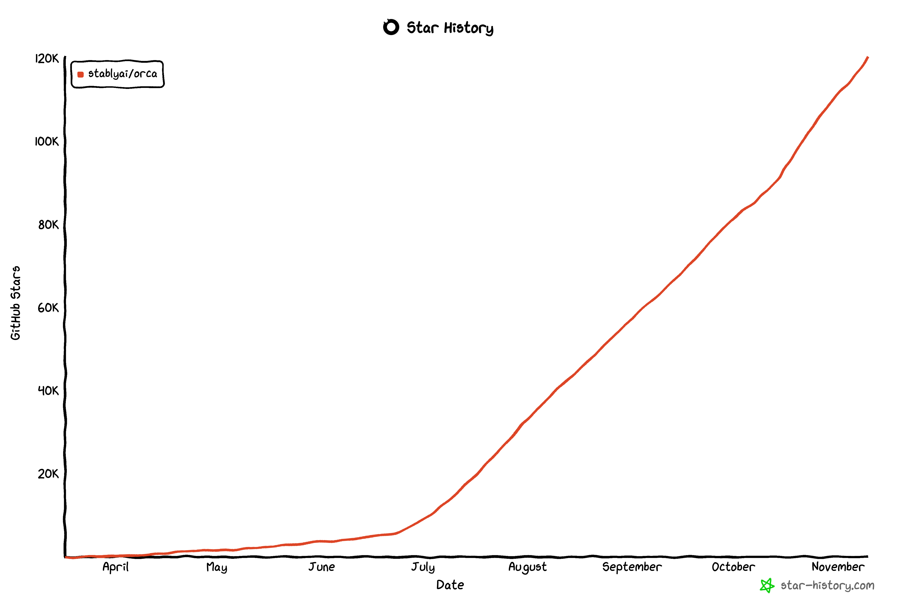
</p>

## Signed Builds

Windows code signing sponsored/provided by [SignPath.io](https://signpath.io), certificate by [SignPath Foundation](https://signpath.org).

## License

Orca is free and open source under the [MIT License](LICENSE). This fork, including the Workflow Builder, is under the same license.
