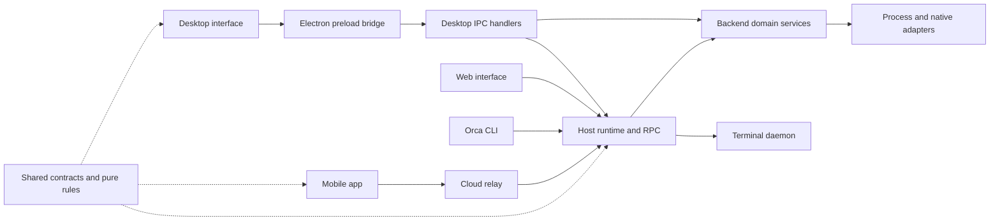

# Orca codebase map and cleanup backlog

Use this map to locate a responsibility before choosing a cleanup. Read the [assessment](README.md) for the recommended naming policy and migration process. [codebase-map.json](codebase-map.json) backs the tables with a complete tracked-directory inventory, repeated-prefix signals and proposed file paths.

Use the [task tracker](TASKS.md) and [execution-tracker.json](execution-tracker.json) for the current PR order and progress. Their activity-informed sequence supersedes the preliminary phases below. The original file paths here remain the audit baseline; execution tasks refine destinations and replace four forwarding-file moves with removal and direct-owner imports.

## How the product fits together

The desktop interface runs in a renderer. Electron's preload bridge exposes selected host operations, and IPC handlers connect those requests to backend domains. The host runtime also serves remote clients, owns sessions and workspace state, and coordinates execution. A long-lived daemon owns terminal processes. Shared modules supply contracts and pure rules to several surfaces.

The mobile app is a separate application. Its connection reaches the desktop host through cloud relay services; the cloud also has a separate push gateway. The relay's director and cells coordinate and carry connections. It is not the place where desktop application commands are implemented.



Arrows describe principal responsibilities and communication routes; this is not an exhaustive deployment or security diagram. The machine-readable `productionAreaImportEdges` is a separate static import summary: an import does not establish the direction of a runtime request.

## Where to look

| Area               | Repository path    | Tracked files | JS/TS files | Responsibility                                                                                    |
| ------------------ | ------------------ | ------------: | ----------: | ------------------------------------------------------------------------------------------------- |
| desktop-shell      | `src/main`         |         8,728 |       8,645 | Desktop application lifecycle, integrations, operating system services and execution adapters     |
| runtime            | `src/main/runtime` |         3,290 |       3,024 | Host-owned sessions, workspace state, command execution, RPC and orchestration                    |
| ipc                | `src/main/ipc`     |         1,208 |       1,208 | Electron renderer-to-host request handlers                                                        |
| terminal-daemon    | `src/main/daemon`  |           587 |         574 | Long-lived terminal processes, endpoint ownership and terminal history                            |
| preload            | `src/preload`      |           181 |         181 | Typed Electron bridge exposed to renderer windows                                                 |
| renderer           | `src/renderer`     |        12,906 |      12,842 | Desktop and web React interface, local state and runtime clients                                  |
| contracts          | `src/shared`       |         3,647 |       3,592 | Cross-surface contracts, schemas and domain rules; a physical folder, not one cohesive domain     |
| cli                | `src/cli`          |           428 |         428 | Orca command-line client and command presentation                                                 |
| process-host       | `src/packages`     |            41 |          36 | Internal packages including the controlled subprocess API                                         |
| wsl-guest          | `src/wsl-guest`    |            94 |          94 | Windows Subsystem for Linux guest dispatcher and protocol                                         |
| types              | `src/types`        |             1 |           1 | Ambient TypeScript declarations and build constants                                               |
| mobile             | `mobile`           |         3,901 |       2,995 | Expo phone application, transport, embedded web engines and mobile tooling; independent workspace |
| cloud              | `cloud`            |           662 |         578 | Relay, push services, wire packages, operations and infrastructure; independent workspace         |
| native             | `native`           |            74 |           4 | Platform-specific operating system integrations and native packages                               |
| tooling            | `config`           |         1,138 |       1,035 | Build configuration, generators, audits, development scripts and CI checks                        |
| integration-tests  | `tests`            |         1,166 |       1,106 | End-to-end, cross-version and test-tool coverage; unit tests also live beside source              |
| documentation-site | `docs/site`        |           125 |          28 | Next.js documentation website; independent package                                                |
| documentation      | `docs`             |           409 |         108 | Engineering references, investigations, audits and documentation assets                           |
| automation         | `.github`          |           142 |          14 | CI, release and cloud-operation workflows and actions                                             |
| repository-support | `.`                |           163 |           3 | Repository root, resources, bundled skills, examples and remaining support files                  |

Counts above assign each tracked file to its most specific area. For example, `runtime`, `ipc` and `terminal-daemon` are removed from the desktop-shell count, and the documentation website is removed from the documentation count. They therefore add up without counting those children twice. The JSON additionally provides recursive directory counts when you want a whole subtree.

Most unit tests live beside implementation files. The top-level `tests/` directory is not the full test suite. Root, mobile, cloud and the documentation website have separate package configurations; consult the package in the affected workspace when checking a move.

## Follow a feature through the codebase

| Feature         | Backend and runtime                                                                                                                         | Contracts and interface                                                                                                                                |
| --------------- | ------------------------------------------------------------------------------------------------------------------------------------------- | ------------------------------------------------------------------------------------------------------------------------------------------------------ |
| Jira            | `src/main/jira/`; `src/main/ipc/jira*.ts`; `src/main/runtime/rpc/methods/jira*.ts`                                                          | Flat `src/shared/jira*.ts`; Jira RPC schemas under `src/shared/rpc-contract/`; `components/task-page/jira/`; Jira state under renderer `store/slices/` |
| Linear          | `src/main/linear/`; `src/main/ipc/linear*.ts`; `src/main/runtime/runtime-linear*.ts`; Linear RPC methods                                    | `src/shared/linear/`; `components/task-page/linear/`; Linear renderer state                                                                            |
| Terminals       | `src/main/runtime/terminal/`; `src/main/ipc/pty/` and flat PTY files; `src/main/daemon/`; `src/packages/process-host/`                      | Renderer `components/terminal-pane/`; phone transport in `mobile/src/transport/`                                                                       |
| Agent chat      | Provider adapters such as `src/main/claude/` and `src/main/codex/`; `src/main/native-chat/`; host session modules under `src/main/runtime/` | Agent-session and native-chat families in `src/shared/`; renderer `components/native-chat/`; `mobile/src/session/`                                     |
| Workspace state | `src/main/runtime/sidebar-inputs/`; `src/main/persistence/`; `src/main/ipc/worktrees/`                                                      | `src/shared/workspace-layout/`; renderer state under `store/slices/`                                                                                   |

Renderer component paths in this table are relative to `src/renderer/src/`. Patterns identify current filenames, not proposed directories. The JSON's `featureTrails` contains the corresponding repository paths and their roles.

Use each trail to retain layer boundaries during cleanup. Moving a Jira IPC handler into `src/main/ipc/jira/` is appropriate; putting the authenticated Jira client into a shared contract folder would cross an execution and dependency boundary.

## Cleanup backlog

Phase 1 means small candidate pilots; start with either IPC provider family. Phase 2 means the next domain-focused work. Phase 3 needs broader ownership and compatibility review. A row is an inventory scope, which can require several PRs.

| Phase | Scope ID                 | Files P/T | Outside prod callers | Risk     | Proposed destination                               |
| ----: | ------------------------ | --------: | -------------------: | -------- | -------------------------------------------------- |
|     1 | `ipc-linear`             |       6/1 |                    1 | lower    | `src/main/ipc/linear/`                             |
|     1 | `ipc-jira`               |       6/4 |                    1 | lower    | `src/main/ipc/jira/`                               |
|     1 | `linear-issue-context`   |      10/7 |                   10 | moderate | `src/main/linear/issue-context/`                   |
|     1 | `jira-attachments`       |       9/6 |                    6 | moderate | `src/main/jira/attachments/`                       |
|     1 | `ephemeral-vm`           |      11/6 |                    2 | moderate | `src/main/ephemeral-vm/`                           |
|     2 | `task-page-leftovers`    |    125/68 |                   61 | moderate | `src/renderer/src/components/task-page/`           |
|     2 | `settings-repository`    |     40/20 |                    9 | moderate | `src/renderer/src/components/settings/repository/` |
|     2 | `store-agent-status`     |     31/24 |                   26 | moderate | `src/renderer/src/store/slices/agent-status/`      |
|     2 | `renderer-session-rules` |     38/21 |                   52 | moderate | `src/renderer/src/lib/agent-session/`              |
|     2 | `ipc-filesystem`         |     68/73 |                   58 | higher   | `src/main/ipc/filesystem/`                         |
|     3 | `ipc-pty`                |     12/78 |                   31 | higher   | `src/main/ipc/pty/`                                |
|     2 | `shared-jira`            |     21/10 |                  176 | higher   | `src/shared/jira/`                                 |
|     2 | `browser-cookie`         |     25/32 |                    4 | higher   | `src/main/browser/cookies/`                        |
|     2 | `cloud-relay-assignment` |      8/20 |                   11 | higher   | `cloud/apps/relay/src/assignment/`                 |
|     2 | `tooling-mobile-web`     |     24/51 |                    2 | moderate | `config/scripts/mobile-web-app/`                   |
|     3 | `shared-session`         |    171/86 |                1,085 | higher   | `src/shared/agent-session/`                        |
|     3 | `shared-native-chat`     |     98/73 |                  420 | higher   | `src/shared/native-chat/`                          |
|     3 | `shared-remote-runtime`  |     52/29 |                  175 | higher   | `src/shared/remote-runtime/`                       |
|     3 | `runtime-session`        |     59/70 |                   76 | higher   | `src/main/runtime/agent-session/`                  |
|     3 | `mobile-native-chat`     |   165/121 |                   27 | higher   | `mobile/src/session/native-chat/`                  |
|     3 | `claude-structured`      |     46/73 |                   33 | higher   | `src/main/claude/structured/`                      |
|     3 | `codex-app-server`       |     14/11 |                   40 | higher   | `src/main/codex/app-server/`                       |
|     3 | `persistence-leftovers`  |      1/84 |                  209 | higher   | `src/main/persistence/`                            |

`P/T` separates production-classified JS/TS from test/support files using the repository's existing classifier. Production-classified includes tools and declarations and is not a count of shipped application modules. Outside callers count distinct production-classified files with a direct import into that scope, including type imports. They measure required import-review work, not runtime cost. Paths are suggestions, not moves already applied.

The Task Page scope routes Jira, Linear, GitHub and GitLab files into their existing child folders; cross-provider files go to `task-page/`. Other broad scopes generally retain basenames in the initial move. Inspect each proposal's `review` field before implementing it.

Directory-size signals also identify work beyond these selected scopes, including terminal-pane, sidebar, editor, right-sidebar and renderer runtime. The `prefixFamilies` collection supplies candidate families throughout the repository. Those signals need semantic review before becoming additional proposals.

## What the data proves

Snapshot commit: `0b82f88e9f2b6904f8ecf296b11d0581de4cfbb9`.

- **38,891 tracked files** across **901 directories**, including **36,496 JS/TS files** and **135 native/shell source files**. Other tracked formats remain in the directory inventory.
- JS/TS classification: **19,666 production-classified**, **16,828 test/support**, and **2 identified generated files**.
- **66 directories** have more than 100 direct JS/TS files; **34** have more than 100 direct production-classified JS/TS files. These are triage signals, not proposed CI limits.
- **1,457 overlapping prefix families** and **23 reviewed candidate scopes** covering **2,008 distinct files**.
- **197,356 distinct-per-file module specifiers** examined, of which **150,800 resolve to tracked JS/TS inputs** and **236 to other tracked inputs**. Multiple specifiers may resolve to one file; graph edges deduplicate those file pairs.
- **0 parser failures**, **0 missing tracked paths**, and **27 unresolved local/source-package specifiers**. The unresolved list includes generated or built outputs and investigation fixture references; it is not a list of product defects. Bare external or unmodeled packages are counted separately.
- **0 existing-target collisions**, with proposed target comparison also checking case-insensitive names.

The data identifies the checkout commit and a SHA-256 over JS/TS paths and current contents. `directories` inventories every existing tracked directory in scope, with direct and recursive counts. `prefixFamilies` normalizes kebab-case, PascalCase and camelCase and removes the `use-` hook prefix to find domain signals; the first one to three tokens produce overlapping families. A family appears when it has at least eight files and three production-classified files. This deliberately does not prescribe a folder for every matching prefix.

For each proposal, `moves` provides exact `from` and `to` paths. `dependencyBoundary` supplies all outside importer paths, a production-classified subset, outgoing dependency-directory counts and direct internal/inbound/outbound edge counts. Internal edges show relationships inside the proposed group; outbound edges show that moving a group does not make it independent. `collisionCount` checks proposed targets against existing tracked paths without case sensitivity; duplicate targets and overlapping source selections are rejected by the generator.

The import analyzer reuses the existing AST module-specifier collector. It recognizes relative imports, supported renderer/mobile/documentation aliases, root workspace source exports and JS-to-TS source counterparts. Bare third-party packages and other unmodeled package paths are not included in local dependency counts. Computed runtime paths, worker URLs, fixture copying, package scripts and workflow strings need a separate search during implementation. Native and shell files have inventory counts but no import graph.

## Working with the JSON

Change the human-maintained `audit-plan.json` when an architectural label or proposed scope changes. Regenerate and verify with:

```sh
node docs/audits/module-organization/generate-map.mjs
node docs/audits/module-organization/generate-map.mjs --check
```

These commands read tracked paths and working-tree contents; they do not move source files. Add new source files to Git before expecting them in the map. Keep this walkthrough's tables and the assessment in sync when refreshing the snapshot.

Examples with `jq`:

```sh
# Largest directories by production-classified sibling count
jq '.directories | sort_by(-.directProductionJsTs) | .[:20]
  | .[] | {path, directProductionJsTs, directTestSupportJsTs}' \
  docs/audits/module-organization/codebase-map.json

# Exact pilot paths and every outside caller
jq '.proposals[] | select(.id == "ipc-linear")
  | {moves, callers: .dependencyBoundary.externalImporterFiles}' \
  docs/audits/module-organization/codebase-map.json

# Domain discovery signals in the flat shared root
jq '.prefixFamilies[] | select(.directory == "src/shared")' \
  docs/audits/module-organization/codebase-map.json
```

| Field                       | How to use it                                                                     |
| --------------------------- | --------------------------------------------------------------------------------- |
| `snapshot`                  | Check commit, corpus hash, coverage and missing tracked paths.                    |
| `methodology`               | Read count definitions and analysis limits before interpreting a metric.          |
| `areas`                     | Locate system responsibilities; counts are mutually exclusive.                    |
| `featureTrails`             | Trace one product feature across execution layers.                                |
| `directories`               | Find oversized sibling lists and inspect production/test breakdowns.              |
| `prefixFamilies`            | Discover repeated domain names; overlapping and not additive.                     |
| `productionAreaImportEdges` | See observed direct dependencies between architectural areas.                     |
| `importAnalysis`            | Inspect unresolved inputs and any parser failures.                                |
| `proposals`                 | Review priority, risk, current target contents, callers and exact proposed moves. |
