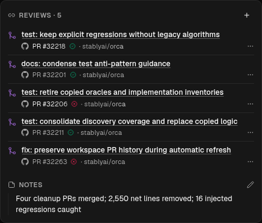
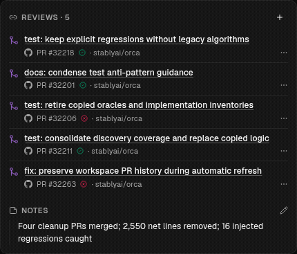

# Inline reference status

“Last known status” added a third line to stale linked references. When a refresh
cleared it, each affected row shrank by 20px and moved the content below it.
Stale references now shimmer only on the reference number and repository/provider
text. Titles, check icons, and the row background stay steady. Screen readers
retain the status label, and reduced motion renders the metadata normally.

| Before                                                    | After                                                     |
| --------------------------------------------------------- | --------------------------------------------------------- |
|  |  |

The selected text effect uses shadcn's [official CSS shimmer utility](https://ui.shadcn.com/docs/utils/shimmer).
Its MIT license is retained in `resources/licenses/shadcn/LICENSE-MIT`.

The [temporary comparison Gist](https://gist.github.com/OrcaWin/5e39ef4c8975d13bda6a2c79a6c904a7)
and [comparison captures](comparison/README.md) preserve the reviewed alternatives.
The selected option is C, metadata-only shimmer.

Captured with Playwright CDP from a hidden Electron renderer on an isolated Xvfb
display, rendering the actual `WorktreeCardLinkedItemsSection` and application CSS
with five seeded PRs and two stale references. These are component captures, not
screenshots of a signed-in app session.

Verified in light and dark themes at 320px and 430px widths: switching those two
references from stale to fresh reduced the original card from 407px to 367px.
Both final states measure 367px, with identical row positions and no horizontal
overflow. Only metadata text in stale rows animates. Reduced motion renders the
text normally, RTL reverses the sweep, and reference links remain clickable.
