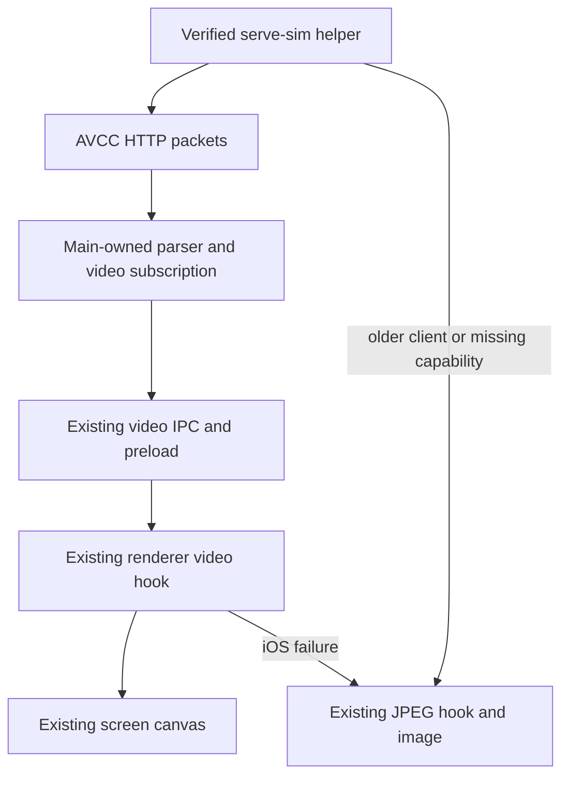
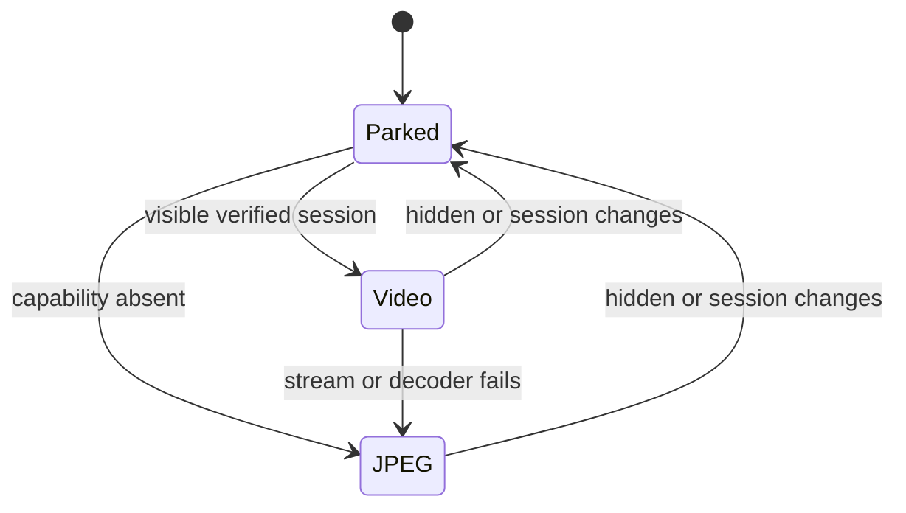

# Efficient Simulator Preview - Plan

## Goal Capsule

- Objective: Simulator motion in Orca is smoother and more current, with a smaller resource footprint.
- Means: Use the measured upstream H.264 path and the existing Orca video decoder (KTD1–KTD3).
- Authority: The user subsequently authorized linked upstream and Orca issues/PRs with benchmarks and demos, superseding the original local-only boundary. Keep source, builds and tests isolated from the user's running checkout.
- Stop: Deliver the verified production path when R1–R7 hold. Do not tune more parameters after the measured targets hold.
- Execution: The main agent owns integration, runtime proof, review, and local commits. Native OMP workers may edit disjoint file sets.

---

## Product Contract

### Summary

Use efficient H.264 for supported iOS Simulator sessions. Preserve the existing JPEG stream as the compatibility and failure path. Keep the screen layout and controls unchanged.

### Problem Frame

The current preview sends separate JPEG images through a 30 fps gate. The pinned helper also performs work that the newer helper can avoid. Increasing the JPEG frame rate made CPU use worse. Three selection pairs and three separate confirmation pairs now show that default-quality H.264 improves freshness, decoded update rate, CPU, bandwidth, and summed process RSS.

### Requirements

**Performance and image quality**

- R1. The production path retains native resolution and passes the fixed source-frame quality bounds in `.context/compound-engineering/ce-optimize/simulator-video-quality/calibration.json`.
- R2. Under the existing low-motion and high-motion instrument, the production path reaches median decoded updates of at least 50 fps and median worst-workload source age p95 of at most 40 ms across three runs.
- R3. The same runs keep median worst client-plus-helper CPU at most 80%, IPC at most 22 Mbps, and summed process RSS at most 900 MB.

**Compatibility and lifecycle**

- R4. Keep the existing MJPEG `streamUrl` unchanged. Add an optional `avccStreamUrl`; absent capability and iOS decoding or transport failure use the existing JPEG path.
- R5. Preserve Android Annex-B decoding, existing screen geometry, input controls, folder-workspace behavior, and current remote/mobile behavior. Do not claim new remote or mobile streaming support.
- R6. Parking, changing the session, and renderer destruction close the owned HTTP request and decoder. No frame IPC continues after stop. A delayed JPEG seed cannot replace a newer video frame.
- R7. Advertise efficient video only after checking the live helper, not just the installed package. A same-app-version helper update must not reuse a stale materialized package.

### Scope Boundaries

No custom encoder, lower resolution, adaptive bitrate, frame-rate control, arbitrary H.264 delta-frame dropping, new tunnel, telemetry subsystem, or generic streaming framework. The confirmed upstream default already meets the targets. Consider another mechanism only if production proof contradicts that result.

---

## Planning Contract

### Key Technical Decisions

- KTD1. Pin `serve-sim` to `0.1.49-beta.139.1`, which passes the existing minimum-release-age policy; do not bypass the policy for the original 140 candidate. Its native binary and capture-related source match that candidate byte for byte. Three integrated 139 runs are recorded in the report. Keep the prerelease risk visible.
- KTD2. Reuse the existing main-owned video IPC and renderer hook. AVCC carries an AVC configuration record; Android remains Annex-B. Add no second decoder lifecycle.
- KTD3. Add `avccStreamUrl?: string` to session metadata and to video-start arguments. Video frames retain `config`, `keyFrame`, and `bytes`, with optional `seed?: boolean`. Add an owner-scoped video error event. Share these wire types across main, preload, and renderer.
- KTD4. Parse the four-byte big-endian outer length plus tag incrementally, with a 32 MiB packet bound. Tags 1/2/3/4 mean configuration/key/delta/JPEG seed. Forward complete packets without a frame-rate gate or delta drops.
- KTD5. Configure AVCC from its configuration record and wait for a key frame after each configuration. Draw the optional JPEG seed only before real video. Always close decoded frames and image bitmaps.
- KTD6. Check loopback `/api/diagnostics` for the verified helper version before advertising AVCC. A ready adopted helper with an old, missing, different or inconclusive version retains JPEG; version metadata does not prove ownership or authorize a restart. Preserve the existing readiness/ownership lifecycle and never shut down the guest merely to refresh its helper.
- KTD7. Compare the bundled and materialized package manifests before reusing the current cache directory. A mismatch uses the existing replacement procedure. Do not add a general file-hashing cache.

### High-Level Technical Design

### Assumptions and Evidence

The existing diagnostic uses Electron 43.8.1 and a real native UIKit source at 1206×2622. Its source-age metric is not physical display latency or input-to-photon latency. CPU and RSS cover measured client/helper processes, not total machine energy or unique physical memory. These limits also apply to production results.

Live-helper reuse and cache behavior were traced in `src/main/emulator/backends/ios-emulator-backend.ts`, `serve-sim-runtime-materializer.ts`, and the exact upstream package source. `/health`, `/config`, and the presence of `/stream.avcc` do not establish the new helper version.

---

## Implementation Units

### U1. Select the verified helper and preserve session metadata

**Goal:** New and reused sessions expose R4/R7 correctly.
**Requirements:** R4, R5, R7.
**Dependencies:** None; KTD1, KTD6, KTD7.
**Files:** `package.json`, `pnpm-lock.yaml`, `src/main/emulator/emulator-types.ts`, `src/main/emulator/emulator-bridge-types.ts`, `src/main/emulator/emulator-session-registry.ts`, `src/main/emulator/backends/ios-emulator-backend.ts`, `src/main/emulator/serve-sim-endpoint-readiness.ts`, `src/main/emulator/serve-sim-runtime-materializer.ts`, `src/main/emulator/backends/ios-emulator-backend.test.ts`, `src/main/emulator/serve-sim-runtime-materializer.test.ts`.
**Approach:** Follow the existing endpoint readiness, helper-stop, and materialization paths. Preserve the MJPEG URL and add the optional AVCC URL through the session registry. Keep the platform guard and lazy executable resolution.
**Test scenarios:** A verified live helper enables video; a ready adopted helper with old, 404, different or inconclusive diagnostics stays alive on JPEG; a failed process census does not recycle a reachable helper; refresh preserves the guest; changing the bundled helper under one app version replaces the stale materialization.
**Verification:** Focused existing tests plus the actual native addon running under Electron-as-Node. Package/install verification is runtime-first, not a test of copied values.

### U2. Relay AVCC through the existing video subscription

**Goal:** The main process relays complete encoded packets under the current owner/lifetime contract.
**Requirements:** R4, R5, R6.
**Dependencies:** The fixed wire contract KTD3; independent authoring from U1/U3 with disjoint files.
**Files:** New `src/shared/emulator-video-stream.ts`, `src/main/emulator/avcc-frame-parser.ts`, `src/main/emulator/avcc-frame-stream.ts`, and `src/main/emulator/avcc-frame-parser.test.ts`; existing `src/main/ipc/emulator-video-stream.ts`, `src/preload/api/emulator-api.ts`, `src/preload/api/emulator-bridge.ts`.
**Approach:** Apply KTD2–KTD4. Keep HTTP ownership in main. Retain the Android registry path. Transport errors reach only the matching renderer and close that subscription. Handshake timeout must not expire a valid idle stream after headers arrive.
**Test scenarios:** Split headers and bodies at arbitrary boundaries without changing packet contents; handle multiple packets in one chunk; reject invalid lengths/tags before unbounded allocation; close a real HTTP stream on stop; preserve subscription ownership and Android behavior.
**Verification:** Focused parser/transport checks and the production IPC path in a hidden Electron renderer.

### U3. Decode and display video with a stable JPEG fallback

**Goal:** The real screen component uses the efficient path without changing its layout or controls.
**Requirements:** R1–R6.
**Dependencies:** The fixed optional metadata and wire contract; independent authoring from U1/U2 with disjoint files.
**Files:** `src/renderer/src/components/emulator-pane/use-emulator-video-stream.ts`, `emulator-screen-stream-content.tsx`, `emulator-screen-surface.tsx`, `emulator-device-frame.tsx`, `emulator-pane-types.ts`, `EmulatorPane.tsx`, `use-emulator-pane-session.ts`, `emulator-pane-session-view.ts`, and the maintained `emulator-screen-stream-content.test.tsx` in that directory. Current main retired the separate video-hook test; keep meaningful lifecycle/failure coverage at the screen consumer.
**Approach:** Apply KTD2, KTD3, KTD5. Pass the existing session device ID and optional AVCC URL to the screen. Preserve the desire to use video after a failure so error state does not reset into a retry loop. Reset on normal session/visibility changes.
**Test scenarios:** AVCC configuration and key-frame gating work; existing Android Annex-B behavior remains; a late seed does not replace video; iOS failure switches once to JPEG; missing capability uses JPEG; parking and session changes release resources.
**Verification:** Existing focused component/hook tests and real hidden-renderer screen captures using the changed hook and IPC.

### U4. Prove and record the integrated result

**Goal:** Preserve a demonstrable result rather than a diagnostic-only projection.
**Requirements:** R1–R7.
**Dependencies:** U1–U3.
**Files:** `docs/optimize/simulator-avcc-autonomous-report.md`; temporary runtime instruments remain under `.context/compound-engineering/ce-optimize/simulator-avcc-autonomous/`.
**Approach:** Exercise the production transport/hook at native resolution, with the same observer-separated CPU phases and source-frame quality comparison. Include phone and iPad shape, start/stop, park, seed, failure, and configuration-change smoke checks.
**Test expectation:** No new permanent test solely for benchmark wiring. Keep only tests for plausible consumer-visible failures.
**Verification:** Recorded raw results, source/driver identities, screenshots, focused checks, and independent correctness/simplicity review. Name missing reviewers explicitly.

---

## Verification Contract

Run the focused changed tests through the existing Vitest configuration, with `ORCA_BACKGROUND_LAUNCH=1` and at most two workers. Run `pnpm tc:node` and `pnpm tc:web` for the changed contracts. Run formatting/lint once after integration. Do not build or run tests in editing workers.

R1–R3 require three measured production runs, with no heavy build/test activity during timing. Use the existing fixed quality bounds and separate readback from CPU phases. A passing unit suite alone is not proof. Inspect the actual hidden renderer through CDP; never show or activate test windows or Simulator.app.

---

## Definition of Done

R1–R7 hold with recorded runtime evidence. All affected callers compile and targeted tests pass. The report separates historical measured revisions from final-source smoke checks and untested platform limits. Remove abandoned production attempts and temporary scaffolding not retained as measurement evidence. Publish the authorized linked issue/PR with playable demos, prerelease/upstream dependencies and exact-head verification status.
