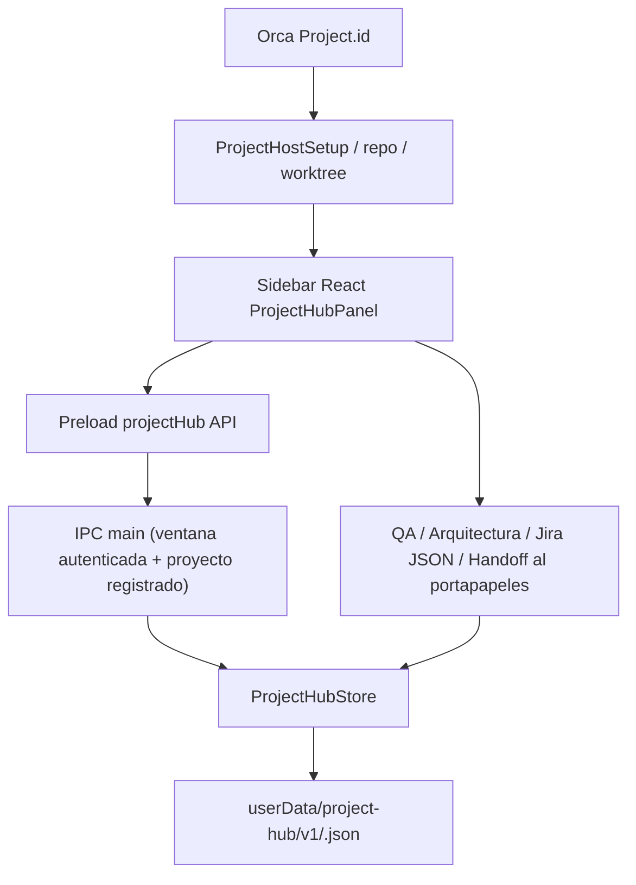

# Project Hub dentro de Orca Desktop — PRs apilados

> Experimental. No está verificado todavía en una compilación real de Electron ni integrado en main.

## Ramas y Pull Requests

1. PR #1: `feat/project-hub-foundation` — primer plugin HTML de prueba, sin integración nativa.
2. PR #2: `feat/project-hub-native-core` (base: rama PR #1) — persistencia en `userData`, IPC seguro y pestaña React nativa.
3. PR #3: `feat/project-hub-design-views` (base: rama PR #2) — siete pantallas basadas en los flujos del diseño recibido, importador JSON, Mermaid, handoff manual y evidencias QA.

No fusionar directamente a `main` sin testear la aplicación real. La rama #3 fue rebasada sobre el head actualizado de #2; el diff del PR #3 contiene solo su propia capa de cambios. Los tres PRs deben revisarse de abajo hacia arriba.

## Arquitectura real



No se parchea Git, no se crea un segundo catálogo de repositorios y no se llama a APIs privilegiadas desde el iframe del plugin antiguo. `Project.id` es propietario de los datos; cambiar de worktree dentro del mismo proyecto conserva el historial.

El panel derecho se registra en `src/shared/ui-chrome-types.ts`, `right-sidebar-route.ts`, `use-right-sidebar-activity-items.ts` y `right-sidebar-panel-content.tsx`. La UI está en `ProjectHubPanel.tsx` y `ProjectHubDesignViews.tsx`. El contrato tipado vive en `src/shared/project-hub-types.ts`; los canales Electron están en `src/preload/api/project-hub-{api,bridge}.ts` y `src/main/ipc/project-hub.ts`.

El almacenamiento es **local al perfil de Orca Desktop**; no se sincroniza automáticamente entre máquinas ni con un servidor remoto, incluso para proyectos SSH. Se protege mediante `writeSecureFile`, nombres derivados por SHA-256, un límite de tamaño y revisiones optimistas; dos ventanas con una revisión antigua deben recargar antes de escribir.

## Uso de la rama visual

```powershell
git clone https://github.com/bcuyul/orca.git Orca-ProjectHub
cd Orca-ProjectHub
git switch feat/project-hub-design-views
node --version
pnpm install
pnpm dev --worktree-profile
```

Requiere Node 24, la versión de pnpm fijada por Orca y herramientas nativas de compilación en Windows (Python 3, Visual Studio C++ Build Tools). La instancia de desarrollo usa un perfil separado y no reemplaza Orca Desktop estable.

En la barra lateral derecha selecciona **Project Hub** con un worktree activo. Si estaba instalado el plugin experimental de PR #1, desactívalo temporalmente para evitar dos entradas con nombres similares.

## Funcionalidad (manual / real)

- **Resumen:** datos reales de un registro persistente por `Project.id` y etapas 1–10.
- **Backlog:** crear historias, mover estados, guardar criterios e importar hasta 100 issues desde JSON de Jira **solo lectura**, sin duplicados.
- **Arquitectura:** componentes y relaciones editables, conservación nativa, diagrama textual y copia Mermaid.
- **QA:** cuatro controles por fase con referencia manual o justificación explícita `No aplica`; no se falsifican resultados de CI.
- **Blueprint:** editar problema, idea, usuarios e indicadores, guardados por proyecto.
- **Delegación:** seleccionar historias, dos agentes diferentes (Claude Code, Codex, Hermes), skills sugeridas y copiar el contrato con el portapapeles nativo. **No** crea Runs/Tasks ni ejecuta una terminal.
- **Equipo:** perfiles conceptuales inspirados en Hermes, **no** estados vivos de sesiones.

La transición de fase también es comprobada en el proceso principal: +1 fase, una nueva aprobación, historial anterior inmutable y cuatro evidencias de la fase anterior. No existen saltos implícitos a Producción.

## Límites y tareas pendientes

- Este trabajo es una integración inicial, **no** la orquestación completa. Vincular Runs/Tasks/Dispatches, worktrees y agentes de Orca requiere un adaptador oficial y pruebas de pertenencia a host, permisos y terminal.
- El design recibido es un HTML autónomo con datos de muestra. Se ha traducido su **estructura** a React/Tailwind de Orca, no copiado su runtime ni fuentes embebidas.
- La importación JSON no usa el proveedor de Jira conectado. No hay PR status, CI, cobertura ni actualizaciones en tiempo real.
- El almacenamiento local por perfil no ofrece sincronización multi-dispositivo ni migración de datos del plugin v0.1. Exportación y recuperación son una siguiente tarea.
- QA es atestación humana explícita, no prueba verificable de una ejecución CI. En producción deberá enlazar evidencias reales, bloquear resultados desconocidos y auditar excepciones.
- Los roles de agente y skills seleccionadas no se guardan todavía como perfiles persistentes del proyecto.
- No hemos ejecutado aún el conjunto completo de pruebas de Orca ni validado compatibilidad en Windows, macOS, SSH y hosts simultáneos.

## Verificación antes del merge

```powershell
pnpm test:node src/shared/project-hub-project-id.test.ts src/shared/project-hub-types.test.ts
pnpm test:node src/main/project-hub/project-hub-store.test.ts
pnpm typecheck
```

Confirmar el nombre real de los scripts de `package.json` antes de ejecutarlos. Probar navegación entre 2 proyectos y 2 worktrees, cierre/reapertura, corrupción y conflicto de revisión, aprobación sin evidencia (debe rechazarse), importación con IDs duplicados y copia del handoff. Probar Orca estable separado de la instancia experimental.

Por seguridad, no se realizan merges, envíos de Jira, creación de worktrees ni despliegues sin intervención del usuario.
