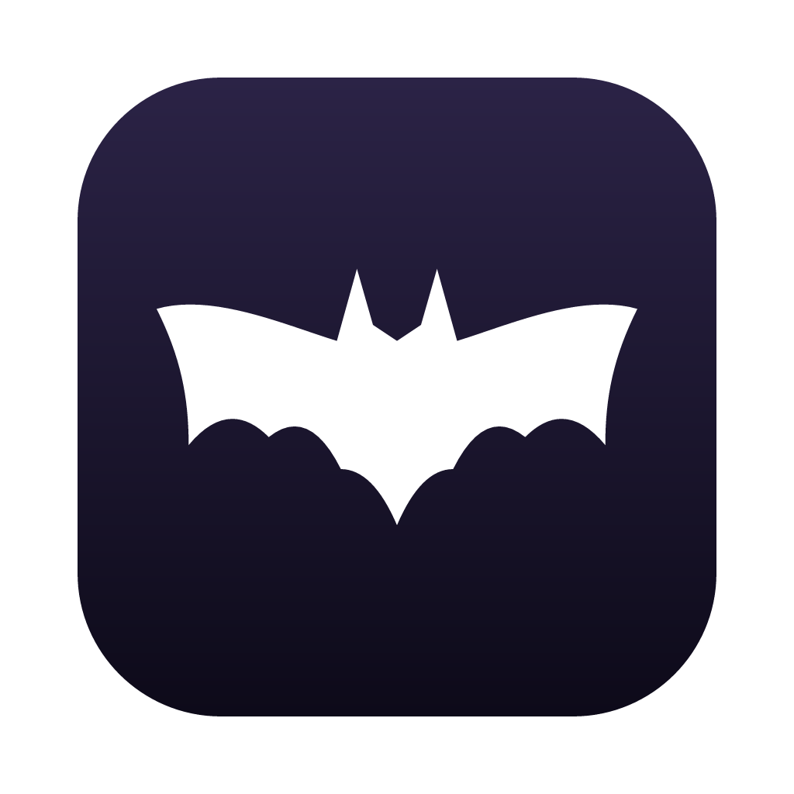
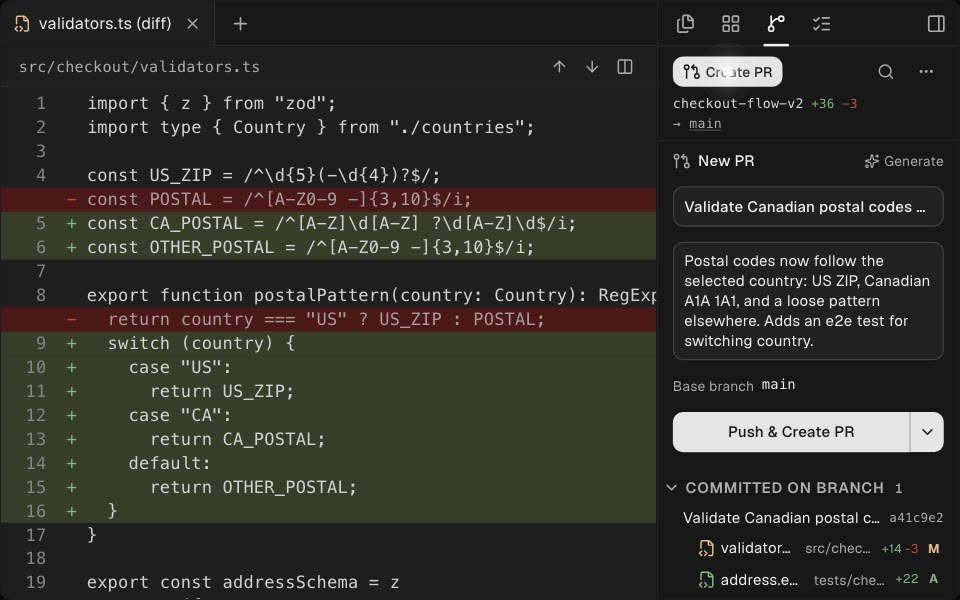
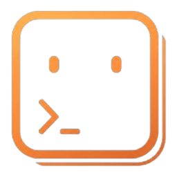
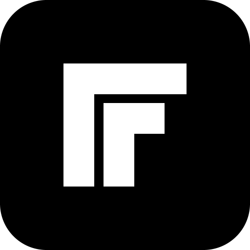
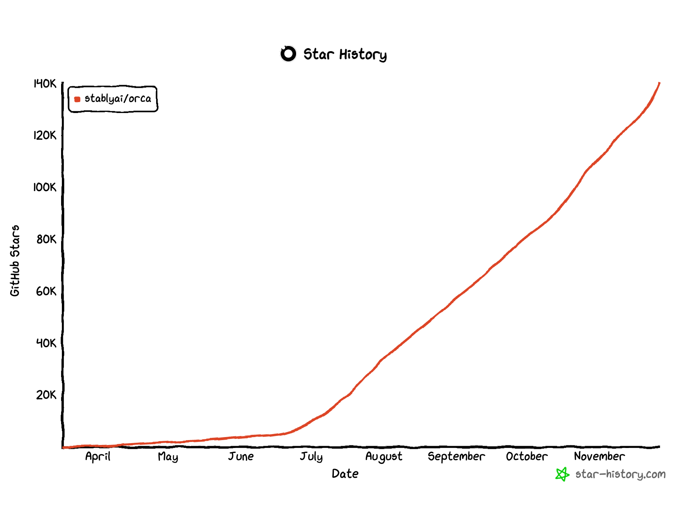

<h1 align="center">
  <a href="https://orca.dev"></a> Orca
</h1>

<p align="center">
  <a href="https://github.com/stablyai/orca"></a>
  <a href="https://github.com/stablyai/orca/releases"></a>
  
  <a href="https://discord.gg/fzjDKHxv8Q"></a>
  <a href="https://x.com/orca_build"></a>
  
</p>

<p align="center">
  <sub><a href="../../README.md">English</a> · <a href="README.zh-CN.md">中文</a> · <a href="README.ja.md">日本語</a> · <a href="README.ko.md">한국어</a> · <a href="README.es.md">Español</a> · <a href="README.fr.md">Français</a> · <a href="README.pt.md">Português</a> · <a href="README.tr.md">Türkçe</a> · <a href="README.ru.md">Русский</a></sub>
</p>

<p align="center">
  <strong>កម្មវិធី AI Orchestrator សម្រាប់អ្នកបង្កើតជំនាន់ថ្មី (100x builders)។</strong><br/>
  ដំណើរការ Claude Code, Codex និង coding agent ផ្សេងទៀតស្របពេលគ្នា (in parallel) ដោយនីមួយៗស្ថិតនៅក្នុង worktree ផ្ទាល់ខ្លួន។ ប្រើប្រាស់តាមរយៈ Chat ឬ Terminal នៅលើកុំព្យូទ័រយួរដៃរបស់អ្នក ឬនៅលើ Cloud រួមជាមួយ Diffs, កម្មវិធីរុករក (Browser) និង CLI ទាំងអស់នៅក្នុងកម្មវិធីតែមួយ។
</p>

<h3 align="center"><a href="https://orca.dev/download"><ins>ទាញយក Orca</ins></a></h3>

<p align="center">
  
</p>

## មុខងារសំខាន់ៗ

<table>
<tr>
<td width="50%" valign="middle">

### Chat ឬ Terminal

ដំណើរការ agent ណាមួយនៅក្នុង Chat UI ឬជា CLI ផ្ទាល់ ហើយអាចផ្លាស់ប្តូរការសន្ទនារវាង UI និង CLI ទៅវិញទៅមកដោយមិនបាត់បង់បរិបទ (context) ឡើយ។

[ឯកសារជំនួយ →](https://orca.dev/docs/agents/native-chat)

</td>
<td width="50%">
  <a href="https://orca.dev/docs/agents/native-chat"><picture><source srcset="../assets/readme-features/chat-or-terminal.webp" type="image/webp"></picture></a>
</td>
</tr>
<tr>
<td width="50%" valign="middle">

### ចាត់ចែង និងសម្របសម្រួល Agents (Orchestrate Agents)

ប្រគល់កិច្ចការធំមួយទៅកាន់ agent មួយ។ វានឹងបំបែកការងារនោះជាចំណែកៗ បង្កើត worker agents នៅក្នុង workspace ផ្ទាល់ខ្លួនរបស់ពួកគេ និងប្រមូលលទ្ធផលត្រឡប់មកជូនអ្នកវិញ។

[ឯកសារជំនួយ →](https://orca.dev/docs/cli/orchestration)

</td>
<td width="50%">
  <a href="https://orca.dev/docs/cli/orchestration"><picture><source srcset="../assets/readme-features/orchestration.webp" type="image/webp"></picture></a>
</td>
</tr>
<tr>
<td width="50%" valign="middle">

### ដំណើរការបានគ្រប់ទីកន្លែង (Run Anywhere)

ភ្ជាប់ជាមួយ Remote Orca Server, ធ្វើការលើ SSH host ណាមួយ ឬផ្ដល់ Cloud VM ផ្ទាល់ខ្លួនសម្រាប់ worktree នីមួយៗ។ Agent របស់អ្នកនៅតែបន្តដំណើរការ ទោះបីកុំព្យូទ័រយួរដៃរបស់អ្នកកំពុង sleep ក៏ដោយ។

[ឯកសារជំនួយ →](https://orca.dev/docs/ways-to-run)

</td>
<td width="50%">
  <a href="https://orca.dev/docs/ways-to-run"><picture><source srcset="../assets/readme-features/remote.webp" type="image/webp"></picture></a>
</td>
</tr>
<tr>
<td width="50%" valign="middle">

### កម្មវិធីទូរស័ព្ទ (Mobile App)

ភ្ជាប់ Orca ជាមួយកម្មវិធីទូរស័ព្ទ ដើម្បីទទួលបានការជូនដំណឹងនៅពេល agent ត្រូវការជំនួយពីអ្នក ឆ្លើយតបក្នុង chat និងបន្តដំណើរការការងារលើម៉ាស៊ីនណាមួយរបស់អ្នកពេលអ្នកនៅឆ្ងាយពីតុធ្វើការ។

[iOS App Store](https://apps.apple.com/us/app/orca-ide/id6766130217) · [Google Play](https://play.google.com/store/apps/details?id=dev.orca.app) · [Android APK](https://orca.dev/download/android) · [ឯកសារជំនួយ →](https://orca.dev/docs/mobile)

</td>
<td width="50%">
  <a href="https://orca.dev/docs/mobile"><picture><source srcset="../assets/readme-features/mobile-companion.webp" type="image/webp"></picture></a>
</td>
</tr>
<tr>
<td width="50%" valign="middle">

### ពិនិត្យមើលលទ្ធផលពី AI (Review AI Output)

ពិនិត្យមើល diffs, ដាក់ចំណាំលើបន្ទាត់កូដជាក់លាក់ដែលបានកែប្រែ និងផ្ញើមតិកែលម្អត្រឡប់ទៅកាន់ agent វិញ។

[ឯកសារជំនួយ →](https://orca.dev/docs/review/annotate-ai-diff)

</td>
<td width="50%">
  <a href="https://orca.dev/docs/review/annotate-ai-diff"><picture><source srcset="../assets/readme-features/annotate-ai-diffs.webp" type="image/webp"></picture></a>
</td>
</tr>
<tr>
<td width="50%" valign="middle">

### ការតភ្ជាប់ Git (Git Integration)

រៀបចំសេចក្ដីព្រាង commit messages និង pull requests ចេញពី diff ដោយផ្ទាល់ រួចផ្ញើ checks ដែលបរាជ័យ ឬមតិយោបល់ពិនិត្យ PR ត្រឡប់ទៅ agent វិញដើម្បីដោះស្រាយ។

[ឯកសារជំនួយ →](https://orca.dev/docs/review/commit-push)

</td>
<td width="50%">
  <a href="https://orca.dev/docs/review/commit-push"><picture><source srcset="../assets/readme-features/git-integration.webp" type="image/webp"></picture></a>
</td>
</tr>
<tr>
<td width="50%" valign="middle">

### ដំណើរការ Worktrees ស្របពេលគ្នា (Parallel Worktrees)

បំបែកកិច្ចការទៅជាបរិស្ថានដាច់ដោយឡែកពីគ្នាយ៉ាងរហ័ស ធ្វើឱ្យ agents ជាច្រើនអាចធ្វើការទន្ទឹមគ្នាដោយមិនប៉ះពាល់គ្នាឡើយ។

[ឯកសារជំនួយ →](https://orca.dev/docs/model/worktrees)

</td>
<td width="50%">
  <a href="https://orca.dev/docs/model/worktrees"><picture><source srcset="../assets/readme-features/parallel-worktrees.webp" type="image/webp"></picture></a>
</td>
</tr>
<tr>
<td width="50%" valign="middle">

### របៀបរចនា (Design Mode)

ចុចលើ element ណាមួយនៅក្នុង browser របស់ Orca ដើម្បីចម្លង HTML, styles និង selector របស់វា រួចបិទភ្ជាប់ (paste) ចូលទៅក្នុងការសន្ទនារបស់ agent អ្នក។

[ឯកសារជំនួយ →](https://orca.dev/docs/browser/design-mode)

</td>
<td width="50%">
  <a href="https://orca.dev/docs/browser/design-mode"><picture><source srcset="../assets/readme-features/design-mode.webp" type="image/webp"></picture></a>
</td>
</tr>
<tr>
<td width="50%" valign="middle">

### GitHub &amp; Linear ភ្ជាប់មកជាមួយស្រាប់

មើលកិច្ចការ GitHub និង Linear របស់អ្នកនៅកន្លែងតែមួយ ហើយចាប់ផ្ដើម workspace សម្រាប់កិច្ចការនីមួយៗនៅពេលអ្នករួចរាល់ក្នុងការសរសេរកូដ។

[ឯកសារជំនួយ →](https://orca.dev/docs/review/linear)

</td>
<td width="50%">
  <a href="https://orca.dev/docs/review/linear"><picture><source srcset="../assets/readme-features/github-linear-tasks.webp" type="image/webp"></picture></a>
</td>
</tr>
<tr>
<td width="50%" valign="middle">

### Orca CLI

រាល់អ្វីដែលអ្នកអាចធ្វើបាននៅក្នុង Orca នោះ agent របស់អ្នកក៏អាចធ្វើបានដូចគ្នាដែរ៖ បង្កើត worktrees, ចាប់ផ្ដើម worker agents, បញ្ជា browser និងកម្មវិធីកុំព្យូទ័រ ព្រមទាំងកំណត់ពេលដំណើរការស្វ័យប្រវត្តិ (automations) ទាំងអស់ចេញពី command line។

[ឯកសារជំនួយ →](https://orca.dev/docs/cli/overview)

</td>
<td width="50%">
  <a href="https://orca.dev/docs/cli/overview"><picture><source srcset="../assets/readme-features/orca-cli.webp" type="image/webp"></picture></a>
</td>
</tr>
<tr>
<td width="50%" valign="middle">

### កម្មវិធីបន្ថែម (Plugins)

Themes, កម្មវិធីកែកូដ (editors), ភាសា (languages), និងផ្ទាំងបញ្ជា (panels) ពីសហគមន៍ អាចដំឡើងបានដោយគ្រាន់តែចុចមួយដង។

[ស្វែងរក plugins →](https://orca.dev/plugins)

</td>
<td width="50%">
  <a href="https://orca.dev/plugins"><picture><source srcset="../assets/readme-features/plugins.webp" type="image/webp"></picture></a>
</td>
</tr>
<tr>
<td width="50%" valign="middle">

### ពុះផ្ទាំងការងារតាមចិត្ត (Split Anything)

ដាក់ agents, terminals, browsers, និង diffs ទន្ទឹមគ្នាជាផ្ទាំងពុះ (split panes) តាមទម្រង់ដែលសមស្របនឹងកិច្ចការរបស់អ្នក។

[ឯកសារជំនួយ →](https://orca.dev/docs/model/tabs-panes-splits)

</td>
<td width="50%">
  <a href="https://orca.dev/docs/model/tabs-panes-splits"><picture><source srcset="../assets/readme-features/split-anything.webp" type="image/webp"></picture></a>
</td>
</tr>
</table>

**រួមបញ្ចូលទាំង៖**

- **[ទាញទម្លាក់ឯកសារទៅកាន់ Agents](https://orca.dev/docs/editing/file-explorer)**: ទាញឯកសារចេញពី explorer ឬរូបភាពពីលើ desktop ចូលទៅកាន់ប្រអប់ prompt របស់ agent ដោយផ្ទាល់។
- **[រំលងទៅកាន់ទីតាំងណាមួយយ៉ាងរហ័ស (Jump Anywhere)](https://orca.dev/docs/model/quick-open)**: គ្រាប់ចុចកាត់ (shortcut) មួយអាចរំលងទៅកាន់ workspace ឬ tab ណាមួយនៅទូទាំង repositories និង hosts ទាំងអស់។
- **[ការមើលឯកសារលម្អិត (Rich Previews)](https://orca.dev/docs/editing/viewers)**: បើកមើលរូបភាព, ឯកសារ PDF, និង Markdown នៅក្នុង workspace ដោយផ្ទាល់ នៅក្បែរ agent ដែលបានបង្កើតពួកវា។
- **[កម្មវិធីត្រាប់តាមទូរស័ព្ទ (Mobile Emulator)](https://orca.dev/docs/cli/overview#mobile-emulator)**: ដំណើរការ iOS Simulator ឬ Android emulator នៅក្បែរ agent របស់អ្នក ដើម្បីឱ្យវាអាចចុច វាយអត្ថបទ និងផ្ទៀងផ្ទាត់ការងាររបស់វាដោយខ្លួនឯង។
- **[ការបញ្ជាដោយសំឡេង (Dictation)](https://orca.dev/docs/settings#voice)**: ចុចគ្រាប់ចុចកាត់ ហើយនិយាយ។ Orca នឹងវាយពាក្យដែលអ្នកនិយាយបញ្ចូលទៅក្នុង prompt ឬ terminal របស់ agent។
- **[ការប្រើប្រាស់ និងគណនី (Usage & Accounts)](https://orca.dev/docs/agents/usage-tracking)**: ពិនិត្យមើលកម្រិតកំណត់ (limits) របស់ agent ដែលអ្នកបានប្រើប្រាស់ និងពេលវេលាកំណត់ឡើងវិញ ព្រមទាំងផ្លាស់ប្តូរគណនីដោយមិនចាំបាច់ចេញពីប្រព័ន្ធ (logout)។
- **[ស្វ័យប្រវត្តិកម្ម (Automations)](https://orca.dev/docs/cli/automations)**: កំណត់កាលវិភាគដំណើរការ prompt លើ repo ណាមួយ៖ ការដំឡើង version dependency ប្រចាំរាត្រី, ការពិនិត្យបញ្ហាប្រចាំសប្ដាហ៍, និងការធ្វើតេស្តស្វែងរក error។
- **[Computer Use](https://orca.dev/docs/cli/computer-use)**: នៅពេលដែលគ្មាន CLI ឬ API នោះ agents អាចមើលឃើញ និងបញ្ជា desktop apps និង browsers ខាងក្រៅបាន។
- **និងមុខងារជាច្រើនទៀត**: យើងបញ្ចេញកំណែថ្មីជារៀងរាល់ថ្ងៃ ដូច្នេះបញ្ជីនេះតែងតែមានការអាប់ដេតជាប្រចាំ។ [កំណត់ហេតុនៃការផ្លាស់ប្តូរ (Changelog)](https://github.com/stablyai/orca/releases) គឺជាបញ្ជីមុខងារជាក់ស្ដែង។

---

## Agents ដែលគាំទ្រ (Supported Agents)

ដំណើរការជាមួយ **CLI agent គ្រប់ប្រភេទ** — ប្រសិនបើវាដំណើរការក្នុង terminal បាន នោះវានឹងដំណើរការក្នុង Orca បានដូចគ្នា។

<p>
  <a href="https://docs.anthropic.com/claude/docs/claude-code"><kbd> Claude Code</kbd></a> &nbsp;
  <a href="https://github.com/openai/codex"><kbd> Codex</kbd></a> &nbsp;
  <a href="https://x.ai/cli"><kbd> Grok</kbd></a> &nbsp;
  <a href="https://cursor.com/cli"><kbd> Cursor</kbd></a> &nbsp;
  <a href="https://docs.github.com/en/copilot/how-tos/set-up/install-copilot-cli"><kbd> GitHub Copilot</kbd></a> &nbsp;
  <a href="https://dev.meta.ai/docs/muse-code"><kbd> Muse</kbd></a> &nbsp;
  <a href="https://deepseek-harness.github.io/deepseek-harness/"><kbd> DeepSeek Harness</kbd></a> &nbsp;
  <a href="https://zcode.z.ai/en/docs"><kbd> ZCode</kbd></a> &nbsp;
  <a href="https://opencode.ai/docs/cli/"><kbd> OpenCode</kbd></a> &nbsp;
  <a href="https://mimo.xiaomi.com/coder"><kbd> MiMo Code</kbd></a> &nbsp;
  <a href="https://ampcode.com/manual#install"><kbd> Amp</kbd></a> &nbsp;
  <a href="https://openclaude.gitlawb.com/"><kbd> OpenClaude</kbd></a> &nbsp;
  <a href="https://antigravity.google/docs/cli-overview"><kbd> Antigravity</kbd></a> &nbsp;
  <a href="https://pi.dev"><kbd> Pi</kbd></a> &nbsp;
  <a href="https://omp.sh"><kbd> oh-my-pi</kbd></a> &nbsp;
  <a href="https://hermes-agent.nousresearch.com/docs/"><kbd> Hermes Agent</kbd></a> &nbsp;
  <a href="https://devin.ai/cli"><kbd> Devin</kbd></a> &nbsp;
  <a href="https://goose-docs.ai/docs/quickstart/"><kbd> Goose</kbd></a> &nbsp;
  <a href="https://docs.augmentcode.com/cli/overview"><kbd> Auggie</kbd></a> &nbsp;
  <a href="https://github.com/autohandai/code-cli"><kbd> Autohand Code</kbd></a> &nbsp;
  <a href="https://github.com/charmbracelet/crush"><kbd> Charm</kbd></a> &nbsp;
  <a href="https://docs.cline.bot/cline-cli/overview"><kbd> Cline</kbd></a> &nbsp;
  <a href="https://www.codebuddy.ai/cli"><kbd> CodeBuddy</kbd></a> &nbsp;
  <a href="https://www.codebuff.com/docs/help/quick-start"><kbd> Codebuff</kbd></a> &nbsp;
  <a href="https://freebuff.com"><kbd> Freebuff</kbd></a> &nbsp;
  <a href="https://commandcode.ai/docs/quickstart"><kbd> Command Code</kbd></a> &nbsp;
  <a href="https://docs.continue.dev/cli/quickstart"><kbd> Continue</kbd></a> &nbsp;
  <a href="https://docs.factory.ai/cli/getting-started/quickstart"><kbd> Droid</kbd></a> &nbsp;
  <a href="https://kilo.ai/docs/cli"><kbd> Kilocode</kbd></a> &nbsp;
  <a href="https://www.kimi.com/code/docs/en/kimi-code-cli/getting-started.html"><kbd> Kimi</kbd></a> &nbsp;
  <a href="https://kiro.dev/docs/cli/"><kbd> Kiro</kbd></a> &nbsp;
  <a href="https://github.com/mistralai/mistral-vibe"><kbd> Mistral Vibe</kbd></a> &nbsp;
  <a href="https://github.com/QwenLM/qwen-code"><kbd> Qwen Code</kbd></a> &nbsp;
  <a href="https://support.atlassian.com/rovo/docs/install-and-run-rovo-dev-cli-on-your-device/"><kbd> Rovo Dev</kbd></a> &nbsp;
  <kbd>+ any CLI agent</kbd>
</p>

---

## ការដំឡើង (Install)

### Desktop — macOS, Windows, Linux

- **[ទាញយកពី orca.dev](https://orca.dev/download)**
- ឬទាញយកឯកសារដំឡើងដោយផ្ទាល់: [macOS Apple Silicon](https://github.com/stablyai/orca/releases/latest/download/orca-macos-arm64.dmg) · [macOS Intel](https://github.com/stablyai/orca/releases/latest/download/orca-macos-x64.dmg) · [Windows (.exe)](https://github.com/stablyai/orca/releases/latest/download/orca-windows-setup.exe) · [Linux AppImage](https://github.com/stablyai/orca/releases/latest/download/orca-linux.AppImage) · [គ្រប់កំណែទាំងអស់](https://github.com/stablyai/orca/releases/latest)

_ឬតាមរយៈកម្មវិធីគ្រប់គ្រងកញ្ចប់កម្មវិធី (Package Manager):_

```bash
# macOS (Homebrew)
# ត្រូវប្រើឈ្មោះពេញជានិច្ច ព្រោះពាក្យ `orca` តែឯងគឺជា cask របស់ Plotly ដែលមិនពាក់ព័ន្ធឡើយ។
brew install --cask stablyai/orca/orca
# អាប់ដេតកំណែដែលបានដំឡើងស្រាប់
brew upgrade --cask stablyai/orca/orca
# កំណែសាកល្បង Release candidates (ជាន់គ្នាជាមួយ stable cask ដូច្នេះត្រូវលុប stable ចេញសិន)
brew install --cask stablyai/orca/orca@rc

# Arch Linux (AUR) — ឬ stably-orca-git ដើម្បី compile ចេញពី source
yay -S stably-orca-bin
```

### កម្មវិធីទូរស័ព្ទ (Mobile App) — iOS, Android

ភ្ជាប់ជាមួយកម្មវិធីកុំព្យូទ័ររបស់អ្នក ដើម្បីតាមដាន និងបញ្ជា agents របស់អ្នកចេញពីទូរស័ព្ទ។

- **iOS:** [ទាញយកនៅលើ App Store](https://apps.apple.com/us/app/orca-ide/id6766130217)
- **Android:** [Google Play](https://play.google.com/store/apps/details?id=dev.orca.app) · [ទាញយក APK](https://orca.dev/download/android) · [ការណែនាំអំពីការដំឡើង](https://orca.dev/docs/android-apk)

---

## សហគមន៍ និងការគាំទ្រ (Community & Support)

- **Discord:** ចូលរួមជាមួយសហគមន៍នៅលើ **[Discord](https://discord.gg/fzjDKHxv8Q)**។
- **Twitter / X:** តាមដាន **[@orca_build](https://x.com/orca_build)** សម្រាប់ព័ត៌មានថ្មីៗ និងការប្រកាសផ្សេងៗ។
- **WeChat:** ស្កេនដើម្បីចូលរួមក្រុម WeChat របស់សហគមន៍ Orca។

  

- **មតិកែលម្អ និងគំនិតយោបល់:** យើងបញ្ចេញកំណែថ្មីយ៉ាងឆាប់រហ័ស។ ខ្វះមុខងារអ្វីមួយមែនទេ? [ស្នើសុំមុខងារថ្មី](https://github.com/stablyai/orca/issues)។
- **ភាពឯកជន:** សូមមើល [ឯកសារភាពឯកជន និង telemetry](https://orca.dev/docs/telemetry) សម្រាប់ព័ត៌មានទិន្នន័យអនាមិកដែល Orca ប្រមូល និងរបៀបបិទវា។
- **គាំទ្រគម្រោងនេះ:** [ផ្ដល់ Star](https://github.com/stablyai/orca) ដល់ repository នេះ ដើម្បីតាមដានការអាប់ដេតប្រចាំថ្ងៃរបស់យើង។

---

## ការចូលរួមអភិវឌ្ឍន៍ (Developing)

ចង់ចូលរួមចំណែក ឬដំណើរការកម្មវិធីនៅក្នុងកុំព្យូទ័ររបស់អ្នក? សូមមើលការណែនាំ [CONTRIBUTING.md](../../.github/CONTRIBUTING.md) របស់យើង។

<a href="https://github.com/stablyai/orca/graphs/contributors">
  
</a>

<p align="center">
  
</p>

## កំណែដែលបានចុះហត្ថលេខាឌីជីថល (Signed Builds)

ការចុះហត្ថលេខាលើកូដ Windows ត្រូវបានឧបត្ថម្ភ/ផ្ដល់ជូនដោយ [SignPath.io](https://signpath.io) វិញ្ញាបនបត្រដោយ [SignPath Foundation](https://signpath.org)។

## អាជ្ញាបណ្ណ (License)

Orca គឺជាកម្មវិធីឥតគិតថ្លៃ និង open source ក្រោម [អាជ្ញាបណ្ណ MIT](../../LICENSE)។
