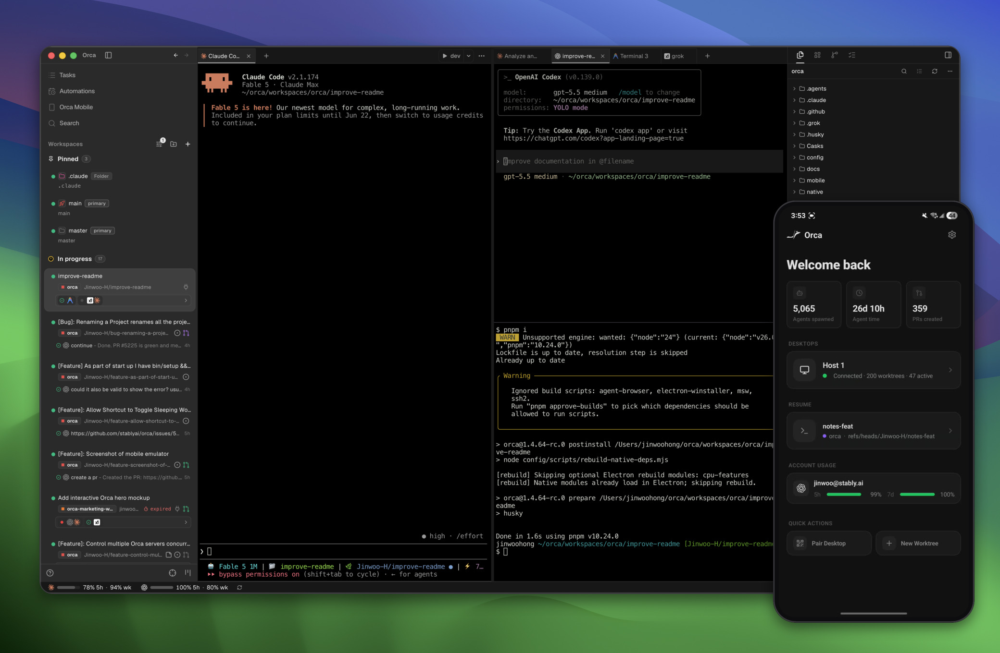
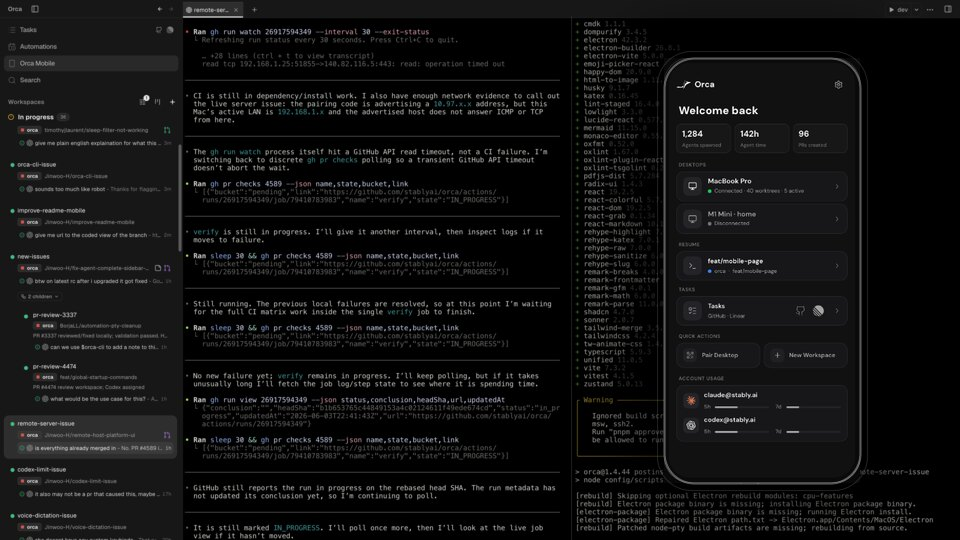
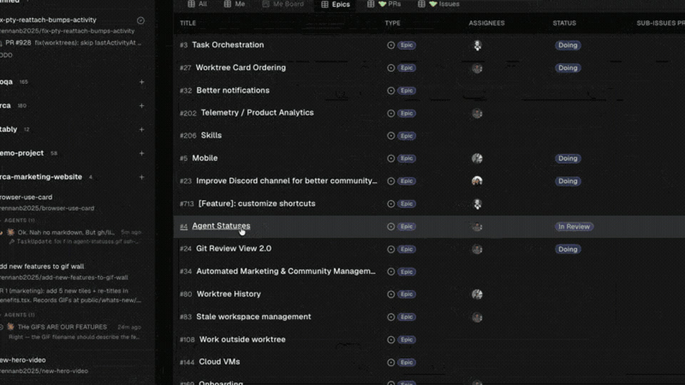
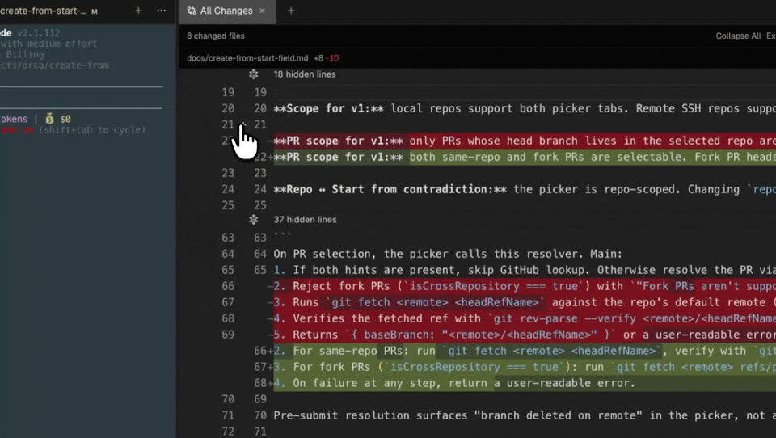
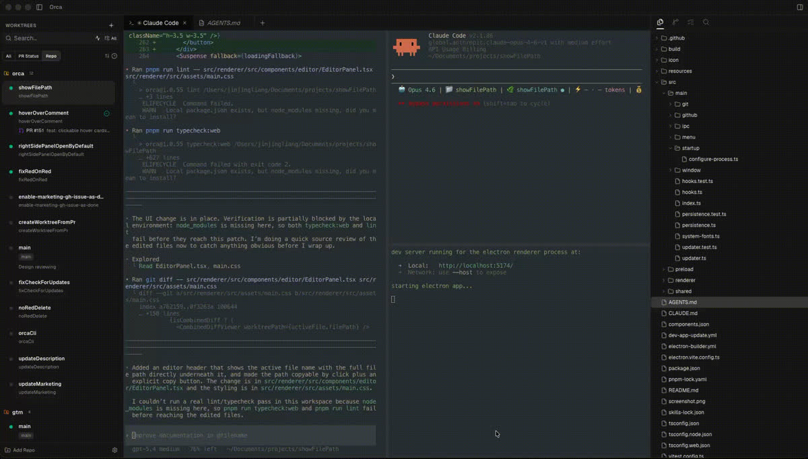
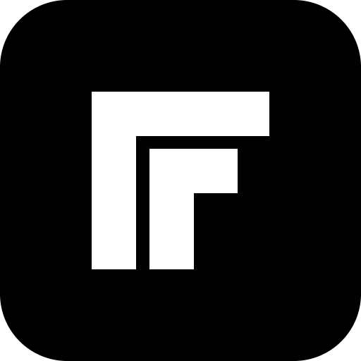
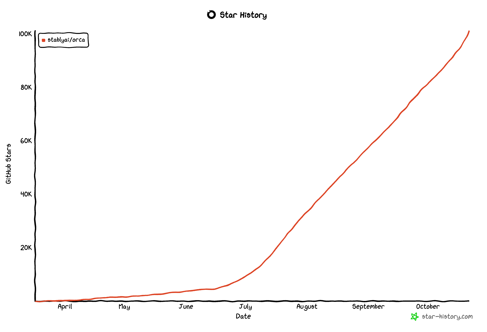

<h1 align="center">
  <a href="https://onOrca.dev"></a> Orca
</h1>

<p align="center">
  <a href="https://github.com/stablyai/orca"></a>
  <a href="https://github.com/stablyai/orca/releases"></a>
  
  <a href="https://discord.gg/fzjDKHxv8Q"></a>
  <a href="https://x.com/orca_build"></a>
  
</p>

<p align="center">
  <sub><a href="../../README.md">English</a> · <a href="README.zh-CN.md">中文</a> · <a href="README.ja.md">日本語</a> · <a href="README.ko.md">한국어</a> · <a href="README.es.md">Español</a> · <a href="README.fr.md">Français</a> · <a href="README.pt.md">Português</a> · <a href="README.tr.md">Türkçe</a></sub>
</p>

<p align="center">
  <strong>Оркестратор ИИ для тех, кто создаёт в 100 раз больше.</strong><br/>
  Запускайте Codex, ClaudeCode, OpenCode или Pi параллельно — каждый в своём рабочем дереве, все под контролем в одном месте.
</p>

<h3 align="center"><a href="https://onorca.dev/download"><ins>Скачать Orca</ins></a></h3>

<p align="center">
  
</p>

## Возможности

<table>
<tr>
<td width="50%" valign="middle">

### Мобильное приложение

Следите за агентами и направляйте их работу с телефона — получайте уведомления о завершении задач и отправляйте дополнительные указания откуда угодно.

[App Store для iOS](https://apps.apple.com/us/app/orca-ide/id6766130217) · [APK для Android](https://www.onorca.dev/download/android) · [Документация →](https://www.onorca.dev/docs/mobile)

</td>
<td width="50%">
  <a href="https://www.onorca.dev/docs/mobile"><picture><source srcset="../assets/feature-wall/mobile-companion-app-showcase.gif" type="image/gif"></picture></a>
</td>
</tr>
<tr>
<td width="50%" valign="middle">

### Параллельные рабочие деревья

Отправьте один запрос пяти агентам, каждый из которых работает в своём изолированном рабочем дереве Git, — сравните результаты и слейте лучший вариант.

[Документация →](https://www.onorca.dev/docs/model/worktrees)

</td>
<td width="50%">
  <a href="https://www.onorca.dev/docs/model/worktrees"><picture><source srcset="../site/public/docs/tab-split.gif" type="image/gif"></picture></a>
</td>
</tr>
<tr>
<td width="50%" valign="middle">

### Разделение терминала

Терминалы уровня Ghostty с отрисовкой через WebGL, неограниченным разделением на панели и историей вывода, которая сохраняется после перезапуска.

[Документация →](https://www.onorca.dev/docs/terminal)

</td>
<td width="50%">
  <a href="https://www.onorca.dev/docs/terminal"><picture><source srcset="../../resources/onboarding/feature-wall/tile-02.webp" type="image/webp"></picture></a>
</td>
</tr>
<tr>
<td width="50%" valign="middle">

### Режим дизайна

Нажмите на любой элемент интерфейса в настоящем окне Chromium, чтобы отправить его HTML, CSS и снимок соответствующей области экрана прямо в запрос агенту.

[Документация →](https://www.onorca.dev/docs/browser/design-mode)

</td>
<td width="50%">
  <a href="https://www.onorca.dev/docs/browser/design-mode"><picture><source srcset="../site/public/docs/orca-design-mode.gif" type="image/gif"></picture></a>
</td>
</tr>
<tr>
<td width="50%" valign="middle">

### Встроенная поддержка GitHub и Linear

Просматривайте пул-реквесты, задачи и доски проектов прямо в приложении — открывайте рабочее дерево из любой задачи и проверяйте код, не переключая контекст.

[Документация →](https://www.onorca.dev/docs/review/linear)

</td>
<td width="50%">
  <a href="https://www.onorca.dev/docs/review/linear"><picture><source srcset="../../resources/onboarding/feature-wall/tile-03.webp" type="image/webp"></picture></a>
</td>
</tr>
<tr>
<td width="50%" valign="middle">

### Рабочие деревья по SSH

Запускайте агентов на мощном удалённом сервере с полноценным редактированием файлов, работой с Git и терминалами — автоматическое переподключение и перенаправление портов уже предусмотрены.

[Документация →](https://www.onorca.dev/docs/ssh)

</td>
<td width="50%">
  <a href="https://www.onorca.dev/docs/ssh"><picture><source srcset="../../resources/onboarding/feature-wall/tile-06.webp" type="image/webp"></picture></a>
</td>
</tr>
<tr>
<td width="50%" valign="middle">

### Комментарии к изменениям ИИ

Оставляйте комментарии к любой строке в сравнении и отправляйте их агенту — проверяйте и редактируйте код, создавайте коммиты, не выходя из Orca.

[Документация →](https://www.onorca.dev/docs/review/annotate-ai-diff)

</td>
<td width="50%">
  <a href="https://www.onorca.dev/docs/review/annotate-ai-diff"><picture><source srcset="../site/public/docs/annotate-ai-diff.gif" type="image/gif"></picture></a>
</td>
</tr>
<tr>
<td width="50%" valign="middle">

### Перетаскивание файлов в запросы агентов

Редактор VS Code с автоматическим сохранением всех изменений — перетаскивайте файлы или изображения прямо в запрос агенту.

[Документация →](https://www.onorca.dev/docs/editing/file-explorer)

</td>
<td width="50%">
  <a href="https://www.onorca.dev/docs/editing/file-explorer"><picture><source srcset="../../resources/onboarding/feature-wall/tile-07.gif" type="image/gif"></picture></a>
</td>
</tr>
<tr>
<td width="50%" valign="middle">

### Orca CLI

Агенты тоже управляют Orca — автоматизируйте любые рабочие процессы с помощью `orca worktree create`, `snapshot`, `click` и `fill`.

[Документация →](https://www.onorca.dev/docs/cli/overview)

</td>
<td width="50%">
  <a href="https://www.onorca.dev/docs/cli/overview"><picture><source srcset="../../resources/onboarding/feature-wall/tile-09.webp" type="image/webp"></picture></a>
</td>
</tr>
</table>

**А ещё:**

- **[Быстрое открытие](https://www.onorca.dev/docs/model/quick-open)** — Ищите рабочие деревья, файлы, агентов, команды и контекст репозитория, не прерывая работу.
- **[Переключение учётных записей и учёт использования](https://www.onorca.dev/docs/agents/usage-tracking)** — Следите за использованием Claude и Codex и временем сброса лимитов, переключайтесь между учётными записями без повторного входа.
- **[Предпросмотр содержимого репозитория](https://www.onorca.dev/docs/editing/markdown)** — Просматривайте Markdown, изображения, PDF и документацию репозитория прямо в рабочем пространстве.
- **[Управление компьютером](https://www.onorca.dev/docs/cli/computer-use)** — Позвольте агентам управлять настольными приложениями и видимым интерфейсом, когда задача требует непосредственного взаимодействия.
- **[Уведомления и статус прочтения](https://www.onorca.dev/docs/notifications)** — Узнавайте, когда агент завершил работу или требует внимания, и отмечайте обсуждения как непрочитанные, чтобы вернуться к ним позже.
- **И многое, многое другое** — мы выпускаем обновления каждый день, поэтому этот список постоянно отстаёт. Актуальный список возможностей — в [журнале изменений](https://github.com/stablyai/orca/releases).

---

## Поддерживаемые агенты

Работает с **любым CLI-агентом** — если он запускается в терминале, то запустится и в Orca.

<p>
  <a href="https://docs.anthropic.com/claude/docs/claude-code"><kbd> Claude Code</kbd></a> &nbsp;
  <a href="https://github.com/openai/codex"><kbd> Codex</kbd></a> &nbsp;
  <a href="https://x.ai/cli"><kbd> Grok</kbd></a> &nbsp;
  <a href="https://cursor.com/cli"><kbd> Cursor</kbd></a> &nbsp;
  <a href="https://docs.github.com/en/copilot/how-tos/set-up/install-copilot-cli"><kbd> GitHub Copilot</kbd></a> &nbsp;
  <a href="https://dev.meta.ai/docs/muse-code"><kbd> Muse</kbd></a> &nbsp;
  <a href="https://deepseek-harness.github.io/deepseek-harness/"><kbd> DeepSeek Harness</kbd></a> &nbsp;
  <a href="https://zcode.z.ai/en/docs"><kbd> ZCode</kbd></a> &nbsp;
  <a href="https://opencode.ai/docs/cli/"><kbd> OpenCode</kbd></a> &nbsp;
  <a href="https://mimo.xiaomi.com/coder"><kbd> MiMo Code</kbd></a> &nbsp;
  <a href="https://ampcode.com/manual#install"><kbd> Amp</kbd></a> &nbsp;
  <a href="https://openclaude.gitlawb.com/"><kbd> OpenClaude</kbd></a> &nbsp;
  <a href="https://antigravity.google/docs/cli-overview"><kbd> Antigravity</kbd></a> &nbsp;
  <a href="https://pi.dev"><kbd> Pi</kbd></a> &nbsp;
  <a href="https://omp.sh"><kbd> oh-my-pi</kbd></a> &nbsp;
  <a href="https://hermes-agent.nousresearch.com/docs/"><kbd> Hermes Agent</kbd></a> &nbsp;
  <a href="https://devin.ai/cli"><kbd> Devin</kbd></a> &nbsp;
  <a href="https://goose-docs.ai/docs/quickstart/"><kbd> Goose</kbd></a> &nbsp;
  <a href="https://docs.augmentcode.com/cli/overview"><kbd> Auggie</kbd></a> &nbsp;
  <a href="https://github.com/autohandai/code-cli"><kbd> Autohand Code</kbd></a> &nbsp;
  <a href="https://github.com/charmbracelet/crush"><kbd> Charm</kbd></a> &nbsp;
  <a href="https://docs.cline.bot/cline-cli/overview"><kbd> Cline</kbd></a> &nbsp;
  <a href="https://www.codebuddy.ai/cli"><kbd> CodeBuddy</kbd></a> &nbsp;
  <a href="https://www.codebuff.com/docs/help/quick-start"><kbd> Codebuff</kbd></a> &nbsp;
  <a href="https://freebuff.com"><kbd> Freebuff</kbd></a> &nbsp;
  <a href="https://commandcode.ai/docs/quickstart"><kbd> Command Code</kbd></a> &nbsp;
  <a href="https://docs.continue.dev/cli/quickstart"><kbd> Continue</kbd></a> &nbsp;
  <a href="https://docs.factory.ai/cli/getting-started/quickstart"><kbd> Droid</kbd></a> &nbsp;
  <a href="https://kilo.ai/docs/cli"><kbd> Kilocode</kbd></a> &nbsp;
  <a href="https://www.kimi.com/code/docs/en/kimi-code-cli/getting-started.html"><kbd> Kimi</kbd></a> &nbsp;
  <a href="https://kiro.dev/docs/cli/"><kbd> Kiro</kbd></a> &nbsp;
  <a href="https://github.com/mistralai/mistral-vibe"><kbd> Mistral Vibe</kbd></a> &nbsp;
  <a href="https://github.com/QwenLM/qwen-code"><kbd> Qwen Code</kbd></a> &nbsp;
  <a href="https://support.atlassian.com/rovo/docs/install-and-run-rovo-dev-cli-on-your-device/"><kbd> Rovo Dev</kbd></a> &nbsp;
  <kbd>+ любой CLI-агент</kbd>
</p>

---

## Установка

### Настольное приложение — macOS, Windows, Linux

- **[Скачать с onOrca.dev](https://onorca.dev/download)**
- Или скачайте сборку напрямую: [macOS Apple Silicon](https://github.com/stablyai/orca/releases/latest/download/orca-macos-arm64.dmg) · [macOS Intel](https://github.com/stablyai/orca/releases/latest/download/orca-macos-x64.dmg) · [Windows (.exe)](https://github.com/stablyai/orca/releases/latest/download/orca-windows-setup.exe) · [Linux AppImage](https://github.com/stablyai/orca/releases/latest/download/orca-linux.AppImage) · [Все сборки](https://github.com/stablyai/orca/releases/latest)

_Или через менеджер пакетов:_

```bash
# macOS (Homebrew)
# Always use the full name; bare `orca` is an unrelated Plotly cask.
brew install --cask stablyai/orca/orca
# Upgrade an existing install
brew upgrade --cask stablyai/orca/orca

# Arch Linux (AUR) — or stably-orca-git to build from source
yay -S stably-orca-bin
```

### Мобильное приложение — iOS, Android

Подключите его к настольному приложению, чтобы следить за агентами и направлять их работу с телефона.

- **iOS:** [Скачать в App Store](https://apps.apple.com/us/app/orca-ide/id6766130217)
- **Android:** [Скачать APK](https://www.onorca.dev/download/android) · [Руководство по установке](https://www.onorca.dev/docs/android-apk)

---

## Сообщество и поддержка

- **Discord:** Присоединяйтесь к сообществу в **[Discord](https://discord.gg/fzjDKHxv8Q)**.
- **Twitter / X:** Подпишитесь на **[@orca_build](https://x.com/orca_build)**, чтобы узнавать об обновлениях и анонсах.
- **WeChat:** Группа № 12 заполнена. Отсканируйте QR-код, чтобы присоединиться к группе № 13 сообщества Orca в WeChat.

  

- **Отзывы и идеи:** Мы быстро выпускаем обновления. Чего-то не хватает? [Предложите новую возможность](https://github.com/stablyai/orca/issues).
- **Конфиденциальность:** В [документации о конфиденциальности и телеметрии](https://www.onorca.dev/docs/telemetry) описано, какие анонимные данные об использовании собирает Orca и как отказаться от их сбора.
- **Поддержите проект:** Отметьте этот репозиторий [звездой](https://github.com/stablyai/orca), чтобы следить за нашими ежедневными выпусками.

---

## Разработка

Хотите внести вклад в проект или запустить его локально? Загляните в наше руководство [CONTRIBUTING.md](../../.github/CONTRIBUTING.md).

Сервис-посредник для подключения мобильного приложения к компьютеру тоже находится в этом репозитории —
в [`cloud/`](../../cloud/README.md), с отдельным рабочим пространством pnpm и руководством по настройке.

<a href="https://github.com/stablyai/orca/graphs/contributors">
  
</a>

<p align="center">
  
</p>

## Подписанные сборки

Подписание кода для Windows спонсирует и обеспечивает [SignPath.io](https://signpath.io), сертификат предоставляет [SignPath Foundation](https://signpath.org).

## Лицензия

Orca — бесплатное ПО с открытым исходным кодом под [лицензией MIT](../../LICENSE).
