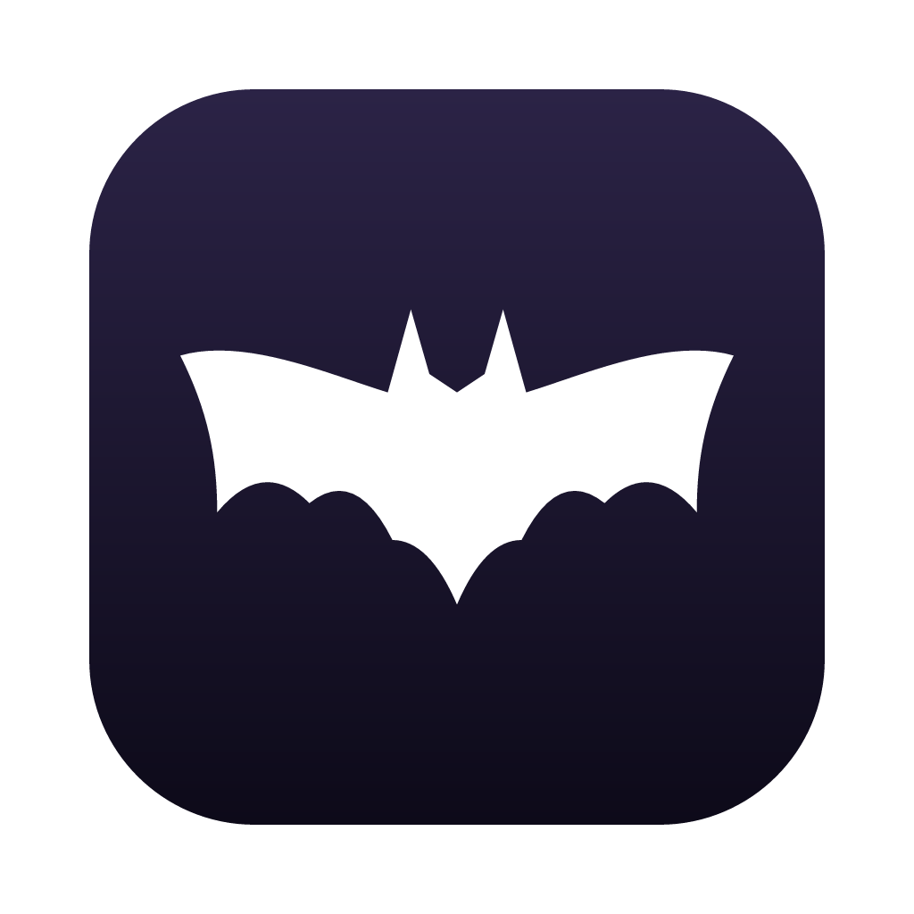
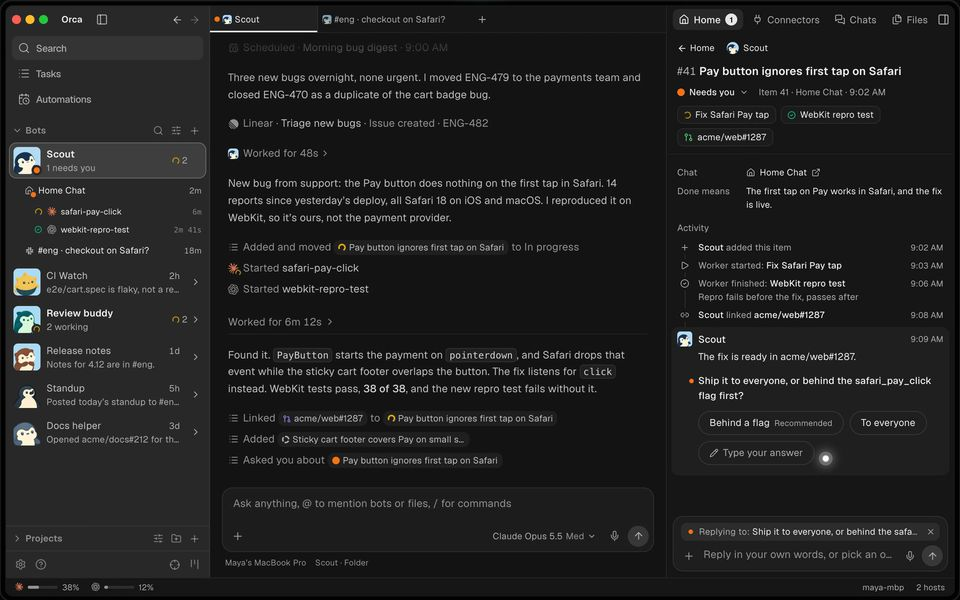
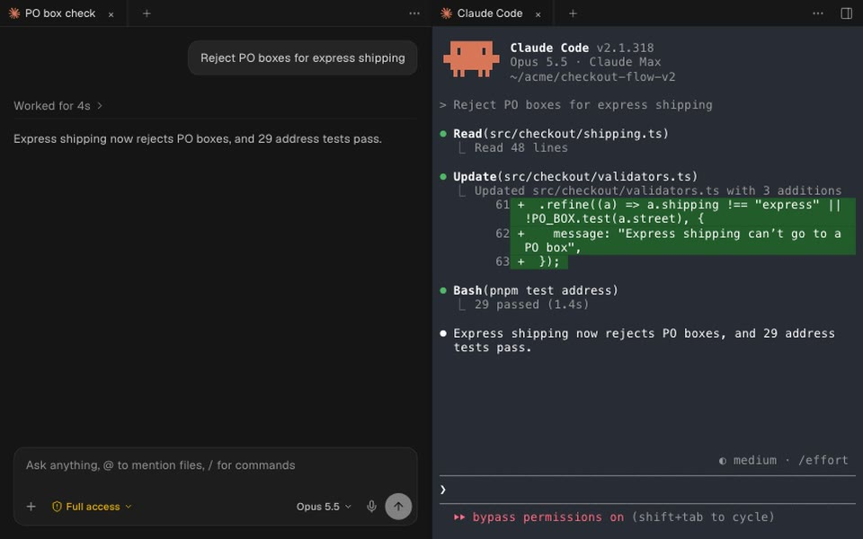
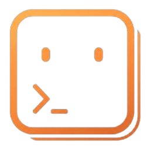
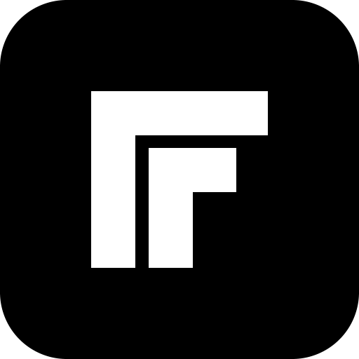
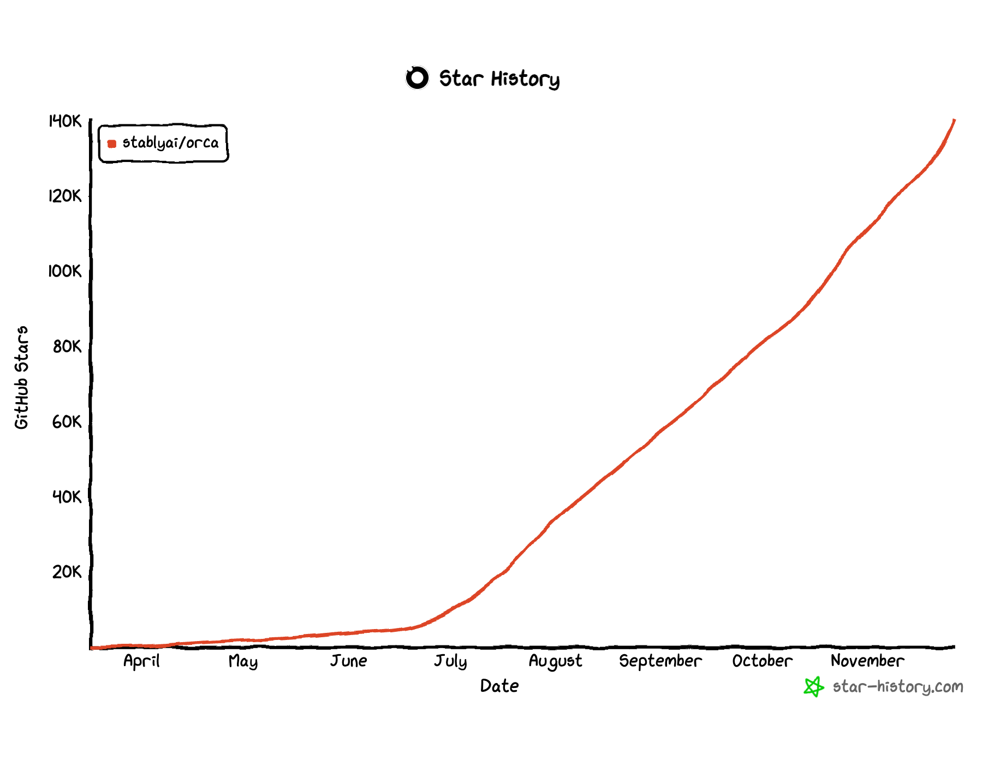

<h1 align="center">
  <a href="https://orca.dev"></a> Orca
</h1>

<p align="center">
  <a href="https://github.com/stablyai/orca"></a>
  <a href="https://github.com/stablyai/orca/releases"></a>
  
  <a href="https://discord.gg/fzjDKHxv8Q"></a>
  <a href="https://x.com/orca_build"></a>
  
</p>

<p align="center">
  <sub><a href="../../README.md">English</a> · <a href="README.zh-CN.md">中文</a> · <a href="README.ja.md">日本語</a> · <a href="README.ko.md">한국어</a> · <a href="README.es.md">Español</a> · <a href="README.fr.md">Français</a> · <a href="README.pt.md">Português</a> · <a href="README.tr.md">Türkçe</a> · <a href="README.ru.md">Русский</a></sub>
</p>

<h2 align="center">บอตใน Agent IDE ของคุณ</h2>

<p align="center">
  โอเพ่นซอร์ส ใช้งานทุกอย่างของคุณเอง: Claude Code หรือ Codex ของคุณ, เครื่องโลคอลหรือรีโมตของคุณ, เครื่องมือของคุณ สั่งงานได้จาก Slack หรือมือถือของคุณ เมื่อบอตต้องการความช่วยเหลือ อยู่ห่างไปเพียงแท็บเดียว
</p>

<h3 align="center"><a href="https://orca.dev/download"><ins>ดาวน์โหลด Orca</ins></a> &nbsp;·&nbsp; <a href="https://orca.dev/bots"><ins>สำรวจบอต →</ins></a></h3>

<p align="center">
  
</p>

## ฟีเจอร์

<table>
<tr>
<td width="50%" valign="middle">

### Orca Bots

สั่งให้บอตใน Slack, Linear หรือ GitHub แก้บั๊ก แล้วกลับมารับ Pull Request ที่ผ่านการทดสอบแล้ว รันบน Claude Code หรือ Codex ของคุณเอง เปิดดูผลงานใน Orca เพื่อรีวิวหรือเข้ามาช่วยเหลือได้ทันที

[ภาพรวม](https://orca.dev/bots) · [ความปลอดภัย](https://orca.dev/docs/bots/security) · [เอกสาร →](https://orca.dev/docs/bots)

</td>
<td width="50%">
  <a href="https://orca.dev/bots"><picture><source srcset="../assets/readme-features/bots.webp" type="image/webp"></picture></a>
</td>
</tr>
<tr>
<td width="50%" valign="middle">

### Chat หรือ Terminal

รัน Agent ใดก็ได้ใน Chat UI หรือเป็น CLI ดั้งเดิม และสลับการสนทนาระหว่างทั้งสองแบบได้โดยไม่สูญเสียบริบท

[เอกสาร →](https://orca.dev/docs/agents/native-chat)

</td>
<td width="50%">
  <a href="https://orca.dev/docs/agents/native-chat"><picture><source srcset="../assets/readme-features/chat-or-terminal.webp" type="image/webp"></picture></a>
</td>
</tr>
<tr>
<td width="50%" valign="middle">

### Orchestrate Agents

ส่งงานใหญ่ให้ Agent ตัวเดียว มันจะแบ่งงาน เริ่มต้น Worker Agent ในเวิร์กสเปซของตัวเอง และรวบรวมผลลัพธ์กลับมาให้คุณ

[เอกสาร →](https://orca.dev/docs/cli/orchestration)

</td>
<td width="50%">
  <a href="https://orca.dev/docs/cli/orchestration"><picture><source srcset="../assets/readme-features/orchestration.webp" type="image/webp"></picture></a>
</td>
</tr>
<tr>
<td width="50%" valign="middle">

### รันได้ทุกที่

จับคู่กับ Remote Orca Server, ทำงานบนโฮสต์ SSH ใดก็ได้, หรือให้ Worktree มีคลาวด์ VM ของตัวเอง Agent ของคุณจะทำงานต่อไปแม้โน้ตบุ๊กจะพักเครื่อง

[เอกสาร →](https://orca.dev/docs/ways-to-run)

</td>
<td width="50%">
  <a href="https://orca.dev/docs/ways-to-run"><picture><source srcset="../assets/readme-features/remote.webp" type="image/webp"></picture></a>
</td>
</tr>
<tr>
<td width="50%" valign="middle">

### แอปมือถือ

จับคู่ Orca กับแอปบนมือถือเพื่อรับการแจ้งเตือนเมื่อ Agent ต้องการคุณ ตอบกลับในแชท และขับเคลื่อนงานบนเครื่องใดก็ได้เมื่อคุณไม่อยู่ที่โต๊ะทำงาน

[iOS App Store](https://apps.apple.com/us/app/orca-ide/id6766130217) · [Google Play](https://play.google.com/store/apps/details?id=dev.orca.app) · [Android APK](https://orca.dev/download/android) · [เอกสาร →](https://orca.dev/docs/mobile)

</td>
<td width="50%">
  <a href="https://orca.dev/docs/mobile"><picture><source srcset="../assets/readme-features/mobile-companion.webp" type="image/webp"></picture></a>
</td>
</tr>
<tr>
<td width="50%" valign="middle">

### ตรวจสอบผลลัพธ์ของ AI

รีวิว Diff, ใส่โน้ตบนบรรทัดที่เปลี่ยนแปลงได้อย่างแม่นยำ และส่งคำแนะนำที่ตรงจุดกลับไปยัง Agent

[เอกสาร →](https://orca.dev/docs/review/annotate-ai-diff)

</td>
<td width="50%">
  <a href="https://orca.dev/docs/review/annotate-ai-diff"><picture><source srcset="../assets/readme-features/annotate-ai-diffs.webp" type="image/webp"></picture></a>
</td>
</tr>
<tr>
<td width="50%" valign="middle">

### การผสานรวม Git

ร่างข้อความคอมมิตและ Pull Request จาก Diff จากนั้นส่งการตรวจสอบที่ล้มเหลวหรือความคิดเห็นรีวิว PR กลับไปให้ Agent แก้ไข

[เอกสาร →](https://orca.dev/docs/review/commit-push)

</td>
<td width="50%">
  <a href="https://orca.dev/docs/review/commit-push"><picture><source srcset="../assets/readme-features/git-integration.webp" type="image/webp"></picture></a>
</td>
</tr>
<tr>
<td width="50%" valign="middle">

### Parallel Worktrees

แยกงานออกเป็นสภาพแวดล้อมที่แยกจากกันอย่างรวดเร็ว เพื่อให้ Agent หลายตัวทำงานเคียงข้างกันได้โดยไม่รบกวนกัน

[เอกสาร →](https://orca.dev/docs/model/worktrees)

</td>
<td width="50%">
  <a href="https://orca.dev/docs/model/worktrees"><picture><source srcset="../assets/readme-features/parallel-worktrees.webp" type="image/webp"></picture></a>
</td>
</tr>
<tr>
<td width="50%" valign="middle">

### Design Mode

คลิกองค์ประกอบใดๆ ในเบราว์เซอร์ของ Orca เพื่อคัดลอก HTML, สไตล์ และซีเล็กเตอร์ แล้วนำไปวางในแชทของ Agent ได้ทันที

[เอกสาร →](https://orca.dev/docs/browser/design-mode)

</td>
<td width="50%">
  <a href="https://orca.dev/docs/browser/design-mode"><picture><source srcset="../assets/readme-features/design-mode.webp" type="image/webp"></picture></a>
</td>
</tr>
<tr>
<td width="50%" valign="middle">

### GitHub &amp; Linear แบบเนทีฟ

ดูงาน GitHub และ Linear ของคุณในที่เดียว และเปิดเวิร์กสเปซสำหรับแต่ละงานเมื่อคุณพร้อมที่จะลงมือสร้าง

[เอกสาร →](https://orca.dev/docs/review/linear)

</td>
<td width="50%">
  <a href="https://orca.dev/docs/review/linear"><picture><source srcset="../assets/readme-features/github-linear-tasks.webp" type="image/webp"></picture></a>
</td>
</tr>
<tr>
<td width="50%" valign="middle">

### Orca CLI

ทุกสิ่งที่คุณทำได้ใน Orca ตัว Agent ก็ทำได้เช่นกัน: สร้าง Worktree, เริ่มต้น Worker, ควบคุมเบราว์เซอร์และแอปเดสก์ท็อป รวมถึงตั้งเวลาทำงานอัตโนมัติ ทั้งหมดนี้สั่งการได้จากบรรทัดคำสั่ง (CLI)

[เอกสาร →](https://orca.dev/docs/cli/overview)

</td>
<td width="50%">
  <a href="https://orca.dev/docs/cli/overview"><picture><source srcset="../assets/readme-features/orca-cli.webp" type="image/webp"></picture></a>
</td>
</tr>
<tr>
<td width="50%" valign="middle">

### ปลั๊กอิน

ธีม, ตัวแก้ไขโค้ด, ภาษา และแผงควบคุมจากชุมชน ติดตั้งได้ในคลิกเดียว

[ดูปลั๊กอินทั้งหมด →](https://orca.dev/plugins)

</td>
<td width="50%">
  <a href="https://orca.dev/plugins"><picture><source srcset="../assets/readme-features/plugins.webp" type="image/webp"></picture></a>
</td>
</tr>
<tr>
<td width="50%" valign="middle">

### แบ่งหน้าจอได้ทุกอย่าง

วาง Agent, เทอร์มินัล, เบราว์เซอร์ และ Diff เคียงข้างกันในหน้าต่างแยกตามความเหมาะสมของงาน

[เอกสาร →](https://orca.dev/docs/model/tabs-panes-splits)

</td>
<td width="50%">
  <a href="https://orca.dev/docs/model/tabs-panes-splits"><picture><source srcset="../assets/readme-features/split-anything.webp" type="image/webp"></picture></a>
</td>
</tr>
</table>

**สิ่งอื่นๆ ที่มาพร้อมกัน:**

- **[กำหนดการและทริกเกอร์บอต](https://orca.dev/docs/bots#put-it-on-a-schedule)**: รันบอตทุกวันธรรมดาเวลา 9:00 น. หรือเมื่อมี Pull Request เปิดขึ้น, การตรวจสอบล้มเหลว, หรือ Webhook ถูกเรียก
- **[ความจำบอตในรูปแบบ Markdown](https://orca.dev/docs/bots/security#what-you-can-review)**: จิตวิญญาณและความจำของบอตเป็นไฟล์ Markdown ธรรมดา (`SOUL.md`, `MEMORY.md`) ที่คุณสามารถอ่านและแก้ไขได้
- **[ลากไฟล์ไปยัง Agent](https://orca.dev/docs/editing/file-explorer)**: ลากไฟล์จาก File Explorer หรือรูปภาพจากเดสก์ท็อปของคุณไปยังพรอมต์ของ Agent ได้โดยตรง
- **[กระโดดไปทุกที่อย่างรวดเร็ว](https://orca.dev/docs/model/quick-open)**: คีย์ลัดเดียวสามารถข้ามไปยังเวิร์กสเปซหรือแท็บใดก็ได้ในทุกที่เก็บโค้ดและโฮสต์
- **[การแสดงตัวอย่างแบบสมบูรณ์](https://orca.dev/docs/editing/viewers)**: เปิดดูรูปภาพ, PDF และ Markdown ได้ในเวิร์กสเปซ ข้างๆ กับ Agent ที่สร้างพวกมันขึ้นมา
- **[ตัวจำลองมือถือ](https://orca.dev/docs/cli/overview#mobile-emulator)**: รัน iOS Simulator หรือตัวจำลอง Android ข้างๆ Agent ของคุณ และปล่อยให้มันแตะ พิมพ์ และตรวจสอบงานของตัวเอง
- **[การพิมพ์ด้วยเสียง (Dictation)](https://orca.dev/docs/settings#voice)**: กดคีย์ลัดแล้วพูด Orca จะพิมพ์สิ่งที่คุณพูดลงในพรอมต์ของ Agent หรือเทอร์มินัล
- **[การใช้งานและบัญชี](https://orca.dev/docs/agents/usage-tracking)**: ดูว่าคุณใช้ขีดจำกัดของ Agent ไปเท่าใดและจะรีเซ็ตเมื่อใด รวมถึงสลับบัญชีได้โดยไม่ต้องออกจากระบบ
- **[ระบบอัตโนมัติ (Automations)](https://orca.dev/docs/cli/automations)**: กำหนดเวลาพรอมต์ให้รันบนที่เก็บโค้ดใดก็ได้: อัปเกรด Dependencies ยามค่ำคืน, คัดแยกประเด็นประจำสัปดาห์, หรือกวาดการทดสอบที่ทำงานไม่สม่ำเสมอ
- **[Computer Use](https://orca.dev/docs/cli/computer-use)**: เมื่อไม่มี CLI หรือ API ทาง Agent สามารถมองเห็นและควบคุมแอปเดสก์ท็อปและเบราว์เซอร์ภายนอกได้
- **และอื่นๆ อีกมากมาย**: เราจัดส่งฟีเจอร์ใหม่ทุกวัน รายการนี้จึงอัปเดตไม่ทันเสมอ สามารถดูฟีเจอร์ล่าสุดที่แท้จริงได้ที่ [Changelog](https://github.com/stablyai/orca/releases)

---

## Agent ที่รองรับ

ทำงานร่วมกับ **CLI Agent ใดก็ได้** — หากรันในเทอร์มินัลได้ ก็รันใน Orca ได้

<p>
  <a href="https://docs.anthropic.com/claude/docs/claude-code"><kbd> Claude Code</kbd></a> &nbsp;
  <a href="https://github.com/openai/codex"><kbd> Codex</kbd></a> &nbsp;
  <a href="https://x.ai/cli"><kbd> Grok</kbd></a> &nbsp;
  <a href="https://cursor.com/cli"><kbd> Cursor</kbd></a> &nbsp;
  <a href="https://docs.github.com/en/copilot/how-tos/set-up/install-copilot-cli"><kbd> GitHub Copilot</kbd></a> &nbsp;
  <a href="https://dev.meta.ai/docs/muse-code"><kbd> Muse</kbd></a> &nbsp;
  <a href="https://deepseek-harness.github.io/deepseek-harness/"><kbd> DeepSeek Harness</kbd></a> &nbsp;
  <a href="https://zcode.z.ai/en/docs"><kbd> ZCode</kbd></a> &nbsp;
  <a href="https://opencode.ai/docs/cli/"><kbd> OpenCode</kbd></a> &nbsp;
  <a href="https://mimo.xiaomi.com/coder"><kbd> MiMo Code</kbd></a> &nbsp;
  <a href="https://ampcode.com/manual#install"><kbd> Amp</kbd></a> &nbsp;
  <a href="https://openclaude.gitlawb.com/"><kbd> OpenClaude</kbd></a> &nbsp;
  <a href="https://antigravity.google/docs/cli-overview"><kbd> Antigravity</kbd></a> &nbsp;
  <a href="https://pi.dev"><kbd> Pi</kbd></a> &nbsp;
  <a href="https://omp.sh"><kbd> oh-my-pi</kbd></a> &nbsp;
  <a href="https://hermes-agent.nousresearch.com/docs/"><kbd> Hermes Agent</kbd></a> &nbsp;
  <a href="https://devin.ai/cli"><kbd> Devin</kbd></a> &nbsp;
  <a href="https://goose-docs.ai/docs/quickstart/"><kbd> Goose</kbd></a> &nbsp;
  <a href="https://docs.augmentcode.com/cli/overview"><kbd> Auggie</kbd></a> &nbsp;
  <a href="https://github.com/autohandai/code-cli"><kbd> Autohand Code</kbd></a> &nbsp;
  <a href="https://github.com/charmbracelet/crush"><kbd> Charm</kbd></a> &nbsp;
  <a href="https://docs.cline.bot/cline-cli/overview"><kbd> Cline</kbd></a> &nbsp;
  <a href="https://www.codebuddy.ai/cli"><kbd> CodeBuddy</kbd></a> &nbsp;
  <a href="https://www.codebuff.com/docs/help/quick-start"><kbd> Codebuff</kbd></a> &nbsp;
  <a href="https://freebuff.com"><kbd> Freebuff</kbd></a> &nbsp;
  <a href="https://commandcode.ai/docs/quickstart"><kbd> Command Code</kbd></a> &nbsp;
  <a href="https://docs.continue.dev/cli/quickstart"><kbd> Continue</kbd></a> &nbsp;
  <a href="https://docs.factory.ai/cli/getting-started/quickstart"><kbd> Droid</kbd></a> &nbsp;
  <a href="https://kilo.ai/docs/cli"><kbd> Kilocode</kbd></a> &nbsp;
  <a href="https://www.kimi.com/code/docs/en/kimi-code-cli/getting-started.html"><kbd> Kimi</kbd></a> &nbsp;
  <a href="https://kiro.dev/docs/cli/"><kbd> Kiro</kbd></a> &nbsp;
  <a href="https://github.com/mistralai/mistral-vibe"><kbd> Mistral Vibe</kbd></a> &nbsp;
  <a href="https://github.com/QwenLM/qwen-code"><kbd> Qwen Code</kbd></a> &nbsp;
  <a href="https://support.atlassian.com/rovo/docs/install-and-run-rovo-dev-cli-on-your-device/"><kbd> Rovo Dev</kbd></a> &nbsp;
  <kbd>+ CLI agent ใดๆ</kbd>
</p>

---

## การติดตั้ง

### เดสก์ท็อป — macOS, Windows, Linux

- **[ดาวน์โหลดจาก orca.dev](https://orca.dev/download)**
- หรือดาวน์โหลดไฟล์ติดตั้งโดยตรง: [macOS Apple Silicon](https://github.com/stablyai/orca/releases/latest/download/orca-macos-arm64.dmg) · [macOS Intel](https://github.com/stablyai/orca/releases/latest/download/orca-macos-x64.dmg) · [Windows (.exe)](https://github.com/stablyai/orca/releases/latest/download/orca-windows-setup.exe) · [Linux AppImage](https://github.com/stablyai/orca/releases/latest/download/orca-linux.AppImage) · [ทุกรุ่นที่พร้อมให้ดาวน์โหลด](https://github.com/stablyai/orca/releases/latest)

_หรือผ่านระบบจัดการแพ็กเกจ (Package Manager):_

```bash
# macOS (Homebrew)
# ใช้ชื่อเต็มเสมอ เนื่องจาก `orca` โดดๆ เป็น Cask อื่นของ Plotly
brew install --cask stablyai/orca/orca
# อัปเกรดเวอร์ชันเดิมที่ติดตั้งไว้
brew upgrade --cask stablyai/orca/orca
# รุ่น Release candidate (อาจขัดแย้งกับ Stable cask; ควรถอนการติดตั้งเดิมก่อน)
brew install --cask stablyai/orca/orca@rc

# Arch Linux (AUR) — หรือใช้ stably-orca-git เพื่อคอมไพล์จากซอร์สโค้ด
yay -S stably-orca-bin
```

### แอปมือถือ — iOS, Android

จับคู่กับแอปเดสก์ท็อปเพื่อติดตามและสั่งการ Agent จากโทรศัพท์ของคุณ

- **iOS:** [ดาวน์โหลดบน App Store](https://apps.apple.com/us/app/orca-ide/id6766130217)
- **Android:** [Google Play](https://play.google.com/store/apps/details?id=dev.orca.app) · [ดาวน์โหลด APK](https://orca.dev/download/android) · [คู่มือการติดตั้ง](https://orca.dev/docs/android-apk)

---

## ชุมชนและการสนับสนุน

- **Discord:** เข้าร่วมชุมชนบน **[Discord](https://discord.gg/fzjDKHxv8Q)**
- **Twitter / X:** ติดตาม **[@orca_build](https://x.com/orca_build)** เพื่อรับข่าวสารและการประกาศอัปเดต
- **WeChat:** สแกนเพื่อเข้าร่วมกลุ่ม WeChat ของชุมชน Orca

  

- **ข้อเสนอแนะและไอเดีย:** เราปล่อยของอย่างรวดเร็ว ขาดฟีเจอร์ใดอยู่หรือไม่? [ขอฟีเจอร์ใหม่](https://github.com/stablyai/orca/issues)
- **ความเป็นส่วนตัว:** ดูเอกสาร [ความเป็นส่วนตัวและ Telemetry](https://orca.dev/docs/telemetry) เพื่อดูข้อมูลการใช้งานแบบไม่ระบุตัวตนที่ Orca เก็บรวบรวมและวิธีเลือกไม่เข้าร่วม
- **สนับสนุนเรา:** ให้ [Star](https://github.com/stablyai/orca) กับที่เก็บโค้ดนี้เพื่อติดตามการอัปเดตรายวันของเรา

---

## การพัฒนา

ต้องการมีส่วนร่วมในการพัฒนาหรือรันแบบโลคอล? ดูคู่มือ [CONTRIBUTING.md](../../.github/CONTRIBUTING.md) ของเรา

<a href="https://github.com/stablyai/orca/graphs/contributors">
  
</a>

<p align="center">
  
</p>

## Signed Builds

การลงนามรหัสสำหรับ Windows ได้รับการสนับสนุนโดย [SignPath.io](https://signpath.io), ใบรับรองโดย [SignPath Foundation](https://signpath.org)

## ใบอนุญาต

Orca เป็นซอฟต์แวร์เสรีและโอเพ่นซอร์สภายใต้ [ใบอนุญาต MIT](https://github.com/stablyai/orca/blob/main/LICENSE)
