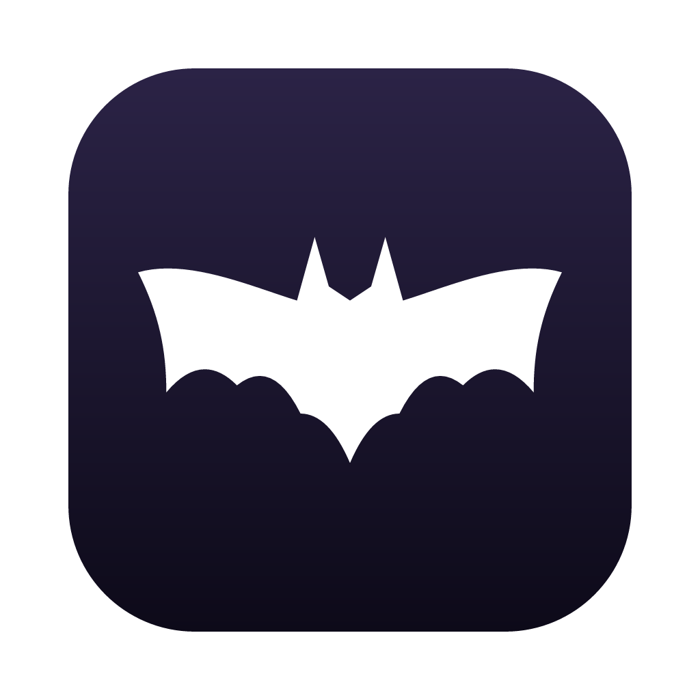
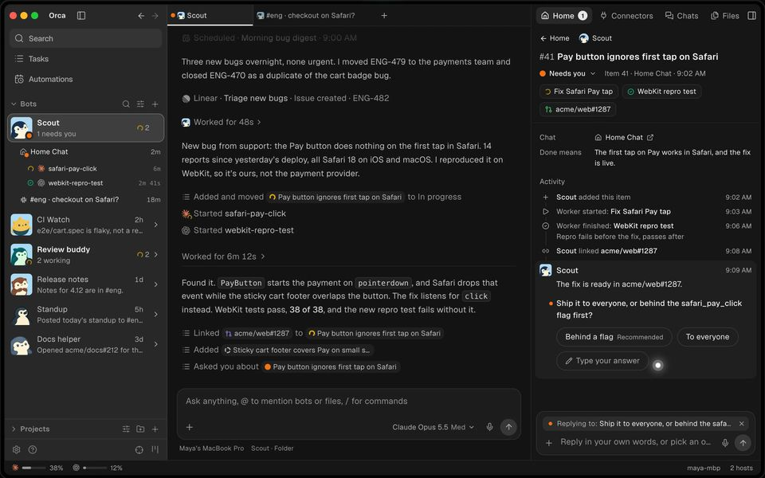
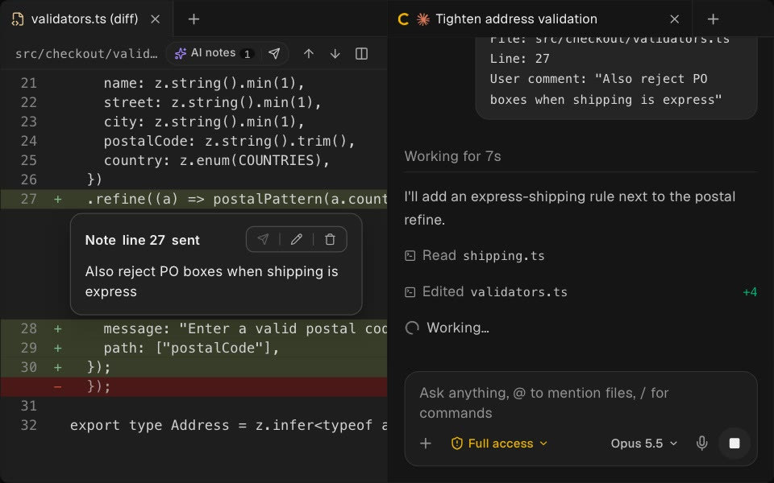
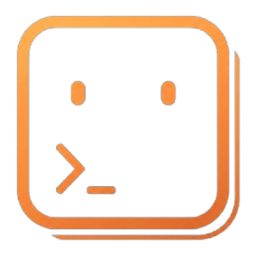
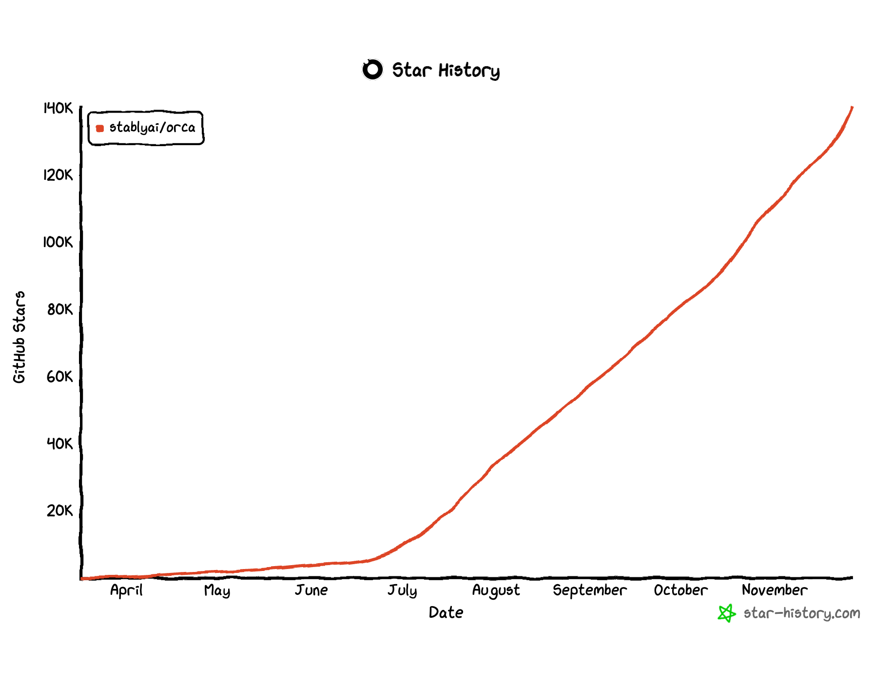

<h1 align="center">
  <a href="https://orca.dev"></a> Orca
</h1>

<p align="center">
  <a href="https://github.com/stablyai/orca"></a>
  <a href="https://github.com/stablyai/orca/releases"></a>
  
  <a href="https://discord.gg/fzjDKHxv8Q"></a>
  <a href="https://x.com/orca_build"></a>
  
</p>

<p align="center">
  <sub><a href="../../README.md">English</a> · <a href="README.zh-CN.md">中文</a> · <a href="README.ja.md">日本語</a> · <a href="README.ko.md">한국어</a> · <a href="README.es.md">Español</a> · <a href="README.fr.md">Français</a> · <a href="README.pt.md">Português</a> · <a href="README.tr.md">Türkçe</a> · <a href="README.ru.md">Русский</a></sub>
</p>

<h2 align="center">Bot ngay trong agent IDE của bạn.</h2>

<p align="center">
  Mã nguồn mở. Dùng đồ của bạn: Claude Code hoặc Codex của bạn, máy local hoặc remote của bạn, công cụ của bạn. Ra lệnh từ Slack hoặc điện thoại. Khi bot cần bạn, chỉ cách một tab.
</p>

<h3 align="center"><a href="https://orca.dev/download"><ins>Tải Orca</ins></a> &nbsp;·&nbsp; <a href="https://orca.dev/bots"><ins>Khám phá bot →</ins></a></h3>

<p align="center">
  
</p>

## Tính năng

<table>
<tr>
<td width="50%" valign="middle">

### Orca Bots

Nhờ một bot trong Slack, Linear hoặc GitHub sửa bug, rồi quay lại nhận một pull request đã test xong. Bot chạy trên Claude Code hoặc Codex của chính bạn. Mở kết quả trong Orca để review hoặc can thiệp.

[Tổng quan](https://orca.dev/bots) · [Bảo mật](https://orca.dev/docs/bots/security) · [Tài liệu →](https://orca.dev/docs/bots)

</td>
<td width="50%">
  <a href="https://orca.dev/bots"><picture><source srcset="../assets/readme-features/bots.webp" type="image/webp"></picture></a>
</td>
</tr>
<tr>
<td width="50%" valign="middle">

### Chat hoặc Terminal

Chạy mọi agent trong Chat UI hoặc CLI thuần, chuyển hội thoại qua lại mà không mất ngữ cảnh.

[Tài liệu →](https://orca.dev/docs/agents/native-chat)

</td>
<td width="50%">
  <a href="https://orca.dev/docs/agents/native-chat"><picture><source srcset="../assets/readme-features/chat-or-terminal.webp" type="image/webp"></picture></a>
</td>
</tr>
<tr>
<td width="50%" valign="middle">

### Điều phối agent

Giao việc lớn cho một agent. Nó chia việc, khởi chạy các worker agent trong workspace riêng, rồi tổng hợp kết quả về cho bạn.

[Tài liệu →](https://orca.dev/docs/cli/orchestration)

</td>
<td width="50%">
  <a href="https://orca.dev/docs/cli/orchestration"><picture><source srcset="../assets/readme-features/orchestration.webp" type="image/webp"></picture></a>
</td>
</tr>
<tr>
<td width="50%" valign="middle">

### Chạy ở bất cứ đâu

Ghép nối Remote Orca Server, làm việc trên mọi SSH host, hoặc cấp cho worktree một cloud VM riêng. Agent vẫn chạy khi laptop của bạn ngủ.

[Tài liệu →](https://orca.dev/docs/ways-to-run)

</td>
<td width="50%">
  <a href="https://orca.dev/docs/ways-to-run"><picture><source srcset="../assets/readme-features/remote.webp" type="image/webp"></picture></a>
</td>
</tr>
<tr>
<td width="50%" valign="middle">

### App mobile

Ghép nối Orca với app mobile để được báo khi agent cần bạn, trả lời trong chat và giữ công việc trôi trên mọi máy khi bạn rời bàn làm việc.

[iOS App Store](https://apps.apple.com/us/app/orca-ide/id6766130217) · [Google Play](https://play.google.com/store/apps/details?id=dev.orca.app) · [Android APK](https://orca.dev/download/android) · [Tài liệu →](https://orca.dev/docs/mobile)

</td>
<td width="50%">
  <a href="https://orca.dev/docs/mobile"><picture><source srcset="../assets/readme-features/mobile-companion.webp" type="image/webp"></picture></a>
</td>
</tr>
<tr>
<td width="50%" valign="middle">

### Review kết quả AI

Review diff, ghi chú ngay trên dòng đã đổi, và gửi phản hồi tập trung lại cho agent.

[Tài liệu →](https://orca.dev/docs/review/annotate-ai-diff)

</td>
<td width="50%">
  <a href="https://orca.dev/docs/review/annotate-ai-diff"><picture><source srcset="../assets/readme-features/annotate-ai-diffs.webp" type="image/webp"></picture></a>
</td>
</tr>
<tr>
<td width="50%" valign="middle">

### Tích hợp Git

Soạn commit message và pull request từ diff, rồi gửi check lỗi hoặc comment review PR lại cho agent sửa.

[Tài liệu →](https://orca.dev/docs/review/commit-push)

</td>
<td width="50%">
  <a href="https://orca.dev/docs/review/commit-push"><picture><source srcset="../assets/readme-features/git-integration.webp" type="image/webp"></picture></a>
</td>
</tr>
<tr>
<td width="50%" valign="middle">

### Worktree song song

Tách nhanh công việc vào các môi trường cô lập, để nhiều agent làm song song mà không ảnh hưởng nhau.

[Tài liệu →](https://orca.dev/docs/model/worktrees)

</td>
<td width="50%">
  <a href="https://orca.dev/docs/model/worktrees"><picture><source srcset="../assets/readme-features/parallel-worktrees.webp" type="image/webp"></picture></a>
</td>
</tr>
<tr>
<td width="50%" valign="middle">

### Design Mode

Nhấn vào bất kỳ phần tử nào trong trình duyệt của Orca để sao chép HTML, style và selector của nó, rồi dán vào chat của agent.

[Tài liệu →](https://orca.dev/docs/browser/design-mode)

</td>
<td width="50%">
  <a href="https://orca.dev/docs/browser/design-mode"><picture><source srcset="../assets/readme-features/design-mode.webp" type="image/webp"></picture></a>
</td>
</tr>
<tr>
<td width="50%" valign="middle">

### GitHub &amp; Linear, native

Xem việc GitHub và Linear ở một nơi, và mở workspace cho từng việc khi sẵn sàng làm.

[Tài liệu →](https://orca.dev/docs/review/adaptive)

</td>
<td width="50%">
  <a href="https://orca.dev/docs/review/adaptive"><picture><source srcset="../assets/readme-features/github-linear-tasks.webp" type="image/webp"></picture></a>
</td>
</tr>
<tr>
<td width="50%" valign="middle">

### Orca CLI

Bạn làm được gì trong Orca, agent cũng làm được: tạo worktree, khởi chạy worker, điều khiển trình duyệt và app desktop, lên lịch automation — tất cả từ dòng lệnh.

[Tài liệu →](https://orca.dev/docs/cli/overview)

</td>
<td width="50%">
  <a href="https://orca.dev/docs/cli/overview"><picture><source srcset="../assets/readme-features/orca-cli.webp" type="image/webp"></picture></a>
</td>
</tr>
<tr>
<td width="50%" valign="middle">

### Plugin

Theme, editor, ngôn ngữ và panel từ cộng đồng, cài trong một cú nhấn.

[Xem plugin →](https://orca.dev/plugins)

</td>
<td width="50%">
  <a href="https://orca.dev/plugins"><picture><source srcset="../assets/readme-features/plugins.webp" type="image/webp"></picture></a>
</td>
</tr>
<tr>
<td width="50%" valign="middle">

### Chia pane tùy ý

Đặt agent, terminal, trình duyệt và diff cạnh nhau trong các pane chia theo đúng công việc.

[Tài liệu →](https://orca.dev/docs/model/tabs-panes-splits)

</td>
<td width="50%">
  <a href="https://orca.dev/docs/model/tabs-panes-splits"><picture><source srcset="../assets/readme-features/split-anything.webp" type="image/webp"></picture></a>
</td>
</tr>
</table>

**Kèm theo sẵn:**

- **[Lịch &amp; trigger cho bot](https://orca.dev/docs/bots#put-it-on-a-schedule)**: chạy bot 9 giờ mỗi ngày làm việc, hoặc khi pull request mở, một check lỗi, hay webhook kích hoạt.
- **[Bộ nhớ bot bằng Markdown](https://orca.dev/docs/bots/security#what-you-can-review)**: soul và bộ nhớ của bot là file Markdown thuần (`SOUL.md`, `MEMORY.md`) — bạn đọc và sửa được.
- **[Kéo file cho agent](https://orca.dev/docs/editing/file-explorer)**: kéo file từ explorer, hoặc ảnh từ desktop, thẳng vào prompt của agent.
- **[Nhảy tới bất cứ đâu](https://orca.dev/docs/model/quick-open)**: một phím tắt nhảy tới mọi workspace hoặc tab trên mọi repo và host.
- **[Xem trước phong phú](https://orca.dev/docs/editing/viewers)**: mở ảnh, PDF và Markdown ngay trong workspace, cạnh agent đã tạo ra chúng.
- **[Mobile Emulator](https://orca.dev/docs/cli/overview#mobile-emulator)**: chạy iOS Simulator hoặc Android emulator cạnh agent, để nó tự chạm, gõ và kiểm tra công việc của mình.
- **[Đọc chính tả](https://orca.dev/docs/settings#voice)**: nhấn phím tắt và nói. Orca gõ lời bạn nói vào prompt của agent hoặc terminal.
- **[Mức dùng &amp; tài khoản](https://orca.dev/docs/agents/usage-tracking)**: xem đã dùng bao nhiêu hạn mức agent và khi nào reset, chuyển tài khoản không cần đăng xuất.
- **[Automation](https://orca.dev/docs/cli/automations)**: lên lịch prompt chạy trên mọi repo: nâng cấp dependency hằng đêm, triage hằng tuần, quét flaky test.
- **[Computer Use](https://orca.dev/docs/cli/computer-use)**: khi không có CLI hay API, agent xem và điều khiển được app desktop cùng trình duyệt ngoài.
- **Và còn rất nhiều nữa**: chúng tôi ship mỗi ngày nên danh sách này luôn chậm hơn thực tế. [Changelog](https://github.com/stablyai/orca/releases) mới là danh sách tính năng thật.

---

## Agent được hỗ trợ

Chạy với **mọi agent CLI** — chạy được trong terminal là chạy được trong Orca.

<p>
  <a href="https://docs.anthropic.com/claude/docs/claude-code"><kbd> Claude Code</kbd></a> &nbsp;
  <a href="https://github.com/openai/codex"><kbd> Codex</kbd></a> &nbsp;
  <a href="https://x.ai/cli"><kbd> Grok</kbd></a> &nbsp;
  <a href="https://cursor.com/cli"><kbd> Cursor</kbd></a> &nbsp;
  <a href="https://docs.github.com/en/copilot/how-tos/set-up/install-copilot-cli"><kbd> GitHub Copilot</kbd></a> &nbsp;
  <a href="https://dev.meta.ai/docs/muse-code"><kbd> Muse</kbd></a> &nbsp;
  <a href="https://deepseek-harness.github.io/deepseek-harness/"><kbd> DeepSeek Harness</kbd></a> &nbsp;
  <a href="https://zcode.z.ai/en/docs"><kbd> ZCode</kbd></a> &nbsp;
  <a href="https://opencode.ai/docs/cli/"><kbd> OpenCode</kbd></a> &nbsp;
  <a href="https://mimo.xiaomi.com/coder"><kbd> MiMo Code</kbd></a> &nbsp;
  <a href="https://ampcode.com/manual#install"><kbd> Amp</kbd></a> &nbsp;
  <a href="https://openclaude.gitlawb.com/"><kbd> OpenClaude</kbd></a> &nbsp;
  <a href="https://antigravity.google/docs/cli-overview"><kbd> Antigravity</kbd></a> &nbsp;
  <a href="https://pi.dev"><kbd> Pi</kbd></a> &nbsp;
  <a href="https://omp.sh"><kbd> oh-my-pi</kbd></a> &nbsp;
  <a href="https://hermes-agent.nousresearch.com/docs/"><kbd> Hermes Agent</kbd></a> &nbsp;
  <a href="https://devin.ai/cli"><kbd> Devin</kbd></a> &nbsp;
  <a href="https://goose-docs.ai/docs/quickstart/"><kbd> Goose</kbd></a> &nbsp;
  <a href="https://docs.augmentcode.com/cli/overview"><kbd> Auggie</kbd></a> &nbsp;
  <a href="https://github.com/autohandai/code-cli"><kbd> Autohand Code</kbd></a> &nbsp;
  <a href="https://github.com/charmbracelet/crush"><kbd> Charm</kbd></a> &nbsp;
  <a href="https://docs.cline.bot/cline-cli/overview"><kbd> Cline</kbd></a> &nbsp;
  <a href="https://www.codebuddy.ai/cli"><kbd> CodeBuddy</kbd></a> &nbsp;
  <a href="https://www.codebuff.com/docs/help/quick-start"><kbd> Codebuff</kbd></a> &nbsp;
  <a href="https://freebuff.com"><kbd> Freebuff</kbd></a> &nbsp;
  <a href="https://commandcode.ai/docs/quickstart"><kbd> Command Code</kbd></a> &nbsp;
  <a href="https://docs.continue.dev/cli/quickstart"><kbd> Continue</kbd></a> &nbsp;
  <a href="https://docs.factory.ai/cli/getting-started/quickstart"><kbd> Droid</kbd></a> &nbsp;
  <a href="https://kilo.ai/docs/cli"><kbd> Kilocode</kbd></a> &nbsp;
  <a href="https://www.kimi.com/code/docs/en/kimi-code-cli/getting-started.html"><kbd> Kimi</kbd></a> &nbsp;
  <a href="https://kiro.dev/docs/cli/"><kbd> Kiro</kbd></a> &nbsp;
  <a href="https://github.com/mistralai/mistral-vibe"><kbd> Mistral Vibe</kbd></a> &nbsp;
  <a href="https://github.com/QwenLM/qwen-code"><kbd> Qwen Code</kbd></a> &nbsp;
  <a href="https://support.atlassian.com/rovo/docs/install-and-run-rovo-dev-cli-on-your-device/"><kbd> Rovo Dev</kbd></a> &nbsp;
  <kbd>+ bất kỳ agent CLI nào</kbd>
</p>

---

## Cài đặt

### Desktop — macOS, Windows, Linux

- **[Tải từ orca.dev](https://orca.dev/download)**
- Hoặc lấy bản build trực tiếp: [macOS Apple Silicon](https://github.com/stablyai/orca/releases/latest/download/orca-macos-arm64.dmg) · [macOS Intel](https://github.com/stablyai/orca/releases/latest/download/orca-macos-x64.dmg) · [Windows (.exe)](https://github.com/stablyai/orca/releases/latest/download/orca-windows-setup.exe) · [Linux AppImage](https://github.com/stablyai/orca/releases/latest/download/orca-linux.AppImage) · [Mọi bản build](https://github.com/stablyai/orca/releases/latest)

_Hoặc qua trình quản lý gói:_

```bash
# macOS (Homebrew)
# Luôn dùng tên đầy đủ; `orca` trần là một cask Plotly không liên quan.
brew install --cask stablyai/orca/orca
# Nâng cấp bản đã cài
brew upgrade --cask stablyai/orca/orca
# Bản release candidate (xung đột với cask stable; gỡ bản stable trước)
brew install --cask stablyai/orca/orca@rc

# Arch Linux (AUR) — hoặc stably-orca-git để build từ source
yay -S stably-orca-bin
```

### App mobile — iOS, Android

Ghép nối với app desktop để theo dõi và điều khiển agent từ điện thoại.

- **iOS:** [Tải trên App Store](https://apps.apple.com/us/app/orca-ide/id6766130217)
- **Android:** [Google Play](https://play.google.com/store/apps/details?id=dev.orca.app) · [Tải APK](https://orca.dev/download/android) · [Hướng dẫn cài đặt](https://orca.dev/docs/android-apk)

---

## Cộng đồng &amp; hỗ trợ

- **Discord:** Tham gia cộng đồng trên **[Discord](https://discord.gg/fzjDKHxv8Q)**.
- **Twitter / X:** Theo dõi **[@orca_build](https://x.com/orca_build)** để nhận tin cập nhật và thông báo.
- **WeChat:** Quét để tham gia nhóm WeChat của cộng đồng Orca.

  

- **Phản hồi &amp; ý tưởng:** Chúng tôi ship nhanh. Thiếu gì đó? [Đề xuất tính năng mới](https://github.com/stablyai/orca/issues).
- **Quyền riêng tư:** Xem [tài liệu quyền riêng tư &amp; telemetry](https://orca.dev/docs/telemetry) để biết Orca thu thập dữ liệu dùng ẩn danh nào và cách tắt.
- **Ủng hộ:** [Star](https://github.com/stablyai/orca) repo này để theo dõi các bản ship hằng ngày của chúng tôi.

---

## Phát triển

Muốn đóng góp hoặc chạy local? Xem hướng dẫn [CONTRIBUTING.md](../../.github/CONTRIBUTING.md).

<a href="https://github.com/stablyai/orca/graphs/contributors">
  
</a>

<p align="center">
  
</p>

## Bản build đã ký

Chữ ký số Windows do [SignPath.io](https://signpath.io) tài trợ/cung cấp, chứng thư bởi [SignPath Foundation](https://signpath.org).

## Giấy phép

Orca miễn phí và mã nguồn mở theo [Giấy phép MIT](../../LICENSE).
