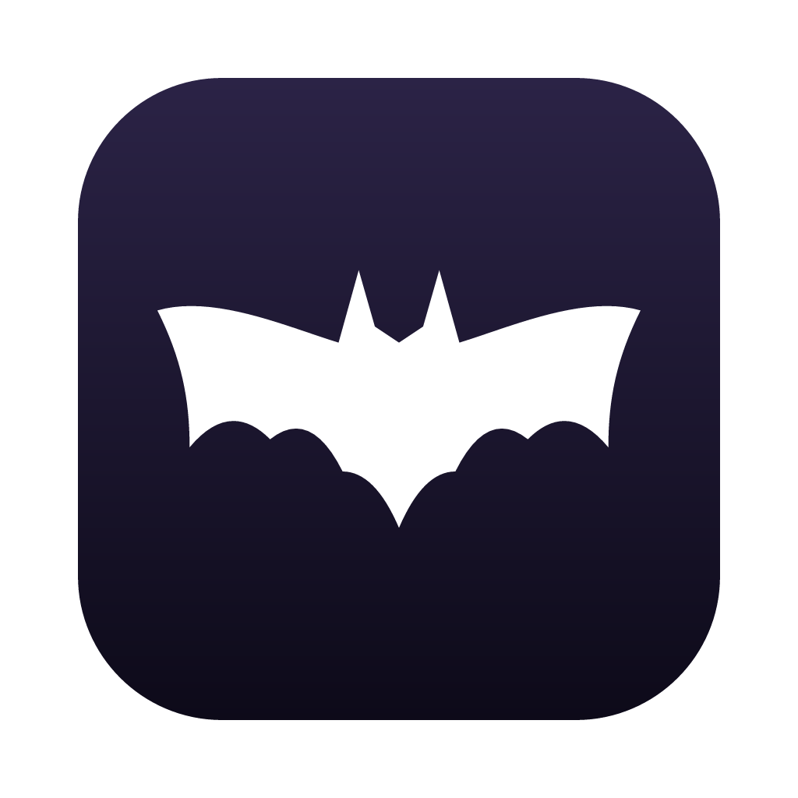
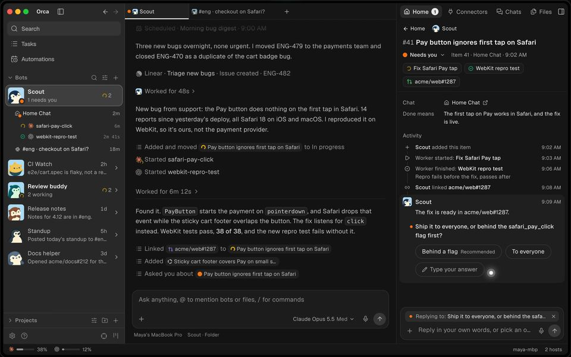
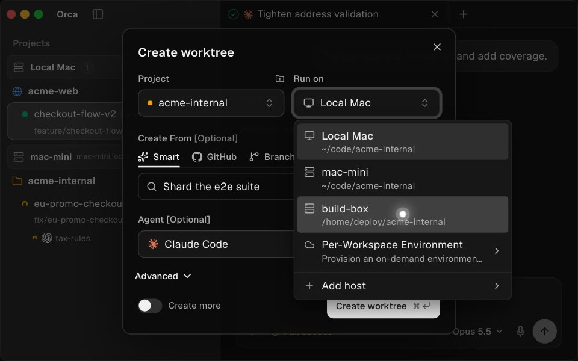
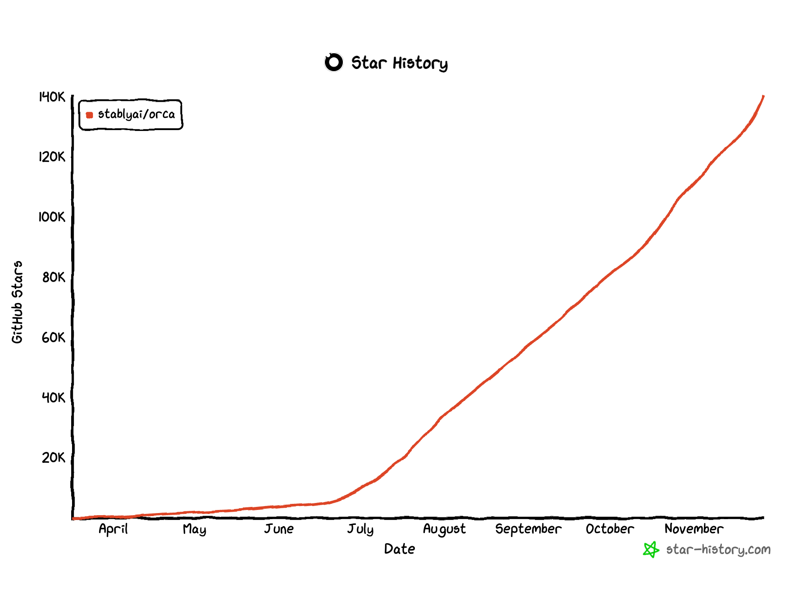

<h1 align="center">
  <a href="https://orca.dev"></a> Orca
</h1>

<p align="center">
  <a href="https://github.com/stablyai/orca"></a>
  <a href="https://github.com/stablyai/orca/releases"></a>
  
  <a href="https://discord.gg/fzjDKHxv8Q"></a>
  <a href="https://x.com/orca_build"></a>
  
</p>

<p align="center">
  <sub><a href="../../README.md">English</a> · <a href="README.ja.md">日本語</a> · <a href="README.ko.md">한국어</a> · <a href="README.es.md">Español</a> · <a href="README.fr.md">Français</a> · <a href="README.pt.md">Português</a> · <a href="README.tr.md">Türkçe</a> · <a href="README.ru.md">Русский</a></sub>
</p>

<h2 align="center">把 Bots 带进你的 Agent IDE。</h2>

<p align="center">
  开源、开放且由你掌控：使用自己的 Claude Code 或 Codex，在本地或远程机器上运行，并接入自己的工具。你可以通过 Slack 或手机向 Bot 分配任务；当它需要你介入时，打开 Orca 即可继续处理。
</p>

<h3 align="center"><a href="https://orca.dev/download"><ins>下载 Orca</ins></a> &nbsp;·&nbsp; <a href="https://orca.dev/bots"><ins>探索 Bots →</ins></a></h3>

<p align="center">
  
</p>

## 功能特性

<table>
<tr>
<td width="50%" valign="middle">

### Orca Bots

在 Slack、Linear 或 GitHub 中向 Bot 分配任务，例如修复一个 Bug；Bot 会调用你自己的 Claude Code 或 Codex 执行任务，并在完成后提供经过测试的 Pull Request。你可以在 Orca 中打开任务结果进行检查，或随时接手处理。

[功能介绍](https://orca.dev/bots) · [安全说明](https://orca.dev/docs/bots/security) · [文档 →](https://orca.dev/docs/bots)

</td>
<td width="50%">
  <a href="https://orca.dev/bots"><picture><source srcset="../assets/readme-features/bots.webp" type="image/webp"></picture></a>
</td>
</tr>
<tr>
<td width="50%" valign="middle">

### Chat 或 Terminal

既可以在 Orca 的 Chat 界面中与 Agent 交互，也可以直接使用原始 CLI。两种模式之间可以切换，并保留原有对话上下文。

[文档 →](https://orca.dev/docs/agents/native-chat)

</td>
<td width="50%">
  <a href="https://orca.dev/docs/agents/native-chat"><picture><source srcset="../assets/readme-features/chat-or-terminal.webp" type="image/webp"></picture></a>
</td>
</tr>
<tr>
<td width="50%" valign="middle">

### Agent 编排

把复杂任务交给一个协调 Agent，由它拆分任务、在各自独立的工作区中启动多个 Worker Agent，并在完成后汇总结果。多个 Agent 可以并行处理不同子任务。

[文档 →](https://orca.dev/docs/cli/orchestration)

</td>
<td width="50%">
  <a href="https://orca.dev/docs/cli/orchestration"><picture><source srcset="../assets/readme-features/orchestration.webp" type="image/webp"></picture></a>
</td>
</tr>
<tr>
<td width="50%" valign="middle">

### 随处运行

连接远程 Orca Server、通过 SSH 使用其他机器，或为每个 Worktree 配置独立的云端虚拟机。即使笔记本电脑休眠，Agent 也可以继续在远程环境中运行。

[文档 →](https://orca.dev/docs/ways-to-run)

</td>
<td width="50%">
  <a href="https://orca.dev/docs/ways-to-run"><picture><source srcset="../assets/readme-features/remote.webp" type="image/webp"></picture></a>
</td>
</tr>
<tr>
<td width="50%" valign="middle">

### 移动应用

将 Orca 与移动应用配对。当 Agent 需要你处理问题时，手机会收到通知；你可以直接在手机上回复，并在离开电脑时继续跟进不同机器上的任务。

[iOS App Store](https://apps.apple.com/us/app/orca-ide/id6766130217) · [Google Play](https://play.google.com/store/apps/details?id=dev.orca.app) · [Android APK](https://orca.dev/download/android) · [文档 →](https://orca.dev/docs/mobile)

</td>
<td width="50%">
  <a href="https://orca.dev/docs/mobile"><picture><source srcset="../assets/readme-features/mobile-companion.webp" type="image/webp"></picture></a>
</td>
</tr>
<tr>
<td width="50%" valign="middle">

### 审查 AI 生成的代码

检查代码 Diff，在具体修改行上添加批注，再将有针对性的反馈发送给 Agent，帮助它根据审查意见继续修改。

[文档 →](https://orca.dev/docs/review/annotate-ai-diff)

</td>
<td width="50%">
  <a href="https://orca.dev/docs/review/annotate-ai-diff"><picture><source srcset="../assets/readme-features/annotate-ai-diffs.webp" type="image/webp"></picture></a>
</td>
</tr>
<tr>
<td width="50%" valign="middle">

### Git 集成

根据代码 Diff 起草 Commit 信息和 Pull Request；也可以将 CI 检查失败信息或 PR 审查评论发送给 Agent，让它协助修复问题。

[文档 →](https://orca.dev/docs/review/commit-push)

</td>
<td width="50%">
  <a href="https://orca.dev/docs/review/commit-push"><picture><source srcset="../assets/readme-features/git-integration.webp" type="image/webp"></picture></a>
</td>
</tr>
<tr>
<td width="50%" valign="middle">

### 并行 Worktree

快速创建相互隔离的工作环境，让多个 Agent 在不同 Worktree 中并行工作，避免相互干扰。

[文档 →](https://orca.dev/docs/model/worktrees)

</td>
<td width="50%">
  <a href="https://orca.dev/docs/model/worktrees"><picture><source srcset="../assets/readme-features/parallel-worktrees.webp" type="image/webp"></picture></a>
</td>
</tr>
<tr>
<td width="50%" valign="middle">

### 设计模式

在 Orca 内置浏览器中点击任意页面元素，即可获取该元素的 HTML、样式和选择器，并将这些信息发送到 Agent 对话中，辅助页面开发与调试。

[文档 →](https://orca.dev/docs/browser/design-mode)

</td>
<td width="50%">
  <a href="https://orca.dev/docs/browser/design-mode"><picture><source srcset="../assets/readme-features/design-mode.webp" type="image/webp"></picture></a>
</td>
</tr>
<tr>
<td width="50%" valign="middle">

### 原生集成 GitHub 与 Linear

在同一个地方查看 GitHub 和 Linear 中的任务，并根据需要为每个任务创建工作区，直接开始开发。

[文档 →](https://orca.dev/docs/review/linear)

</td>
<td width="50%">
  <a href="https://orca.dev/docs/review/linear"><picture><source srcset="../assets/readme-features/github-linear-tasks.webp" type="image/webp"></picture></a>
</td>
</tr>
<tr>
<td width="50%" valign="middle">

### Orca CLI

Agent 也可以通过命令行驱动 Orca：创建 Worktree、启动 Worker、操作浏览器和桌面应用，以及安排自动化任务。

[文档 →](https://orca.dev/docs/cli/overview)

</td>
<td width="50%">
  <a href="https://orca.dev/docs/cli/overview"><picture><source srcset="../assets/readme-features/orca-cli.webp" type="image/webp"></picture></a>
</td>
</tr>
<tr>
<td width="50%" valign="middle">

### 插件

通过社区插件扩展 Orca，可一键安装主题、编辑器、语言支持和面板。

[浏览插件 →](https://orca.dev/plugins)

</td>
<td width="50%">
  <a href="https://orca.dev/plugins"><picture><source srcset="../assets/readme-features/plugins.webp" type="image/webp"></picture></a>
</td>
</tr>
<tr>
<td width="50%" valign="middle">

### 自由分屏布局

将 Agent、终端、浏览器和代码 Diff 按照任务需要并排排列，自由组合工作区布局。

[文档 →](https://orca.dev/docs/model/tabs-panes-splits)

</td>
<td width="50%">
  <a href="https://orca.dev/docs/model/tabs-panes-splits"><picture><source srcset="../assets/readme-features/split-anything.webp" type="image/webp"></picture></a>
</td>
</tr>
</table>

**此外还包括：**

- **[Bot 定时任务与触发器](https://orca.dev/docs/bots#put-it-on-a-schedule)**：按工作日定时运行 Bot，或在 Pull Request 创建、检查失败、Webhook 触发时自动启动任务。
- **[基于 Markdown 的 Bot 记忆](https://orca.dev/docs/bots/security#what-you-can-review)**：Bot 的角色设定和记忆以 `SOUL.md`、`MEMORY.md` 等 Markdown 文件保存，内容可查看、可编辑。
- **[向 Agent 拖入文件](https://orca.dev/docs/editing/file-explorer)**：将文件浏览器中的文件或桌面上的图片直接拖入 Agent 提示词。
- **[快速跳转](https://orca.dev/docs/model/quick-open)**：通过一个快捷键，在不同仓库、主机和工作区中的标签页之间快速查找和切换。
- **[文件预览](https://orca.dev/docs/editing/viewers)**：在工作区中直接查看图片、PDF 和 Markdown 文件，并与 Agent 的工作内容并排展示。
- **[移动设备模拟器](https://orca.dev/docs/cli/overview#mobile-emulator)**：在 Agent 旁运行 iOS Simulator 或 Android Emulator，让 Agent 执行点击、输入并检查结果。
- **[语音输入](https://orca.dev/docs/settings#voice)**：通过快捷键语音输入，内容可直接进入 Agent 提示词或终端。
- **[用量与账号管理](https://orca.dev/docs/agents/usage-tracking)**：查看 Agent 用量和限额重置时间，并在无需退出登录的情况下切换账号。
- **[自动化任务](https://orca.dev/docs/cli/automations)**：为任意仓库安排定时提示词任务，例如夜间依赖更新、每周问题整理和不稳定测试排查。
- **[Computer Use](https://orca.dev/docs/cli/computer-use)**：当任务没有可用的 CLI 或 API 时，让 Agent 观察并操作桌面应用及外部浏览器。
- **更多功能**：Orca 持续快速迭代，以上列表可能无法涵盖全部功能。请查看[更新日志](https://github.com/stablyai/orca/releases)了解最新变化。

---

## 支持的 Agent

Orca 兼容**任何 CLI Agent**：只要能够在终端中运行，就可以在 Orca 中使用。

<p>
  <a href="https://docs.anthropic.com/claude/docs/claude-code"><kbd> Claude Code</kbd></a> &nbsp;
  <a href="https://github.com/openai/codex"><kbd> Codex</kbd></a> &nbsp;
  <a href="https://x.ai/cli"><kbd> Grok</kbd></a> &nbsp;
  <a href="https://cursor.com/cli"><kbd> Cursor</kbd></a> &nbsp;
  <a href="https://docs.github.com/en/copilot/how-tos/set-up/install-copilot-cli"><kbd> GitHub Copilot</kbd></a> &nbsp;
  <a href="https://dev.meta.ai/docs/muse-code"><kbd> Muse</kbd></a> &nbsp;
  <a href="https://deepseek-harness.github.io/deepseek-harness/"><kbd> DeepSeek Harness</kbd></a> &nbsp;
  <a href="https://zcode.z.ai/en/docs"><kbd> ZCode</kbd></a> &nbsp;
  <a href="https://opencode.ai/docs/cli/"><kbd> OpenCode</kbd></a> &nbsp;
  <a href="https://mimo.xiaomi.com/coder"><kbd> MiMo Code</kbd></a> &nbsp;
  <a href="https://ampcode.com/manual#install"><kbd> Amp</kbd></a> &nbsp;
  <a href="https://openclaude.gitlawb.com/"><kbd> OpenClaude</kbd></a> &nbsp;
  <a href="https://antigravity.google/docs/cli-overview"><kbd> Antigravity</kbd></a> &nbsp;
  <a href="https://pi.dev"><kbd> Pi</kbd></a> &nbsp;
  <a href="https://omp.sh"><kbd> oh-my-pi</kbd></a> &nbsp;
  <a href="https://hermes-agent.nousresearch.com/docs/"><kbd> Hermes Agent</kbd></a> &nbsp;
  <a href="https://devin.ai/cli"><kbd> Devin</kbd></a> &nbsp;
  <a href="https://goose-docs.ai/docs/quickstart/"><kbd> Goose</kbd></a> &nbsp;
  <a href="https://docs.augmentcode.com/cli/overview"><kbd> Auggie</kbd></a> &nbsp;
  <a href="https://github.com/autohandai/code-cli"><kbd> Autohand Code</kbd></a> &nbsp;
  <a href="https://github.com/charmbracelet/crush"><kbd> Charm</kbd></a> &nbsp;
  <a href="https://docs.cline.bot/cline-cli/overview"><kbd> Cline</kbd></a> &nbsp;
  <a href="https://www.codebuddy.ai/cli"><kbd> CodeBuddy</kbd></a> &nbsp;
  <a href="https://www.codebuff.com/docs/help/quick-start"><kbd> Codebuff</kbd></a> &nbsp;
  <a href="https://freebuff.com"><kbd> Freebuff</kbd></a> &nbsp;
  <a href="https://commandcode.ai/docs/quickstart"><kbd> Command Code</kbd></a> &nbsp;
  <a href="https://docs.continue.dev/cli/quickstart"><kbd> Continue</kbd></a> &nbsp;
  <a href="https://docs.factory.ai/cli/getting-started/quickstart"><kbd> Droid</kbd></a> &nbsp;
  <a href="https://kilo.ai/docs/cli"><kbd> Kilocode</kbd></a> &nbsp;
  <a href="https://www.kimi.com/code/docs/en/kimi-code-cli/getting-started.html"><kbd> Kimi</kbd></a> &nbsp;
  <a href="https://kiro.dev/docs/cli/"><kbd> Kiro</kbd></a> &nbsp;
  <a href="https://github.com/mistralai/mistral-vibe"><kbd> Mistral Vibe</kbd></a> &nbsp;
  <a href="https://github.com/QwenLM/qwen-code"><kbd> Qwen Code</kbd></a> &nbsp;
  <a href="https://support.atlassian.com/rovo/docs/install-and-run-rovo-dev-cli-on-your-device/"><kbd> Rovo Dev</kbd></a> &nbsp;
  <kbd>+ 其他 CLI Agent</kbd>
</p>

---

## 安装

### 桌面端 — macOS、Windows、Linux

- **[从 orca.dev 下载](https://orca.dev/download)**
- 或直接下载对应安装包：[macOS Apple Silicon](https://github.com/stablyai/orca/releases/latest/download/orca-macos-arm64.dmg) · [macOS Intel](https://github.com/stablyai/orca/releases/latest/download/orca-macos-x64.dmg) · [Windows (.exe)](https://github.com/stablyai/orca/releases/latest/download/orca-windows-setup.exe) · [Linux AppImage](https://github.com/stablyai/orca/releases/latest/download/orca-linux.AppImage) · [全部构建版本](https://github.com/stablyai/orca/releases/latest)

也可以通过包管理器安装：

```bash
# macOS（Homebrew）
# 请始终使用完整名称；单独的 orca 是与本项目无关的 Plotly cask。
brew install --cask stablyai/orca/orca

# 升级已有安装
brew upgrade --cask stablyai/orca/orca

# 安装 Release Candidate（与稳定版 cask 冲突，需先卸载稳定版）
brew install --cask stablyai/orca/orca@rc

# Arch Linux（AUR）；也可以使用 stably-orca-git 从源码构建
yay -S stably-orca-bin
```

### 移动应用 — iOS、Android

将移动应用与桌面端配对，即可通过手机查看 Agent 状态、接收通知并继续处理任务。

- **iOS**：[从 App Store 下载](https://apps.apple.com/us/app/orca-ide/id6766130217)
- **Android**：[Google Play](https://play.google.com/store/apps/details?id=dev.orca.app) · [下载 APK](https://orca.dev/download/android) · [APK 安装指南](https://orca.dev/docs/android-apk)

---

## 社区与支持

- **Discord**：加入 [Orca Discord 社区](https://discord.gg/fzjDKHxv8Q)。
- **Twitter / X**：关注 [@orca_build](https://x.com/orca_build)，获取项目更新和公告。
- **微信**：扫描下方二维码加入 Orca 微信社区。

  

- **反馈与建议**：发现问题或有新功能想法？欢迎[提交 Issue](https://github.com/stablyai/orca/issues)。
- **隐私**：查看[隐私与遥测说明](https://orca.dev/docs/telemetry)，了解 Orca 收集哪些匿名使用数据，以及如何选择退出。
- **支持项目**：欢迎为 [Orca GitHub 仓库](https://github.com/stablyai/orca)点 Star，关注项目的持续更新。

---

## 参与开发

希望参与贡献或在本地运行 Orca？请先阅读[贡献指南](../../.github/CONTRIBUTING.md)。

<a href="https://github.com/stablyai/orca/graphs/contributors">
  
</a>

<p align="center">
  
</p>

## 签名构建

Windows 版本的代码签名由 [SignPath.io](https://signpath.io) 赞助/提供，证书由 [SignPath Foundation](https://signpath.org) 提供。

## 许可证

Orca 是免费开源软件，采用 [MIT 许可证](../../LICENSE)。
