# Design Document: Workspace Popout Window Architecture

> Auditado contra o código em 2026-11-13. Cada afirmação sobre comportamento existente cita `arquivo:linha`. O que depende de medição está marcado como **hipótese**.

## 1. Visão Geral da Arquitetura

O modelo **Workspace Popout Window** estende o padrão de janelas satélite que o Orca já tem (`src/main/window/dashboard-popout-window.ts`, `src/main/window/workspace-space-window.ts`) e o transporte de terminal da popout do dashboard (`src/main/ipc/terminal-preview.ts`).

```mermaid
flowchart TD
    subgraph MainProcess ["Electron Main Process"]
        Runtime["OrcaRuntimeService (grafo publicado só pela janela principal)"]
        PTYHost["Provedor de PTY / daemon (processos dos agentes)"]
        Floor["RemoteDesktopTerminalFloor (dono do grid por PTY)"]
        Preview["terminal-preview.ts (connect / input / fit / ack / unsubscribe)"]
        Registry["WorkspacePopoutRegistry (Map worktreeId -> entrada)"]
    end

    subgraph Window1 ["Monitor 1: Janela Principal"]
        MainShell["Renderer principal (aba marcada como destacada no store local)"]
    end

    subgraph Window2 ["Monitor 2: Satélite"]
        PopoutShell["workspace-popout.html (AgentTerminalPreview + xterm DOM)"]
    end

    MainShell -->|runtime:syncWindowGraph (contrato inalterado)| Runtime
    MainShell -->|workspacePopout:open / dock / list| Registry
    Registry --> Window2
    PopoutShell -->|terminalPreview:connect / input / fit / ack| Preview
    Preview --> Runtime
    Preview --> Floor
    PTYHost -->|subscribeToTerminalData| Preview
    Runtime -->|Visibilidade inalterada| Ext["Orca CLI & Mobile"]
```

---

## 2. O que o código existente já garante (e o que não garante)

| Tema                                                  | Fato no código                                                                                                                                                                                                                                                                                                | Consequência para o design                                                                                                                                                                                                                                                                                                                                                                                                                     |
| ----------------------------------------------------- | ------------------------------------------------------------------------------------------------------------------------------------------------------------------------------------------------------------------------------------------------------------------------------------------------------------- | ---------------------------------------------------------------------------------------------------------------------------------------------------------------------------------------------------------------------------------------------------------------------------------------------------------------------------------------------------------------------------------------------------------------------------------------------- |
| Fronteira snapshot/stream                             | A assinatura de dados é registrada antes da serialização (`terminal-preview.ts:107-109` antes de `:133`); o que chega durante a captura fica em `initialPending` e é recortado por `seq` (`terminal-preview-output-stream.ts:23-46`, `:115-127`).                                                             | Não há perda de bytes entre snapshot e stream quando o produtor envia `seq` e `rawLength`. Sem `seq`, o pedaço é reentregue como `replay` (`:27-33`), ou seja, pode duplicar mas não perder.                                                                                                                                                                                                                                                   |
| Estouro durante a captura                             | Acima de 256 KiB pendentes (`terminal-preview-output-stream.ts:12`) o snapshot é refeito uma vez e, se estourar de novo, volta `resyncRequired` (`terminal-preview.ts:134-139`, `:156-160`). O renderer tenta de novo a cada 150 ms (`AgentTerminalPreview.tsx:40`, `:252-263`).                              | Não há perda, mas há laço de reconexão sem teto sob saída sustentada. Falta limite (FMEA F-07).                                                                                                                                                                                                                                                                                                                                                |
| Backpressure                                          | 512 KiB em voo, 256 KiB pendentes; acima disso, resync (`terminal-preview-output-stream.ts:10-11`, `:218-225`).                                                                                                                                                                                               | Renderer travado não faz o main crescer sem limite.                                                                                                                                                                                                                                                                                                                                                                                            |
| Input                                                 | `terminalPreview:input` -> `writeTerminalPreviewInput` com `inputKind: 'driving'`, `inputSource: 'desktop'` e limite de tamanho (`terminal-preview.ts:164-176`, `terminal-view-presence.ts:268-282`).                                                                                                         | **O `TerminalPreviewOutputStream` é só saída.** Input e resize existem, mas em canais irmãos no mesmo módulo. A spec antiga atribuía tudo ao stream.                                                                                                                                                                                                                                                                                           |
| Respostas a queries do terminal                       | A satélite abre o xterm com `answersQueries: false` (`AgentTerminalPreview.tsx:220`).                                                                                                                                                                                                                         | Respostas DA/CPR continuam com a janela principal ou com o estado headless. O pane principal da aba não pode ser desmontado (FMEA F-12).                                                                                                                                                                                                                                                                                                       |
| Dono do grid                                          | `RemoteDesktopTerminalFloor` guarda um dono por PTY (`remote-desktop-terminal-floor.ts:20-21`); `updateViewer` com `claim` troca o dono (`:122-163`); digitar na janela principal faz `pty:claimViewport` -> `claimHost` (`src/main/ipc/pty/ipc/write.ts:54-77`, `remote-desktop-terminal-floor.ts:183-193`). | O "um único dono de resize por PTY" já existe.                                                                                                                                                                                                                                                                                                                                                                                                 |
| Resize da janela principal enquanto a satélite é dona | `pty:resize` é descartado e só registra o alvo de retomada quando um visualizador remoto é dono (`src/main/ipc/pty/ipc/resize-visibility.ts:47-54`).                                                                                                                                                          | **Não é preciso suspender o `FitAddon` da janela principal.** O main já bloqueia o ping-pong. A tarefa antiga 2.3 foi trocada por um teste dessa garantia.                                                                                                                                                                                                                                                                                     |
| Celular tem prioridade                                | `applyLayout` não faz nada quando o PTY é dirigido pelo celular (`remote-desktop-terminal-floor.ts:93-96`); a satélite cai em modo escalado (`terminal-preview.ts:195`).                                                                                                                                      | Comportamento esperado, documentado em REQ-WPO-04.                                                                                                                                                                                                                                                                                                                                                                                             |
| Satélite parada depois que o host retoma              | `createPreviewGridClaim` só reclama quando o tamanho muda (`preview-grid-claim.ts:43-47`).                                                                                                                                                                                                                    | Se o usuário digitar na janela principal, a satélite fica escalada até mudar de tamanho. A satélite precisa reclamar o grid ao ganhar foco (FMEA F-09).                                                                                                                                                                                                                                                                                        |
| Limpeza por renderer                                  | `abortWhenRendererGone` escuta `destroyed`, `render-process-gone` e `did-navigate` (`renderer-lifetime-abort.ts:6`) e descarta streams e claims daquele `webContents` (`terminal-preview.ts:60-86`).                                                                                                          | Crash ou reload da satélite libera PTY, claim de grid e presença raw sem código novo.                                                                                                                                                                                                                                                                                                                                                          |
| Popouts fecham com a janela principal                 | `mainWindow.on('closed')` chama `closeDashboardPopout()` e `closeWorkspaceSpaceWindow()` (`src/main/window/createMainWindow.ts:240-242`).                                                                                                                                                                     | A satélite entra na mesma lista.                                                                                                                                                                                                                                                                                                                                                                                                               |
| Publicador do grafo                                   | Outra janela publicando lança `Runtime graph publisher does not match the authoritative window` (`session-window-publisher.ts:27-29`). `runtime:syncWindowGraph` aceita qualquer `BrowserWindow` (`src/main/ipc/runtime.ts:52-66`).                                                                           | A satélite nunca pode chamar `syncWindowGraph`. Com a janela principal ativa, a chamada falha com erro. Mas `authoritativeWindowId` volta a `null` quando o grafo fica indisponível (`session-graph-reload-lifecycle.ts:205`), e nesse intervalo o primeiro publicador vira a autoridade (`session-window-publisher.ts:24-26`). Uma satélite que publique nessa janela de tempo assume o grafo. A guarda no main é obrigatória, não cosmética. |
| Gravação de sessão                                    | `session:set`, `session:patch` e `session:close-terminal-surface` não validam remetente (`src/main/ipc/session.ts:50-87`).                                                                                                                                                                                    | **A invariante "satélite não grava session.json" hoje depende só de disciplina do renderer.** A change adiciona guarda no main.                                                                                                                                                                                                                                                                                                                |
| Sem reação a monitor removido                         | Não há `screen.on(...)` em `src/main` (busca vazia). `rectHasVisibleAreaOnAnyDisplay` existe (`window-bounds-validation.ts:6-28`).                                                                                                                                                                            | Repatriação é código novo.                                                                                                                                                                                                                                                                                                                                                                                                                     |
| Sem recuperação de crash                              | A popout do dashboard só recarrega quando é reaberta (`dashboard-popout-window.ts:133-136`).                                                                                                                                                                                                                  | Recuperação automática é código novo e precisa de teto.                                                                                                                                                                                                                                                                                                                                                                                        |

---

## 3. Componentes

### 3.1. Main process: `src/main/window/workspace-popout-window.ts`

- Registro `Map<string /* worktreeId */, WorkspacePopoutEntry>`; nunca um singleton como `dashboardPopoutWindow` (`dashboard-popout-window.ts:30`).
- `createOrFocusWorkspacePopout(store, target)`: se já existe entrada para o `worktreeId`, foca e, se o `tabId` ou o `ptyId` mudou, troca o alvo: emite `stateChanged({ tabId: <antigo>, open: false, reason: 'replaced' })` para a aba anterior, `stateChanged({ tabId: <novo>, open: true })` para a nova e envia `workspacePopout:target` para a satélite. Sem o primeiro evento, a aba anterior fica marcada como "Aberto em outra janela" para sempre na principal. Se não existe entrada, cria. A entrada é gravada no registro **antes** de `loadURL/loadFile`, igual a `dashboard-popout-window.ts:177`.
- `BrowserWindow` com `preload: ../preload/index.js`, `sandbox: true`, `partition: 'orca-workspace-popout'`, `webviewTag: false`, `installPrivilegedWindowNavigationPolicy` e permissões negadas, copiando `dashboard-popout-window.ts:150-176`.
- Bounds: extrair `resolveRestoredBounds` (hoje privada em `dashboard-popout-window.ts:107-126`) para `src/main/window/presentation/` e reutilizar com a chave nova. Debounce de 500 ms e congelamento no fechamento como em `:234-267`.
- `app.on('before-quit')`: **um** listener no módulo para todas as satélites, não um por janela como em `dashboard-popout-window.ts:267`, para não passar do limite de 10 listeners do `EventEmitter` com várias satélites.
- Monitor: um único `screen.on('display-removed')` e `screen.on('display-metrics-changed')` no módulo, registrado quando o registro passa de 0 para 1 entrada e removido quando volta a 0. Para cada janela cujo `getBounds()` falha em `rectHasVisibleAreaOnAnyDisplay(bounds, MIN_WIDTH / 2, MIN_HEIGHT / 2)`, centralizar no `screen.getPrimaryDisplay().workArea`.
- Crash: `webContents.on('render-process-gone')` recarrega no máximo 2 vezes em 60 s; na terceira, fecha a janela com motivo `crashed` (a aba volta para a janela principal).
- Teclado: `webContents.on('before-input-event')` como em `dashboard-popout-window.ts:200-215`, e mais: quando `keybindingMatchesAction('tab.close', input, process.platform, keybindings)` (padrão de `src/main/browser/guest-lifecycle/input/shortcuts/browser-guest-shortcut-dispatch.ts:164`), chamar `preventDefault()` e fazer o dock no main. Não dá para tratar no renderer: com o modo Kitty ativo o xterm codifica `Cmd+W` como CSI u e consome a tecla, o mesmo motivo pelo qual o paste já é interceptado no main (`dashboard-popout-window.ts:201-205`). Sem isso, `Cmd+W` dentro do Claude Code vira bytes no PTY em vez de reacoplar.
- Sleep/wake: um `powerMonitor.on('resume')` no módulo que envia `workspacePopout:resumed` para cada satélite viva, espelhando `createMainWindow.ts:199-205` e `:228`.
- `closeAllWorkspacePopouts(reason)` chamado em `createMainWindow.ts:240-242` e quando a flag é desligada (mesmo padrão de `src/main/ipc/dashboard-popout.ts:44-52`).

### 3.2. IPC: `src/main/ipc/workspace-popout.ts`

Contratos na seção 4. Registra com `ipcMain.removeHandler` antes, como `workspace-space-window.ts:15-25`.

### 3.3. Ajustes em módulos existentes (mínimos e com teste)

- `src/main/ipc/terminal-preview.ts:22-24`: `isTerminalPreviewRenderer` passa a aceitar `isWorkspacePopoutRenderer(sender)`.
- `src/main/ipc/terminal-preview.ts:38`: a chave do visualizador vira `${prefixo}:${contentsId}` com prefixo `workspace-popout` para a satélite, para logs e diagnósticos distinguirem as duas popouts.
- `src/main/window/clipboard/clipboard-ipc-sender-trust.ts:19` e `src/main/ipc/ui.ts:113-116`: aceitar a satélite em copiar, colar e selecionar tudo.
- `src/main/ipc/session.ts:50-87`: recusar `session:set`, `session:patch` e `session:close-terminal-surface` vindos da satélite (e, por coerência, da popout do dashboard).
- `src/main/ipc/runtime.ts:52-66`: recusar `runtime:syncWindowGraph` vindo da satélite antes de chegar ao runtime.

### 3.4. Renderer da satélite

- Entrada: `src/renderer/workspace-popout.html` e `src/renderer/src/workspace-popout.tsx`, registrados em `electron.vite.config.ts` ao lado de `popout: resolve('src/renderer/popout.html')` (`electron.vite.config.ts:312`).
- Bootstrap igual a `src/renderer/src/popout.tsx:25-80` (tema, fonte, settings, keybindings, `useAppMenuPaste`).
- Conteúdo da v1: `AgentTerminalPreview` (`src/renderer/src/components/dashboard-popout/AgentTerminalPreview.tsx:47`) com o `ptyId` e o `terminalInput` recebidos por `workspacePopout:getTarget`.
- Proibido no renderer da satélite: montar `App`, chamar `runtime:syncWindowGraph`, `session:*` de escrita, ou qualquer hook de persistência do store. O store (`useAppStore`) é carregado como em `popout.tsx:17`, mas só com `settings` e keybindings.
- Reconexão externa: `AgentTerminalPreview` hoje só reconecta por `resync` ou mudança de props (`AgentTerminalPreview.tsx:313-324`, `:336-347`). Para `workspacePopout:resumed` e troca de `ptyId`, a satélite remonta o componente com `key={ptyId + ':' + epoch}`; a guarda `refreshInFlight` (`:287-290`) evita conexões paralelas.
- Reclamar grid no foco: ao receber `focus` da janela, chamar `terminalPreview.fit` com o tamanho atual, ignorando a deduplicação de `preview-grid-claim.ts:43-47`, para retomar o dono depois que o host digitou.

---

## 4. Contratos de dados

### 4.1. Tipos compartilhados (`src/shared/workspace-popout/workspace-popout-contract.ts`)

```ts
import type { DashboardCardTerminalInput } from '../dashboard-snapshot'

export type WorkspacePopoutTarget = {
  worktreeId: string // 1..4096 chars
  tabId: string // 1..4096 chars
  ptyId: string // 1..4096 chars, não remote-runtime na v1
  terminalInput: DashboardCardTerminalInput | null
  title: string // 0..256 chars, só para o título da janela
}

export type WorkspacePopoutState = 'opening' | 'open' | 'recovering' | 'closing'

export type WorkspacePopoutCloseReason =
  | 'docked' // botão "Reacoplar" ou Cmd/Ctrl+W na satélite
  | 'replaced' // outra aba do mesmo worktree foi destacada na mesma satélite
  | 'window-closed' // botão nativo de fechar
  | 'crashed' // teto de recuperação atingido
  | 'main-closed' // janela principal fechou
  | 'flag-disabled' // experimentalWorkspacePopout desligada
  | 'pty-gone' // connect devolveu snapshot nulo de forma definitiva
  | 'app-quit'

export type WorkspacePopoutEntrySummary = {
  worktreeId: string
  tabId: string
  ptyId: string
  state: WorkspacePopoutState
}

export type WorkspacePopoutOpenResult =
  | { status: 'opened' | 'focused' }
  | {
      status: 'rejected'
      reason: 'flag-disabled' | 'invalid-payload' | 'remote-runtime-pty' | 'closing'
    }

export type WorkspacePopoutStateChanged =
  | { worktreeId: string; tabId: string; open: true }
  | { worktreeId: string; tabId: string; open: false; reason: WorkspacePopoutCloseReason }

export type WorkspacePopoutWindowBounds = {
  x: number
  y: number
  width: number // >= 480
  height: number // >= 360
}
```

### 4.2. Canais

| Canal                                                                                      | Tipo       | Direção                       | Payload                                                         | Resposta                        | Remetente aceito                                                                               |
| ------------------------------------------------------------------------------------------ | ---------- | ----------------------------- | --------------------------------------------------------------- | ------------------------------- | ---------------------------------------------------------------------------------------------- |
| `workspacePopout:open`                                                                     | invoke     | principal -> main             | `WorkspacePopoutTarget`                                         | `WorkspacePopoutOpenResult`     | `isTrustedUIRenderer` (`src/main/ipc/ui.ts:128-130`) e flag ligada                             |
| `workspacePopout:publishTarget`                                                            | invoke     | principal -> main             | `WorkspacePopoutTarget`                                         | `void`                          | `isTrustedUIRenderer`; ignorado se não há entrada para o `worktreeId`                          |
| `workspacePopout:dock`                                                                     | invoke     | principal ou satélite -> main | `{ worktreeId: string }`                                        | `void`                          | principal: qualquer `worktreeId`; satélite: só o seu (comparando `event.sender` com a entrada) |
| `workspacePopout:list`                                                                     | invoke     | principal -> main             | nenhum                                                          | `WorkspacePopoutEntrySummary[]` | `isTrustedUIRenderer`                                                                          |
| `workspacePopout:getTarget`                                                                | invoke     | satélite -> main              | nenhum                                                          | `WorkspacePopoutTarget \| null` | `isWorkspacePopoutRenderer`; devolve só a entrada daquele `webContents`                        |
| `workspacePopout:stateChanged`                                                             | send       | main -> principal             | `WorkspacePopoutStateChanged`                                   | n/a                             | via `sendToTrustedUIRenderer` (`ui.ts:27-34`)                                                  |
| `workspacePopout:target`                                                                   | send       | main -> satélite              | `WorkspacePopoutTarget`                                         | n/a                             | `entry.window.webContents.send`                                                                |
| `workspacePopout:resumed`                                                                  | send       | main -> satélite              | `null`                                                          | n/a                             | idem                                                                                           |
| `terminalPreview:connect / input / fit / ack / unsubscribe`, evento `terminalPreview:data` | existentes | satélite <-> main             | inalterados (`src/preload/api/terminal-preview-bridge.ts:8-34`) | inalterados                     | `isTerminalPreviewRenderer` estendido                                                          |

Regras de validação no main (mesmo estilo de `terminal-preview.ts:17-19` e `workspace-space-window.ts:42-56`): strings não vazias com até 4096 caracteres; `isRemoteRuntimePtyId(ptyId)` (`src/shared/remote-runtime/remote-runtime-pty-id`) rejeita na v1; payload inválido devolve `rejected`, nunca lança.

### 4.3. Persistência

- Novo campo em `PersistedUIState` (`src/shared/persisted-ui-state-types.ts:229`, ao lado de `dashboardPopoutBounds`): `workspacePopoutBounds?: WorkspacePopoutWindowBounds | null`.
- Campo main-only: entrar em `MainOwnedUIState` (`src/main/runtime/rpc/methods/client-state/ui-state-schema-parity-checks.ts:8-25`) e na lista de `src/shared/wsl-move/wsl-move-ui-dispositions.ts:160`.
- Gravado só pelo main (debounce de 500 ms). A satélite não grava nada.
- Nada sobre "aba destacada" é persistido na v1: no boot seguinte a aba aparece acoplada (ver seção 6).

### 4.4. Flag

- Tipo: `experimentalWorkspacePopout?: boolean` em `src/shared/global-settings-types.ts` (onde já estão `experimentalAgentDashboardPopout` na linha 453 e `experimentalOrchestrationPanel` na 455).
- Padrão `false` em `src/shared/default-global-settings.ts` (junto de `experimentalOrchestrationPanel: false`, linha 297).
- UI em `src/renderer/src/components/settings/advanced/ExperimentalPane.tsx` com entrada de busca em `experimental-search.ts` e textos em `src/renderer/src/i18n/locales`.
- Telemetria de adoção, se desejada, em `SETTINGS_CHANGED_WHITELIST` (`src/shared/telemetry-property-schemas.ts:195-210`).
- O main checa a flag em todo handler `workspacePopout:*` (padrão `isDashboardEnabled`, `src/main/ipc/dashboard-popout.ts:24-26`) e fecha tudo quando ela é desligada.

---

## 5. Máquina de estados (por `worktreeId`)

```mermaid
stateDiagram-v2
    [*] --> docked
    docked --> opening: open
    opening --> open: ready-to-show
    opening --> closing: dock / close / main-closed
    open --> open: open (foca; se tabId/ptyId mudou, emite replaced para a aba antiga e troca o target)
    open --> recovering: render-process-gone (tentativas < 2 em 60 s)
    recovering --> open: did-finish-load
    recovering --> closing: 3ª queda em 60 s
    open --> closing: dock / window-closed / main-closed / flag-disabled / pty-gone / app-quit
    closing --> closing: dock (no-op)
    closing --> docked: evento 'closed' da BrowserWindow
```



Regras de idempotência:

1. `open` com entrada em `opening`, `open` ou `recovering` não cria janela; devolve `focused`.
2. `open` com entrada em `closing` devolve `rejected: closing`; o renderer pode tentar de novo depois de `stateChanged(open: false)`.
3. `dock` em `closing` ou sem entrada é no-op.
4. **Só o evento `closed` da `BrowserWindow` remove a entrada e emite `stateChanged(open: false)`.** `dock`, crash final, flag e fechamento da principal apenas chamam `window.close()` e gravam o motivo. Isso resolve dock-back concorrente com fechamento: quem chegar primeiro grava o motivo, e só um `closed` acontece.
5. A troca de foco para a janela principal e a reativação da aba acontecem no renderer principal ao receber `stateChanged(open: false)`, nunca antes.
6. Se o renderer principal recarregar com satélites abertas, ele chama `workspacePopout:list` no boot para reconstruir o estado local, porque `sendToTrustedUIRenderer` não entrega nada enquanto não há renderer confiável (`ui.ts:32-33`).

---

## 6. Fluxo de destaque e reacoplamento

```mermaid
sequenceDiagram
    autonumber
    actor Dev as Desenvolvedor
    participant W1 as Janela Principal
    participant Main as Main Process
    participant W2 as Satélite

    Note over Main: Agente rodando no PTY (ptyId: 42)
    Dev->>W1: "Mover para Nova Janela"
    W1->>Main: invoke workspacePopout:open({ worktreeId, tabId, ptyId: 42, terminalInput, title })
    Main->>Main: valida remetente, flag e payload; registra entrada (opening)
    Main->>W2: cria BrowserWindow e carrega workspace-popout.html
    Main-->>W1: { status: 'opened' }
    Main->>W1: send workspacePopout:stateChanged({ open: true })
    W1->>W1: marca a aba como destacada no store local (pane e folha continuam montados)
    W2->>Main: invoke workspacePopout:getTarget()
    W2->>Main: invoke terminalPreview:connect(42)
    Main-->>W2: snapshot + replay (fronteira atômica)
    W2->>Main: invoke terminalPreview:fit(42, cols, rows)
    Note over Main: RemoteDesktopTerminalFloor: dono = workspace-popout:<id>
    Dev->>W2: digita
    W2->>Main: invoke terminalPreview:input(42, bytes)
    Dev->>W2: "Reacoplar" (ou Cmd/Ctrl+W)
    W2->>Main: invoke workspacePopout:dock({ worktreeId })
    Main->>W2: window.close() (closing)
    Note over Main: 'destroyed' -> terminal-preview descarta stream e claim; floor devolve o grid ao host
    Main->>W1: send workspacePopout:stateChanged({ open: false, reason: 'docked' })
    W1->>W1: remove a marca, foca a aba
```

### 6.1. Janela principal fecha, app sai, próximo boot

- Janela principal fecha: `createMainWindow.ts:240-242` passa a chamar `closeAllWorkspacePopouts('main-closed')`. O PTY não é afetado pela satélite; o que acontece com ele depende do fluxo normal da janela principal (headless ou encerramento do app), igual a hoje.
- App sai: `before-quit` congela bounds (padrão de `dashboard-popout-window.ts:256-267`); as satélites fecham com o app. Nada sobre "aba destacada" é salvo.
- Próximo boot: a aba aparece acoplada na janela principal. Reabrir a satélite automaticamente fica como questão aberta.

---

## 7. Chat e diff na satélite (fora da v1)

- `NativeChatView` (`src/renderer/src/components/native-chat/NativeChatView.tsx:1-9`) depende de `NativeChatStructuredSession`, que usa o transporte de sessão estruturada e o store completo do renderer. A popout do dashboard recebe dados por snapshot publicado pela janela principal (`src/main/ipc/dashboard-popout.ts:61-92`); não existe snapshot equivalente para chat.
- `nativeChat:*` não valida remetente (`src/main/ipc/native-chat.ts:322-335`) e `runtime:call` aceita qualquer `mainFrame` (`src/main/ipc/runtime.ts:86-110`), então tecnicamente a satélite conseguiria ler, mas isso amplia a superfície sem contrato.
- `EditorDiffFileSurface` (`src/renderer/src/components/editor/EditorDiffFileSurface.tsx:1-9`) recebe `OpenFile` e `GitDiffResult` do store do editor e carrega o Monaco por `editor-lazy-views`. Não há caminho de dados para a satélite.
- Imagens de plugin usam `protocol.handle` global (`src/main/plugins/plugin-image-protocol.ts:102`), que vale só para a sessão padrão; numa partição isolada esse esquema não resolve.

Por isso a v1 é só terminal. Levar chat ou diff exige um contrato próprio de publicação (como `dashboard:publishSnapshot`) ou uma decisão explícita de liberar `runtime:call` para a satélite.

---

## 8. Partição isolada

A popout do dashboard usa a partição em memória `orca-dashboard-popout` porque o Chromium compartilha zoom por origem e a equipe quis zoom local (`dashboard-popout-window.ts:164-165`). A satélite pode usar `orca-workspace-popout` pelo mesmo motivo, com estas consequências:

- Todas as satélites compartilham a mesma sessão entre si, então compartilham zoom entre si (não com a principal).
- A sessão isolada não herda a política de permissões; é preciso negar tudo como em `dashboard-popout-window.ts:172-176`.
- `localStorage` dessa sessão não persiste (partição sem `persist:`), o que é desejável.
- Esquemas registrados com `protocol.handle` global não existem nela (seção 7).

---

## 9. FMEA

Severidade (S), ocorrência (O) e detecção (D) de 1 a 5; D alto significa difícil de detectar.

| ID   | Etapa     | Modo de falha                               | Causa                                                                                                              | Efeito                                                                                                                                                                                                                                                    | S   | O   | D   | Detecção                                   | Mitigação                                                                                                                                                              |
| ---- | --------- | ------------------------------------------- | ------------------------------------------------------------------------------------------------------------------ | --------------------------------------------------------------------------------------------------------------------------------------------------------------------------------------------------------------------------------------------------------- | --- | --- | --- | ------------------------------------------ | ---------------------------------------------------------------------------------------------------------------------------------------------------------------------- |
| F-01 | open      | Duas satélites para o mesmo worktree        | Duplo clique ou atalho repetido                                                                                    | Dois donos de grid alternando, dois streams                                                                                                                                                                                                               | 3   | 3   | 2   | Teste de máquina de estados                | Regra 1 da seção 5; entrada gravada antes do `load`                                                                                                                    |
| F-02 | open      | Satélite aberta para PTY de runtime remoto  | `ptyId` remoto                                                                                                     | `terminalPreviewApiFor` usa o multiplexador do renderer (`terminal-preview-api.ts:5-7`), que não existe na satélite                                                                                                                                       | 3   | 2   | 3   | Teste de validação de payload              | Rejeitar `remote-runtime-pty` na v1                                                                                                                                    |
| F-03 | open      | Satélite fora da tela                       | Bounds salvos de monitor removido                                                                                  | Janela invisível                                                                                                                                                                                                                                          | 3   | 3   | 2   | Teste de `resolveRestoredBounds`           | Validação de `window-bounds-validation.ts:6-28`                                                                                                                        |
| F-04 | getTarget | Satélite sem alvo                           | Main reiniciou o registro ou entrada já fechou                                                                     | Tela vazia                                                                                                                                                                                                                                                | 2   | 1   | 1   | Teste de IPC                               | Devolver `null` e fechar com `pty-gone`                                                                                                                                |
| F-05 | connect   | Remetente recusado                          | `isTerminalPreviewRenderer` não estendido                                                                          | `connect` devolve `{ snapshot: null }` (`terminal-preview.ts:94-96`), satélite mostra "indisponível"                                                                                                                                                      | 4   | 2   | 1   | Teste de contrato                          | Seção 3.3                                                                                                                                                              |
| F-06 | replay    | Bytes duplicados no início                  | Produtor sem `seq`                                                                                                 | Linha repetida na satélite                                                                                                                                                                                                                                | 2   | 2   | 3   | Teste com produtor sem `seq`               | Já aceito pelo design atual (`terminal-preview-output-stream.ts:27-33`)                                                                                                |
| F-07 | replay    | Laço de reconexão                           | Saída sustentada > 256 KiB durante cada captura                                                                    | Reconexão a cada 150 ms sem fim, CPU no main                                                                                                                                                                                                              | 3   | 2   | 3   | Contador de `resyncRequired`               | Backoff exponencial até 2 s e aviso na UI após 10 tentativas (novo)                                                                                                    |
| F-08 | input     | Teclas perdidas ou erradas                  | `terminalInput` ausente (ConPTY, Shift+Enter)                                                                      | Atalhos de TUI errados no Windows                                                                                                                                                                                                                         | 3   | 3   | 3   | Teste de shortcuts com `terminalInput`     | Enviar `DashboardCardTerminalInput` no alvo (`src/shared/dashboard-snapshot.ts:141-153`)                                                                               |
| F-09 | resize    | Satélite fica escalada                      | Usuário digitou na principal e o host retomou o grid; satélite não reclama de novo (`preview-grid-claim.ts:43-47`) | Terminal pequeno e escalado no monitor 2                                                                                                                                                                                                                  | 2   | 4   | 2   | Teste de foco                              | Reclamar grid no `focus` da satélite (seção 3.4)                                                                                                                       |
| F-10 | resize    | Ping-pong de SIGWINCH                       | Duas fontes aplicando grid                                                                                         | TUI redesenhando sem parar                                                                                                                                                                                                                                | 4   | 1   | 2   | Teste de `pty:resize` com dono remoto      | Já bloqueado em `resize-visibility.ts:47-54`; cada resize gera um resync (`terminal-preview.ts:112-118`), limitado pelo debounce de 200 ms (`preview-grid-claim.ts:5`) |
| F-11 | resize    | Celular toma o grid                         | PTY dirigido pelo celular                                                                                          | Satélite escalada                                                                                                                                                                                                                                         | 1   | 2   | 1   | Esperado                                   | Documentado em REQ-WPO-04                                                                                                                                              |
| F-12 | estado    | Aba some do grafo                           | Renderer principal remove a aba ou desmonta a folha ao destacar                                                    | `markPtyColdParked`, handles de CLI invalidados (`session-window-graph.ts:181-187`); ninguém responde queries (`answersQueries: false`)                                                                                                                   | 5   | 2   | 3   | Teste: `orca terminal list` antes e depois | A aba fica no modelo e a folha continua publicada; só a área visual muda                                                                                               |
| F-13 | estado    | Satélite grava sessão                       | Hook de persistência montado na satélite                                                                           | `session.json` sobrescrito com estado parcial                                                                                                                                                                                                             | 5   | 1   | 4   | Teste de remetente em `session:*`          | Guarda no main (seção 3.3)                                                                                                                                             |
| F-14 | estado    | Satélite publica grafo                      | Código compartilhado chama `syncWindowGraph`                                                                       | Com a principal ativa: erro de publicador (`session-window-publisher.ts:27-29`). Durante reload da principal (`authoritativeWindowId = null`, `session-graph-reload-lifecycle.ts:205`): a satélite vira autoridade e o grafo publicado passa a ser o dela | 5   | 1   | 4   | Teste com `authoritativeWindowId` nulo     | Guarda em `runtime.ts:52-66`, antes do runtime                                                                                                                         |
| F-15 | dock      | Dock e close concorrentes                   | Botão e fechamento nativo juntos                                                                                   | Dois `stateChanged` ou entrada órfã                                                                                                                                                                                                                       | 3   | 2   | 2   | Teste de máquina de estados                | Regra 4 da seção 5                                                                                                                                                     |
| F-16 | dock      | Estado da principal desatualizado           | Principal recarregou com satélite aberta                                                                           | Aba aparece acoplada e destacada ao mesmo tempo                                                                                                                                                                                                           | 3   | 2   | 2   | Teste de `list`                            | Regra 6 da seção 5                                                                                                                                                     |
| F-17 | close     | Janela principal fecha com satélite aberta  | Usuário fecha a principal                                                                                          | Satélite órfã                                                                                                                                                                                                                                             | 4   | 3   | 1   | Teste                                      | `closeAllWorkspacePopouts('main-closed')` em `createMainWindow.ts:240-242`                                                                                             |
| F-18 | close     | Vazamento de listeners                      | Listener por janela em `app`, `screen`, `powerMonitor`, `mainI18n`, `store.onUIChanged`                            | Aviso de `MaxListenersExceeded`, memória crescendo                                                                                                                                                                                                        | 3   | 3   | 3   | Teste de vazamento (N ciclos)              | Listeners de módulo com contagem de referência; desfazer tudo no `closed` (padrão de `dashboard-popout-window.ts:279-287`)                                             |
| F-19 | crash     | Laço de crash                               | Bug no renderer da satélite                                                                                        | Reload infinito                                                                                                                                                                                                                                           | 4   | 2   | 2   | Teste de teto                              | No máximo 2 reloads em 60 s, depois `crashed`                                                                                                                          |
| F-20 | crash     | Renderer principal cai                      | OOM ou bug na principal                                                                                            | Satélite continua (stream é por `webContents` da satélite) mas a principal volta sem a marca                                                                                                                                                              | 3   | 2   | 2   | Teste de `list`                            | Regra 6 da seção 5; `preserveLivePtysDuringReload` mantém handles (`session-window-graph.ts:89`)                                                                       |
| F-21 | sleep     | Tela da satélite desatualizada após acordar | Renderer suspenso                                                                                                  | Frame velho                                                                                                                                                                                                                                               | 2   | 3   | 2   | Smoke manual                               | `workspacePopout:resumed` força reconexão                                                                                                                              |
| F-22 | monitor   | Monitor removido                            | Cabo desconectado                                                                                                  | Janela fora da área visível                                                                                                                                                                                                                               | 3   | 3   | 1   | Smoke manual                               | Seção 3.1                                                                                                                                                              |
| F-23 | PTY       | PTY encerra com satélite aberta             | Agente terminou                                                                                                    | Satélite mostra "indisponível" (`AgentTerminalPreview.tsx:299-303`)                                                                                                                                                                                       | 2   | 3   | 1   | Teste                                      | Manter mensagem; fechar com `pty-gone` só por ação do usuário ou após o principal remover a aba                                                                        |
| F-24 | flag      | Flag desligada com satélites abertas        | Usuário desliga                                                                                                    | Satélites sem dono                                                                                                                                                                                                                                        | 2   | 2   | 1   | Teste                                      | `closeAllWorkspacePopouts('flag-disabled')`                                                                                                                            |

---

## 10. Invariantes verificáveis

| ID    | Invariante                                                                                       | Como verificar                                                                                                                                                                                                                                                                                                                                                                                          |
| ----- | ------------------------------------------------------------------------------------------------ | ------------------------------------------------------------------------------------------------------------------------------------------------------------------------------------------------------------------------------------------------------------------------------------------------------------------------------------------------------------------------------------------------------- |
| INV-1 | No máximo uma satélite por `worktreeId`.                                                         | Vitest: `open` 2x e N vezes em paralelo; `BrowserWindow` criada 1 vez.                                                                                                                                                                                                                                                                                                                                  |
| INV-2 | Um único dono de grid por PTY.                                                                   | Vitest: com a satélite dona, `pty:resize` não chama `provider.resize` e chama `recordRemoteDesktopHostReclaimTarget` (`resize-visibility.ts:47-54`); `isRemoteDesktopViewerOwner(ptyId, 'workspace-popout:<id>')` verdadeiro.                                                                                                                                                                           |
| INV-3 | Contagem de listeners volta ao valor inicial depois do dock.                                     | Vitest: medir `app.listenerCount('before-quit')`, `screen.listenerCount('display-removed')`, `screen.listenerCount('display-metrics-changed')`, `powerMonitor.listenerCount('resume')`, `mainI18n` e `store.onUIChanged` antes e depois de N=20 ciclos; diferença 0. Estado do runtime: `hasRawTerminalViewSubscriber(ptyId)` falso e `RemoteDesktopTerminalFloor.hasViewers(ptyId)` falso após o dock. |
| INV-4 | A satélite não grava `session.json`.                                                             | Vitest: `session:set`, `session:patch` e `session:close-terminal-surface` vindos da satélite não chamam `store.setWorkspaceSession`, `store.patchWorkspaceSession` nem `runtime.closeTerminalSurfaceFromRenderer`.                                                                                                                                                                                      |
| INV-5 | O grafo continua com uma única janela publicadora e a folha da aba destacada continua publicada. | Vitest: `syncWindowGraph` da satélite é recusado antes do runtime; smoke: `orca terminal list --json` lista o mesmo terminal antes, durante e depois.                                                                                                                                                                                                                                                   |
| INV-6 | O PID do agente não muda.                                                                        | Smoke: PID do processo filho do PTY antes do destaque, durante e depois do dock é o mesmo (seção 11).                                                                                                                                                                                                                                                                                                   |
| INV-7 | Fechar a satélite nunca fecha o PTY.                                                             | Vitest: nenhum caminho de `workspacePopout:dock` ou do `closed` chama `session:close-terminal-surface` ou `markPtyStopRequested`.                                                                                                                                                                                                                                                                       |

---

## 11. Recursos e método de medição

O número de 40 a 60 MB não tem medição no repositório. O que a satélite carrega de fato na v1:

- Um processo renderer Chromium completo, com React, o `useAppStore` inteiro importado de `./store/index` (`popout.tsx:17`), i18n e `main.css` (`popout.tsx:4`).
- xterm com renderer DOM, sem WebGL (`AgentTerminalPreview.tsx:46`), scrollback de 1000 linhas (`:37`) e snapshot inicial de 24 linhas (`:35`).
- Sem Monaco e sem `NativeChatView` na v1 (seção 7). Incluí-los aumentaria o custo.

Critério mensurável (substitui o "< 80 MB"):

1. Medir com o coletor que o app já tem (`src/main/memory/collector.ts:98-140`, exposto em `orca diagnostics memory`) ou com `app.getAppMetrics()` filtrado por `window.webContents.getOSProcessId()`.
2. Referência: o processo renderer da popout do dashboard com um `AgentTerminalDialog` aberto, nas mesmas condições.
3. Critério de aceite: memória do processo da satélite em repouso (30 s após conectar, terminal com 1000 linhas de scrollback cheias) **não maior que a referência + 15%**. O valor absoluto medido é registrado na Issue mãe; o teto absoluto fica para o dono decidir depois da medição.
4. Vazamento: depois de 20 ciclos de abrir e reacoplar, a memória do main process (`process.memoryUsage().heapUsed` após `global.gc()` em build de desenvolvimento com `--js-flags=--expose-gc`) fica dentro de 10% do valor após o 1º ciclo, e INV-3 vale.
