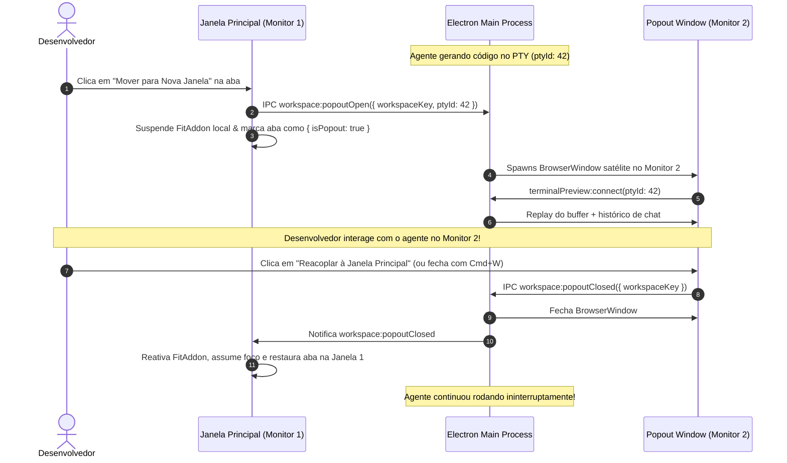

# Design Document: Workspace Popout Window Architecture (Homologado em 4 Passes)

## 1. Visão Geral da Arquitetura

O modelo **Workspace Popout Window** estende o padrão oficial de popouts já validado pelo Orca em produção (`dashboard-popout-window.ts` e `workspace-space-window.ts`), eliminando a necessidade de reescrever o core do aplicativo.

```mermaid
flowchart TD
    subgraph MainProcess ["Electron Main Process"]
        AuthWindow["Janela Principal (Única Autoritária)"]
        Runtime["OrcaRuntimeService (Grafo Intacto)"]
        PTYDaemon["node-pty / orcad (Processos dos Agentes)"]
        PopoutManager["WorkspacePopoutManager (Bounds & Lifecycle)"]
    end

    subgraph Window1 ["Monitor 1: Janela Principal"]
        MainShell["Orca Main Shell (Monaco + Zustand + Tabs)"]
    end

    subgraph Window2 ["Monitor 2: Janela Popout Satélite"]
        PopoutShell["workspace-popout.html (xterm.js + NativeChatView)"]
    end

    AuthWindow --> MainShell
    PopoutManager --> Window2
    PTYDaemon -->|Streaming via TerminalPreviewOutputStream| Window2
    MainShell -.->|isPopout: true (Aba desanexada)| Runtime
    Runtime -->|Visibilidade Global Intacta| Ext["Orca CLI & Mobile"]
```

---

## 2. Componentes e Subsistemas Chave

### 2.1. Main Process: `workspace-popout-window.ts`
* **Localização:** `src/main/window/workspace-popout-window.ts`
* **Responsabilidade:**
  - Cria e gerencia a `BrowserWindow` secundária.
  - Carrega `workspace-popout.html` em partição isolada (`partition: 'orca-workspace-popout'`).
  - Utiliza `resolveRestoredBounds` e `rectHasVisibleAreaOnAnyDisplay` para garantir que a janela abra na tela visível correta.
  - **Blindagem de Display:** Escuta `screen.on('display-removed')` e `screen.on('display-metrics-changed')` para auto-repatriar a janela caso o cabo do monitor seja desconectado.
  - **Blindagem de Suspensão:** Escuta `powerMonitor.on('resume')` para notificar a janela a reidratar conexões de streaming e recalcular escalas de DPI.
  - **Blindagem de Crash:** Escuta `webContents.on('render-process-gone')` com recuperação automática e fallback de desacoplamento.

### 2.2. Streaming de Terminal: `terminal-preview.ts` & Consumer Handover
* **Mecanismo:**
  - O terminal não utiliza o canal frágil `pty:data` (que sofre com descompasso de ACKs em `accounting.ts`).
  - Ele utiliza o subsistema multi-cliente já homologado: `TerminalPreviewOutputStream`.
  - Cada janela satélite possui seu próprio stream dedicado e isolado via `subscriptionsByContents`.
  - Replay síncrono de buffers via `preview-terminal-snapshot-replay.ts` com restauração de flags do Kitty Keyboard (`TerminalKittyKeyboardModeTracker`).
  - **Zero SIGWINCH Storms:** Enquanto o workspace estiver no popout, o `FitAddon` da Janela 1 é desativado para aquele workspace, concedendo exclusividade de grid para a janela ativa.

### 2.3. Frontend Popout Shell: `workspace-popout.html` / `workspace-popout.tsx`
* **Entrada:** `src/renderer/workspace-popout.html` e `src/renderer/src/workspace-popout.tsx`.
* **Componentes Renderizados:**
  - **Terminal / Shell:** `AgentTerminalPreview` com suporte completo a comandos interativos (Vim, Htop, Claude Code `y/n`).
  - **Chat com Agentes:** `NativeChatView` consumindo o histórico e o canal de streaming de mensagens.
  - **Diffs de Código:** `EditorDiffFileSurface` para code review no segundo monitor.
* **Memória:** Consumo estimado de **~40MB a 60MB**, comparado aos ~500MB de uma segunda janela principal.

---

## 3. Fluxo de Tear-Off (Destaque) e Dock-Back (Reacoplamento)



---

## 4. Garantias e Invariantes do Sistema

1. **Invariante de Grafo:** O `OrcaRuntimeService` nunca vê o grafo dividido. A Janela 1 continua como dona global de todos os worktrees. A CLI e o Orca Mobile nunca perdem a visão de nenhum agente.
2. **Invariante de Processo:** Nenhum processo de agente ou PTY recebe `SIGTERM` ou `SIGHUP` durante a transição entre telas.
3. **Invariante de Persistência:** A janela satélite nunca grava diretamente em `session.json`. Zero risco de corrupção de sessões ou perda de histórico ao reiniciar o aplicativo.
4. **Invariante de Hardware:** Desconectar o cabo do monitor move a janela de volta para a tela principal em tempo real.
