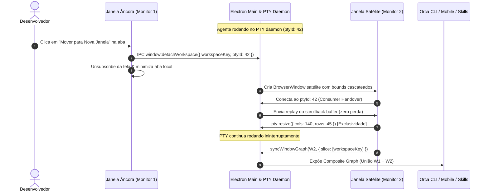

# Design Document: Arquitetura Anchor-Satellite & Consumer Handover

## 1. Visão Geral da Arquitetura

O modelo **Anchor-Satellite** desacopla a visualização gráfica (Renderers) do ciclo de vida dos processos e agentes (Main/Daemon).



---

## 2. Detalhamento dos Subsistemas

### 2.1. MainWindowRegistry & Modelo Anchor-Satellite
* **Arquivo:** `src/main/window/main-window-registry.ts`
* **Contrato:**
  ```typescript
  export interface WindowDescriptor {
    id: number;
    browserWindow: BrowserWindow;
    role: 'anchor' | 'satellite';
    activeWorkspaces: Set<string>;
  }
  ```
* **Comportamento do Ciclo de Vida:**
  * A primeira janela criada é registrada como `anchor`.
  * Janelas subsequentes (`File > New Window` ou Tear-Off) são registradas como `satellite`.
  * **Fechamento de Satélite:** O satélite avisa o Main (`window:satelliteClosed`). Seus workspaces voltam para a visualização da Janela Âncora ou ficam desacoplados. O app continua ativo.
  * **Fechamento da Âncora:** Se a Âncora for fechada enquanto houver satélites abertos, o Main pode promover um satélite ativo para Âncora ou fechar de forma ordenada com confirmação do usuário.
  * `app.on('window-all-closed')` só encerra o processo se `liveMainWindows().length === 0`.

### 2.2. Consumer Handover no PTY (Zero Interrupção de Agentes)
* **Arquivo:** `src/main/ipc/pty/delivery/pty-owner-routing.ts`
* **Mecanismo:**
  * O PTY roda desanexado do DOM do React, gerenciado pelo `node-pty` / `orcad` no Main process.
  * O `pty-owner-routing` mantém um mapa:
    ```typescript
    const ptyOwnerByPtyId = new Map<string, number>(); // ptyId -> webContentsId
    ```
  * Quando a Janela 2 assume um terminal:
    1. A Janela 1 emite `pty:unsubscribe`. O Main cessa o envio de `pty:data` para a Janela 1.
    2. A Janela 2 emite `pty:subscribe` com o mesmo `ptyId`.
    3. O Main registra `ptyOwnerByPtyId.set(ptyId, window2.webContents.id)`.
    4. O Main despacha o histórico acumulado em memória (`replayBuffer`) para o xterm da Janela 2.
    5. A Janela 2 emite `pty:resize` com as dimensões da nova tela.
  * **Invariante:** O processo do agente (PID do sistema operacional) nunca recebe `SIGTERM` ou `SIGHUP`. Ele permanece vivo e operando.

### 2.3. Exclusividade de Redimensionamento do Terminal
* **Regra de Ouro:** Não existe múltiplos consumidores enviando `pty:resize` concorrentes para o mesmo terminal.
* O canal `pty:resize` só é aceito se:
  ```typescript
  if (effectivePtyOwnerId(ptyId) !== sender.id) {
    return; // Rejeita silenciosamente se a janela não for a dona ativa
  }
  ```
* Isso previne a corrupção de buffer xterm quando duas telas têm densidades de pixels ou resoluções diferentes.

### 2.4. Composite Runtime Graph (Visibilidade Total para CLI, Mobile e Skills)
* **Arquivo:** `src/main/runtime/orca-runtime.ts` e `session-window-graph.ts`
* **Estrutura de Armazenamento:**
  ```typescript
  private windowGraphs = new Map<number, WindowGraph>();
  ```
* **Processamento de Sincronização:**
  * Cada janela publica apenas o seu slice:
    `syncWindowGraph(windowId, graphSlice)`
  * A Janela 1 publica os workspaces que estão nela; a Janela 2 publica os que estão nela.
* **Consulta Externa (`getStatus()` / WebSockets CLI e Mobile):**
  * O runtime computa a união linear:
    ```typescript
    export function getCompositeGraph(windowGraphs: Map<number, WindowGraph>): WindowGraph {
      const composite: WindowGraph = { tabs: [], leaves: [] };
      for (const [_, graph] of windowGraphs) {
        composite.tabs.push(...graph.tabs);
        composite.leaves.push(...graph.leaves);
      }
      return composite;
    }
    ```
  * A CLI (`orca worktree ps`), o aplicativo móvel e as Skills enxergam a lista unificada de todos os agentes em execução.

### 2.5. Persistência Segura de Sessão (`session.json`)
* **Arquivo:** `src/renderer/src/app-shell/use-app-session-persistence.ts`
* **Proteção de Escrita:**
  * As Janelas Satélites carregam com a flag `?orcaWindowRole=satellite`.
  * `isSecondaryWindow` desativa o autosave local na Janela Satélite.
  * A persistência de sessão no disco é orquestrada centralizadamente pelo processo Main ao detectar mudanças estruturais ou no fechamento do aplicativo.
  * O arquivo `session.json` preserva os workspaces da janela principal, garantindo integridade contra sobrescritas vazias.

---

## 3. Experiência do Usuário (UI/UX)

1. **Menu de Contexto na Aba de Workspace/Chat:**
   * Botão direito na aba -> *"Mover para Nova Janela"*.
   * Ícone discreto de pop-out (`↗`) ao passar o mouse na aba ativa.
2. **Janela Satélite:**
   * Abre no monitor secundário com bounds calculados para evitar sobreposição total.
   * Barra de título com botão *"Reacoplar à Janela Principal"* (`↙`).
   * Acesso rápido via atalho `Mod+Shift+N` ou `Mod+Alt+W`.
